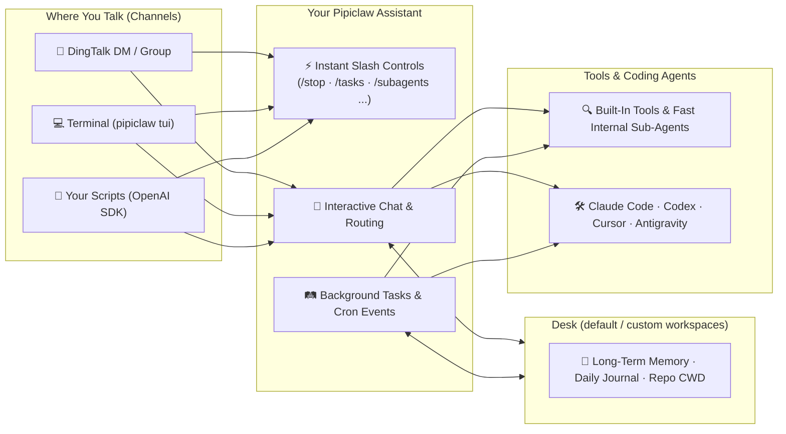

<div align="center">

# Pipiclaw

**Your Always-On Personal AI Engineering Assistant in DingTalk & the Terminal**

Hand off a goal from your phone — Pipiclaw remembers your project conventions, orchestrates your models and coding agents in the background, and comes back with verified deliverables.

<p>
  <a href="./README.md">简体中文</a> · <strong>English</strong> · <a href="https://github.com/oyasmi/pipiclaw/blob/master/docs/README.md">Documentation</a>
</p>

<p>
  <a href="https://www.npmjs.com/package/@oyasmi/pipiclaw"></a>
  <a href="https://github.com/oyasmi/pipiclaw/actions/workflows/ci.yml"></a>
  = 22.19.0">
  
  <a href="./LICENSE"></a>
</p>

**[Why Pipiclaw](#why-pipiclaw) · [In Action](#see-it-in-action) · [Quick Start](#quick-start) · [Core Capabilities](#core-capabilities) · [Slash Commands](#common-commands) · [FAQ](#faq) · [Docs](#documentation)**

</div>

---

## Why Pipiclaw

Even if you already pay for **Claude Code**, **Codex CLI**, **Cursor**, and top LLM APIs, three everyday friction points slow down real engineering work:

1. **Work stops when you step away**: Terminal coding agents are tied to an open window — step out for a meeting or commute, and you lose visibility and momentum.
2. **Copy-pasting across isolated tools**: You triage logs in one tab, implement in Claude Code, and run a review in Codex — acting as the human glue copying context back and forth.
3. **Repeating project context every session**: Every fresh chat forgets your repo layout, deployment rules, and personal conventions unless you repeat them.

**Pipiclaw turns your existing models and coding CLIs into one cohesive, always-reachable assistant.** Running on your dev machine or server, it connects directly to **DingTalk** (with zero public IP setup), an interactive **Terminal UI**, and an **OpenAI-compatible Web API** — remembering your conventions, advancing long tasks in the background, and delivering verified results wherever you are.

| What You Care About | Typical Chatbots | Standalone Coding CLIs | **Pipiclaw** |
|---|---|---|---|
| **Reachable Anywhere** | Mobile-friendly, but blind to your local repo & tools | Full local power, but chained to your laptop screen | **DingTalk DM/Group + Terminal + OpenAI SDK on one brain** |
| **Multi-Hour Work** | Times out after one reply | Blocks your terminal; dies if disconnected | **Dedicated background tasks that run without blocking chat** |
| **Multi-Agent Synergy** | Locked to a single model | Separate tabs & manual context handoffs | **Orchestrates built-in models + Claude / Codex / Cursor / Antigravity** |
| **Persistent Memory** | Ephemeral chats or brittle keyword search | Static rule files only | **Auto-curated long-term memory + daily journals you can inspect or delete** |
| **Instant Human Control** | Wait until generation finishes | `Ctrl-C` at your keyboard | **Instant `/stop`, mid-turn `/steer`, task pause, or process kill from phone/CLI** |

---

## See It in Action

Here is what a typical workflow looks like once Pipiclaw is running on your workstation:

```text
09:15  [On your commute · DingTalk DM]
You ──▶ "Switch the user export endpoint to streaming, add large-file unit tests, and have
         codex-review independently check the diff before sending me the result."

09:16  [Background task starts · Chat stays free]
Bot ──▶ Creates a background task, breaks down work items, and launches local claude-main
        to implement and run tests.
        (Meanwhile, you can keep chatting in the exact same window about other issues.)

09:32  [Steer anytime]
You ──▶ Check progress with "/tasks", then send:
        "/tasks msg export-stream Make sure CSV exports preserve UTF-8 BOM compatibility"

09:48  [Independent verification & mobile delivery]
Bot ──▶ claude-main passes tests → dispatches read-only codex-review to audit the diff →
        pushes a clean summary, test proof, and benchmark CSV straight to your DingTalk app.
```

What else users build into their daily routine:

- **⏰ Zero-Noise Scheduled Inspections**: Run Cron events with a local gate script first — **burning zero tokens when nothing changed**, and spinning up an investigation task only when new commits or error spikes appear.
- **🔀 Smart Compute Routing Across Subscriptions**: Use fast, affordable models for quick Q&A; route thorny architecture or root-cause debugging to `claude-high` / `codex-high` / `cursor-high`; batch mechanical edits with `codex-flash` / `glm-flash`; hand long-context collaboration to `agy-main`.
- **🗂️ Clean Context Separation When Needed**: Share one memory across DMs, groups, and terminal by default — or spin up isolated **Desks** (`/desk new side-project`) for separate repos and initiatives.
- **🔌 Drop-In Automation with Official OpenAI SDKs**: Flip on the built-in Web API and call your assistant from Python, Node.js, or CI scripts in five lines of code.

---

## Quick Start

Go from zero to an always-on setup in minutes: **60-second terminal run → 5-minute DingTalk connection → external coding agents → 24/7 background service**.

<details>
<summary>💡 <b>Shortcut: Paste this prompt into Claude Code / Codex / Cursor and let it set up Pipiclaw for you</b></summary>

```text
Please install and initialize Pipiclaw for me:

1. Check Node.js >= 22.19.0; stop and explain if it is not met.
2. Run npm install -g @oyasmi/pipiclaw; on a permission failure do not sudo on your own.
3. Run `pipiclaw auth status` once to initialize ~/.pipiclaw/, and share the generated initial Web API key (`pk_...`) printed on stdout with me.
4. Ask me whether I want to use an environment API key, a custom provider in ~/.pipiclaw/models.json, or run `pipiclaw auth login` myself; do not invent missing values.
5. If I want to connect DingTalk, collect clientId, clientSecret, optional cardTemplateId, and allowFrom item by item, write them into the dingtalk section of channel.json, and set dingtalk.enabled to true.
6. When configuration is done, ask first whether to start. Terminal mode uses `pipiclaw tui` (or `pipiclaw tui --cwd .` inside a repo); background daemon mode uses `pipiclaw` (local Web API socket + http://127.0.0.1:8787/v1 are enabled out of the box).
7. Honestly list the operations performed, files changed, verification results, and information still missing; do not pretend it succeeded.
```

</details>

### Step 1: Install & Run Out of the Box (No DingTalk Setup Needed)

Prerequisites: **Node.js `>= 22.19.0`** on **Linux / macOS** (on Windows, use **WSL2**).

```bash
npm install -g @oyasmi/pipiclaw
```

On first run, Pipiclaw automatically initializes `~/.pipiclaw/`, **enables the local Web API (`socket` + `http://127.0.0.1:8787/v1`) with a generated default key (`pk_...`)**, and prompts you to log in if no model credential is configured yet.

You can also configure a model beforehand (pick either):

```bash
# Option A: Interactive login for supported subscription / API-key providers
pipiclaw auth login

# Option B: Export an API key (Anthropic shown as example)
export ANTHROPIC_API_KEY=sk-ant-...
```

Launch the interactive terminal UI (pass `--cwd .` inside a repository to bind the desk's working directory):

```bash
pipiclaw tui
```

Or start the background daemon directly (both `pipiclaw tui` and OpenAI SDK clients connect right away):

```bash
pipiclaw
```

Or run a quick one-liner to verify the end-to-end model connection:

```bash
pipiclaw tui --print "Reply with only: Pipiclaw is ready"
```

> Using an OpenAI-compatible proxy/gateway, DeepSeek, GLM, or local Ollama? Copy the built-in `_examples` block in `~/.pipiclaw/models.json`, or check the [Configuration Quickstart](https://github.com/oyasmi/pipiclaw/blob/master/docs/configuration.md).

### Step 2: Connect DingTalk When Needed (No Public IP Required)

Pipiclaw uses **DingTalk Stream Mode**, so any laptop or private server with outbound internet access connects directly — no public IP, domain name, or webhook relay required:

1. Create an **Enterprise Internal App** on the [DingTalk Open Platform](https://open-dev.dingtalk.com/) and copy its **`Client ID`** and **`Client Secret`**.
2. Add the **Bot** capability, choose **Stream Mode** for message receiving, and publish the app.
3. *(Recommended)* Create an AI Card template and copy its **`Card Template ID`** for live streaming progress cards.

Edit `~/.pipiclaw/channel.json` — set `dingtalk.enabled` to `true` and fill in your credentials:

```json
{
  "dingtalk": {
    "enabled": true,
    "clientId": "your-actual-client-id",
    "clientSecret": "your-actual-client-secret",
    "robotCode": "",
    "cardTemplateId": "optional-card-template-id",
    "cardTemplateKey": "content",
    "allowFrom": []
  },
  "webapi": {
    "enabled": true,
    "socket": true,
    "tcp": "127.0.0.1:8787",
    "tls": null,
    "keys": [{ "name": "default", "sha256": "...", "desks": ["default"] }]
  }
}
```

- Only `clientId` and `clientSecret` are strictly required (`robotCode` falls back to `clientId` when empty).
- `allowFrom: []` allows anyone with access to the DingTalk app; add your DingTalk `staffId` if you want to restrict access.

Start the service:

```bash
pipiclaw
```

Open DingTalk on your phone or desktop, **DM the bot** or **@mention it in a group**, send `/status` to check health, and start chatting!

### Step 3: Plug In Claude Code / Codex / Cursor / Antigravity (Optional)

If you already have `claude`, `codex`, Cursor's `agent`, or Antigravity's `agy` installed and logged in under the same OS user, enable them in two commands:

```bash
mkdir -p ~/.pipiclaw/workspace/sub-agents
PIPICLAW_PACKAGE_DIR="$(npm root -g)/@oyasmi/pipiclaw"

# Copy the entries matching the subscriptions you own (Claude, Codex & read-only review shown)
cp "$PIPICLAW_PACKAGE_DIR"/examples/sub-agents/agents/{claude-main,codex-main,codex-review}.md \
  ~/.pipiclaw/workspace/sub-agents/
```

*(Curated profiles for `claude-high`, `codex-high`, `codex-flash`, `cursor-main`, `cursor-high`, `agy-main`, `glm-high`, and `glm-flash` are also included — see [Sub-Agent Examples](https://github.com/oyasmi/pipiclaw/blob/master/examples/sub-agents/README.md).)*

**No restart needed.** Send `/subagents roles` in chat to confirm availability, then delegate naturally:

```text
Hand this cross-module refactor to a suitable external coding agent, run the test suite, and perform an independent read-only review before reporting back.
```

> [!IMPORTANT]
> **Permission Notice**: External coding agents run as standalone OS processes and bypass Pipiclaw's built-in command/path guards (and write-capable templates pass permissive CLI flags by default). Review the [Agent Delegation Guide](https://github.com/oyasmi/pipiclaw/blob/master/docs/sub-agents.md) before enabling them.

### Step 4: Keep It Running 24/7 in the Background (Recommended)

To keep your assistant online when you close your terminal, run `pipiclaw` under `pm2` or `systemd` on an always-on workstation, Mac mini, or server:

```bash
# Quick background setup with pm2
pm2 start pipiclaw --name pipiclaw && pm2 save
```

For production `systemd` unit files, environment isolation, backups, and troubleshooting, see [Deployment & Operations](https://github.com/oyasmi/pipiclaw/blob/master/docs/deployment-and-operations.md).

---

## Core Capabilities

### 💬 1. Live Streaming Across DingTalk, Terminal & SDK

- **Real-Time AI Cards**: Watch reasoning steps and tool calls unfold live in DingTalk. Need to adjust course while it's working? Just send a message to steer mid-turn (`/steer`), or queue your next request with `/followup`.
- **Native File Delivery**: Generated reports, CSV exports, screenshots, and archives arrive directly in DingTalk as native file attachments.
- **Official OpenAI SDK Compatibility**: Both `pipiclaw tui` and your own Python/JS scripts talk to the same assistant via the built-in OpenAI Responses-compatible [Web API](https://github.com/oyasmi/pipiclaw/blob/master/docs/webapi.md).

### 🛤️ 2. Non-Blocking Background Tasks & Scheduled Events

- **Dedicated Task Lane**: Multi-step projects progress in the background without tying up your conversation, persisting every checklist item and step on disk so work resumes cleanly across restarts.
- **Built-In Cost & Safety Guardrails**: Step limits, USD budgets, per-step timeouts, and error circuit breakers automatically pause runaway tasks and notify you when human input is needed.
- **Timers & Zero-Token Sensors**: Schedule one-off reminders or recurring Cron jobs, optionally gated by local check scripts so idle inspections cost zero tokens.

### 🤝 3. Unified Multi-Agent Orchestration

- **Lead Assistant + Specialized Workers**: Your main assistant owns context, planning, and acceptance — spinning up fast **built-in sub-agents** for quick searches/log triage, and **Claude Code / Codex / Cursor / Antigravity** for heavy multi-file coding and test loops.
- **Async Wakeups & Follow-Ups**: Long external runs execute in the background, wake your chat automatically when done, support session continuation for follow-up questions, and can be killed anytime via `/subagents cancel`.

### 🧠 4. Transparent, Controllable Memory

- **Long-Term Conventions + Daily Journals**: Durable project rules live in `memory/*.md` and load automatically at session start (no brittle keyword guessing), while day-to-day progress stays neatly separated in daily `journal/` files.
- **Probation & Permanent Forgetting**: Newly inferred habits enter a 30-day probation window first, and `/memory forget <name>` deletes unwanted entries permanently so background maintenance never brings them back.

### 🛡️ 5. Instant Takeover & 100% Local Plain-Text Data

- **LLM-Independent Controls**: Commands like `/stop`, `/tasks`, `/subagents`, `/status`, and `/usage` execute directly in the local runtime — **responding instantly even if an upstream model API is slow or unreachable**.
- **Plain-Text Data Ownership**: Every config, memory, journal, task spec, and usage ledger lives as readable Markdown or JSON under `~/.pipiclaw/`, protected by built-in command, path, and network guards.

### Mental Model at a Glance



| Everyday Term | What It Means for You |
|---|---|
| **Channel** | A conversation window (a DingTalk DM, a DingTalk group, or a terminal/API session), each keeping its own chat history. |
| **Desk** | A named workspace owning memory, journals, tasks, events, and a working directory. Everything shares `default` out of the box; create more only when you want separation. |
| **Task** | A multi-step project advancing in the background without blocking chat — inspectable, steerable, and resumable anytime. |
| **Event** | A one-time alarm or Cron schedule that wakes the assistant or spawns recurring tasks (optionally gated by a local check script). |
| **Sub-Agent** | A helper dispatched for a specific job — either a fast built-in reader or an external CLI like Claude Code or Codex. |

---

## Common Commands

Type `/` in DingTalk or the terminal to control your assistant (send `/help` for the full list, or `/help <command>` for examples):

### ⚡ Available Anytime (Responds instantly — even mid-reply or if a model hangs)

| Command | When to Use It |
|---|---|
| `/help [command]` | Browse all commands, or view subcommands and examples for one (e.g. `/help tasks`) |
| `/status` | Check health, active model, context usage, uptime, and background task summary |
| `/stop` | Immediately abort the current chat reply and clear queued messages |
| `/steer <message>` | Nudge or redirect a running reply on the fly (plain messages sent while busy do this by default) |
| `/followup <message>` | Queue your next request to run right after the current reply finishes |
| `/tasks [show\|msg\|pause\|resume\|cancel...]` | Check background task progress, send instructions (`msg`), pause, resume with extra budget, or cancel |
| `/subagents [list\|show\|output\|cancel\|roles]` | Inspect active/recent Claude/Codex delegations, read live output, or `cancel` a process immediately |
| `/events <list\|show\|delete\|history>` | List or delete scheduled reminders/Cron jobs and inspect trigger history |
| `/desk [list\|new\|cwd\|bind]` | View desks, create a new desk, or set its repo directory (note: `bind` waits until the active turn ends) |
| `/usage [7d\|month]` | View token consumption and cost breakdown for your desk and globally |
| `/context [detail]` | See exactly how much system prompt, tool schema, and history is sent to the model |
| `/skills [list\|show <name>]` | List loaded workspace and shared user skills |
| `/new` | Start a fresh chat session while keeping your long-term desk memory intact |

### 🛋️ Available When Idle (Run after the current reply finishes)

| Command | When to Use It |
|---|---|
| `/memory [status\|list\|show\|forget\|journal]` | Browse saved memories, read daily journals, or permanently delete/block an item (`forget`) |
| `/model [name-or-substring]` | Check the active model or switch models by exact ID or unique substring |
| `/thinking [low\|medium\|high\|cycle...]` | Tune reasoning depth (lower for snappy chat, higher for hard debugging) |
| `/compact [instructions]` | Compress a long chat history manually, optionally telling it what details to preserve |
| `/session` | Check message counts and token stats for the current conversation |
| `/reload` | Hot-reload updated skills and workspace resources without restarting |

---

## Where Your Data & Config Live

Everything lives in `~/.pipiclaw/` (override anytime via `PIPICLAW_HOME=/your/path`) — backing up or moving machines is as simple as copying one folder:

```text
~/.pipiclaw/
├── channel.json      # DingTalk bot credentials, AI Card template & Web API switches
├── auth.json         # Model credentials (managed via pipiclaw auth login)
├── models.json       # Custom model providers, OpenAI-compatible gateways & local endpoints
├── settings.json     # Default model, fallback model & runtime preferences
├── tools.json        # Feature toggles such as web search/fetch (off by default; keyless DuckDuckGo supported)
├── security.json     # Command, path & network guard policies
└── workspace/        # Your personal assets:
    ├── SOUL.md       # Customize assistant persona, tone & language preferences
    ├── AGENTS.md     # Shared engineering rules & workflow conventions
    ├── skills/       # Reusable workflow skills (also loads shared skills from ~/.agents/skills/)
    ├── sub-agents/   # Enabled external coding agent profiles
    └── desk-default/ # Default desk's memory/, daily journal/, and background tasks/
```

See the **[Configuration Quickstart](https://github.com/oyasmi/pipiclaw/blob/master/docs/configuration.md)** for common recipes (custom gateways, proxies via `PIPICLAW_PROXY`, web tools, and more).

---

## FAQ

<details>
<summary><b>1. Do I need a cloud server, domain name, or public IP for DingTalk?</b></summary>

**No.** Pipiclaw connects outbound via DingTalk's official Stream Mode. Any laptop, desktop, or private server with regular internet access works out of the box.
</details>

<details>
<summary><b>2. Will tasks keep running if I close my laptop lid?</b></summary>

Pipiclaw runs locally on the host where you installed it. If your laptop goes to sleep, the process pauses until wake-up (and then automatically reconnects and resumes). For **true 24/7 mobile access**, run Pipiclaw on an always-on desktop, Mac mini, home server, or cloud VM.
</details>

<details>
<summary><b>3. Does delegating to Claude Code / Codex cost extra? What is the security model?</b></summary>

Pipiclaw adds zero middleman fees — it invokes the official CLIs already installed and authenticated on your machine using your existing subscriptions or API keys.
**Security scope**: Pipiclaw is built for individual developers (and small trusted setups sharing one assistant), not hard multi-tenant SaaS isolation. External coding CLIs run under your OS user account and **bypass Pipiclaw's built-in command/path guards**. Run them in dedicated project directories or under a dedicated OS user. Read the [Security Guide](https://github.com/oyasmi/pipiclaw/blob/master/docs/security.md) for details.
</details>

<details>
<summary><b>4. How do I enable web search or upgrade Pipiclaw?</b></summary>

- **Enable web search**: Set `tools.web.enable: true` in `~/.pipiclaw/tools.json` (DuckDuckGo works immediately with no API key; Tavily, Jina, and SearXNG are also supported).
- **Upgrade**: Run `npm install -g @oyasmi/pipiclaw@latest` and restart the `pipiclaw` process. Your `~/.pipiclaw/` data and memories stay untouched.
</details>

---

## Documentation

Explore the full user guides in **[docs/README.md](https://github.com/oyasmi/pipiclaw/blob/master/docs/README.md)** *(currently primarily in Chinese)*:

| Goal | Guide |
|---|---|
| 💬 Master DMs, groups, AI Card modes & slash commands | [Interaction & Commands](https://github.com/oyasmi/pipiclaw/blob/master/docs/interaction-and-commands.md) |
| ⚙️ Configure custom models, gateways, proxies & web search | [Configuration Quickstart](https://github.com/oyasmi/pipiclaw/blob/master/docs/configuration.md) · [Field Reference](https://github.com/oyasmi/pipiclaw/blob/master/docs/configuration-reference.md) |
| 🤝 Set up & customize Claude Code / Codex / Cursor / Antigravity | [Agent Delegation](https://github.com/oyasmi/pipiclaw/blob/master/docs/sub-agents.md) · [Profile Examples](https://github.com/oyasmi/pipiclaw/blob/master/examples/sub-agents/README.md) |
| 📋 Run background tasks, Cron inspections & budgets | [Events & Tasks](https://github.com/oyasmi/pipiclaw/blob/master/docs/events-and-tasks.md) |
| 🧠 Manage long-term memory, journals, probation & forgetting | [Memory Guide](https://github.com/oyasmi/pipiclaw/blob/master/docs/memory.md) |
| 🧩 Package reusable personal or project workflows as Skills | [Skills Guide](https://github.com/oyasmi/pipiclaw/blob/master/docs/skills.md) · [Built-In Tools](https://github.com/oyasmi/pipiclaw/blob/master/docs/tools.md) |
| 🔌 Connect Python/JS scripts or custom UIs via OpenAI SDK | [Web API Guide](https://github.com/oyasmi/pipiclaw/blob/master/docs/webapi.md) |
| 💡 Best practices for high-leverage autonomous delivery | [Leverage Notes](https://github.com/oyasmi/pipiclaw/blob/master/docs/leverage/README.md) · [Design Philosophy](https://github.com/oyasmi/pipiclaw/blob/master/docs/design-philosophy.md) |
| 🚀 Host 24/7 with systemd/pm2, review guards & troubleshoot | [Deployment & Operations](https://github.com/oyasmi/pipiclaw/blob/master/docs/deployment-and-operations.md) · [Security Guide](https://github.com/oyasmi/pipiclaw/blob/master/docs/security.md) · [Scaling & Concurrency](https://github.com/oyasmi/pipiclaw/blob/master/docs/scaling-and-concurrency.md) |

---

## Building from Source & Contributing

Want to build from source, customize locally, or contribute?

```bash
git clone https://github.com/oyasmi/pipiclaw.git
cd pipiclaw
npm install && npm run build && npm run check
```

For module boundaries, runtime internals, and engineering conventions, see [Architecture](https://github.com/oyasmi/pipiclaw/blob/master/docs/architecture.md), [Runtime Mechanisms](https://github.com/oyasmi/pipiclaw/blob/master/docs/runtime-mechanisms.md), and [AGENTS.md](https://github.com/oyasmi/pipiclaw/blob/master/AGENTS.md). Issues and Pull Requests are welcome!

---

## License

Licensed under the [GNU Affero General Public License v3.0 (AGPL-3.0)](./LICENSE).
