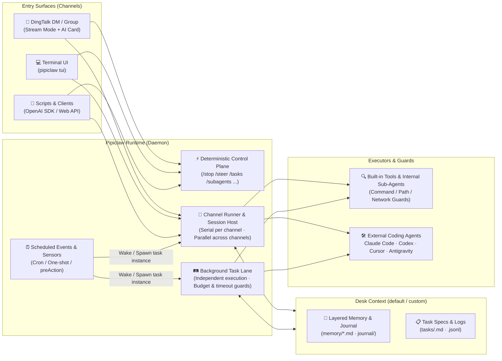

# Pipiclaw

<p align="left">
  <a href="./README.md">简体中文</a> | <strong>English</strong>
</p>

<p align="left">
  <a href="https://www.npmjs.com/package/@oyasmi/pipiclaw"></a>
  = 22.19.0">
  
  <a href="./LICENSE"></a>
</p>

> **Turn DingTalk and your terminal into an always-on AI engineering workbench — assign a goal, close your laptop, and let it progress in the background across your models and coding agents, returning verified deliverables.**

**Pipiclaw** is a DingTalk-first AI coding assistant runtime for individual developers. Assign a goal from DingTalk, the terminal, or your own scripts, keep its working context intact, and let it advance long-running work in the background while delegating to your existing models, **Claude Code**, **Codex CLI**, **Cursor CLI**, **Antigravity CLI**, or custom executors. Follow progress, steer mid-turn, pause or take over at any moment, and receive deliverables backed by verification evidence.

**[Key Highlights](#key-highlights) · [How It Works](#how-it-works) · [Use Cases](#use-cases) · [Quick Start](#quick-start) · [Common Commands](#common-commands) · [Documentation](#documentation)**

---

## Key Highlights

### 🚀 1. Work Keeps Moving When You Walk Away: Task Lane & Scheduled Events

Traditional CLI coding agents stop the moment you close the terminal or end a chat. Pipiclaw decouples long-horizon engineering work from ephemeral conversations:

- **Background Task Lane**: Multi-step, multi-hour projects advance in a dedicated background task lane **without blocking your chat**. Each task is backed by a human-readable Markdown **task spec** (goal, Definition of Done checklist, **work items**) and an append-only JSONL **task log** (steps, delegations, settlements). Task states are derived deterministically by the runtime from observed facts — never stuck in a hallucinated "waiting" state.
- **Scheduled Events & Zero-Token Sensors**: Trigger `one-shot` reminders or `periodic` (Cron) workflows. Run local `preAction` gate scripts as **zero-token conditional sensors**, or spawn fresh, isolated task instances from event templates (e.g., daily repo inspections or weekly release digests) with automatic overlap protection.
- **Deterministic Budgets & Circuit Breakers**: Built-in step and USD budgets, idle-loop detection, per-step timeouts, and consecutive-error guards pause runaway work automatically and notify you.

### 🤝 2. One Workflow Orchestrating All Your Top Coding Agents

Stop copy-pasting context across multiple terminal tabs. Pipiclaw lets your main assistant act as the lead, dispatching work to the right executor based on capability, cost, and execution boundaries:

- **Built-in Sub-Agents (`internal`)**: Spin up isolated in-process agents in milliseconds under Pipiclaw's security guards for fast retrieval, log triage, and focused analysis.
- **Heavyweight External Harnesses (`external`)**: Launch real **Claude Code**, **Codex CLI**, **Cursor CLI**, **Antigravity CLI (`agy`)**, GLM wrapper scripts, or custom shell commands to tackle multi-file implementations, write and run tests, and iterate autonomously.
- **Async Wakeup, Session Continuation & Independent Verification**: External runs execute in the background (with records and managed artifacts retained for 30 days) and automatically wake the originating channel upon completion. You can ask follow-up questions on finished external sessions, or dispatch CLI-enforced read-only agents (such as `codex-review`) for independent verification (`purpose: verify`).

### 💬 3. Native in DingTalk + Terminal TUI + OpenAI-Compatible Web API

- **Zero Public IP DingTalk Setup**: Built on **DingTalk Stream Mode** — connect directly from your laptop or private server without hosting webhook relays or exposing public ports.
- **Live AI Card Streaming**: Watch thinking steps, tool calls, and stage updates stream live in DingTalk AI Cards. Send a message mid-turn to adjust direction on the fly (`/steer`), queue the next request (`/followup`), or abort immediately (`/stop`). Deliver generated reports, screenshots, and exports as **native DingTalk attachments**.
- **One Assistant, Every Surface**: A single daemon serves multiple DMs and group chats concurrently (parallel across channels, serialized within each channel). The terminal UI (`pipiclaw tui`) and your own scripts connect to the exact same assistant over a local Unix socket or TCP **Web API** compatible with the official **OpenAI SDK (implemented Responses API subset)**.

### 🧠 4. Remembers Conventions, Respects Boundaries: Layered Memory & Desks

- **Shared by Default, Isolated on Demand**: Your terminal, DingTalk DMs, and group chats bind to the `default` desk out of the box — sharing long-term memory, daily journals, tasks, and working files with zero setup. When you want to separate projects or contexts, create an isolated desk with `/desk new <name>`.
- **Three-Layer Transparent Memory (No Keyword Guessing)**:
  - **Desk Memory (`memory/*.md`)**: One durable fact per file with an auto-generated `MEMORY.md` index injected in full at session start — the model sees all your conventions up front without fragile RAG keyword matching.
  - **Daily Journal (`journal/YYYY-MM-DD.md`)**: Day-by-day working notes written by the background reflect pass, keeping temporary progress out of permanent rules.
  - **Automatic Reflection & Probation**: Automatically consolidates memory before context compaction, on `/new`, on shutdown, or during idle windows. Newly inferred facts enter a 30-day **probation period** before promotion; `/memory forget` leaves a hash tombstone so background reflection never resurrects forgotten items. Idle checks pass through a local deterministic gate first — **burning zero tokens when idle**.

### 🛡️ 5. Autonomous Yet Instantly Interruptible: Deterministic Control Plane & Local Ownership

- **LLM-Free Control Plane**: `/help`, `/stop`, `/steer`, `/followup`, `/tasks`, `/subagents`, `/events`, `/desk`, `/status`, `/usage`, and `/context` are handled directly by the runtime. **Even if a model provider is down or a turn is stuck**, you can still inspect state, pause tasks, or kill external processes (`/subagents cancel`) immediately.
- **Your Config, Your Plain-Text Data**: Works with built-in providers, OpenAI-compatible gateways, API keys, and subscription logins (`pipiclaw auth login`). Every memory, task, role, event, and audit log lives as human-readable Markdown, JSON, or JSONL under `~/.pipiclaw/`, protected by command, path, and network guards.

---

## How It Works



### Core Concepts at a Glance

| Concept | What It Is | Problem It Solves |
|---|---|---|
| **Channel** | A DingTalk DM, DingTalk group, or Web API / TUI conversation | Keeps each conversation history separate while acting as your remote control to assign, inspect, and steer work |
| **Desk** | A named work context (`default` built-in, custom desks on demand) | Owns the long-term memory, daily journal, tasks, scheduled events, and working directory for a body of work |
| **Task** | A one-off project running in the background task lane (`.md` spec + `.jsonl` log) | Advances multi-step, multi-hour deliverables independently of chat and survives restarts |
| **Event** | A `one-shot` or `periodic` (Cron) trigger with optional `preAction` or task template | Answers *"when to wake up"* — driving reminders, zero-token checks, and recurring task instances |
| **Sub-Agent** | An in-process lightweight role (`internal`) or external CLI process (`external`) | Answers *"who executes this step"* — uniting your subscriptions and external coding CLIs under one workflow |

---

## Use Cases

- **📱 Mobile Engineering Workbench**: Assign *"migrate this module to the new interface and add unit tests"* from DingTalk on your commute; the background task breaks down work items, dispatches Claude Code / Codex to implement and run tests, runs an independent `codex-review` check on the diff, and delivers the summary with test evidence to your phone.
- **⏰ Low-Noise Scheduled Inspections & Reports**: Set up daily or weekly event templates that run a local `preAction` script first, spawning a background task to investigate and deliver a DingTalk report only when new commits or anomalies appear.
- **🔀 Multi-Model & Multi-Agent Compute Routing**: Use fast or cost-effective models for everyday chat, route tough architectural trade-offs and root-cause debugging to `claude-high` / `codex-high` / `cursor-high`, batch mechanical edits with `codex-flash` / `glm-flash`, and leverage `agy-main` for long-context collaboration.
- **🤝 Multi-Surface Personal & Small-Team Collaboration**: Keep separate conversations across DMs and group chats while sharing one body of project memory by default — or split contexts cleanly with desks when needed.
- **🔌 Scriptable Personal Assistant via Official OpenAI SDK**: Enable the Web API and connect CI hooks, local scripts, or custom frontends to your assistant in a few lines of Python or JS.

> [!NOTE]
> **Scope & Security Boundaries**: Pipiclaw is designed for individual developers (and small-scale shared use of a single assistant) in self-hosted, single-instance deployments. It is not a hard multi-tenant SaaS platform and does not provide an OS-level sandbox. **External agents bypass Pipiclaw's built-in command and path guards** — their real permissions are governed by the target CLI's sandbox flags, the host user account, and the operating environment.

---

## Quick Start

Follow the steps below to go from **installation → 30-second terminal verification → DingTalk connection → external coding agent delegation**. Jump straight to any section if you already know what you need.

<details>
<summary>💡 <b>Shortcut: Let your favorite local AI Agent (Claude Code / Codex / Cursor) install and configure Pipiclaw for you</b></summary>

Copy and paste the prompt below into your local AI coding agent:

```text
Please install and initialize Pipiclaw for me:

1. Check Node.js >= 22.19.0; stop and explain if it is not met.
2. Run npm install -g @oyasmi/pipiclaw; on a permission failure do not sudo on your own.
3. Run pipiclaw once to initialize ~/.pipiclaw/; it prompting you to complete channel.json and exiting because it is still a template is normal.
4. Ask me whether I want to use an API key, a custom provider, or a subscription login supported by pipiclaw auth login; do not invent missing values.
5. If I want to connect DingTalk, collect clientId, clientSecret, optional cardTemplateId, and allowFrom item by item, write them into the `dingtalk` section of channel.json, and remove all your-* placeholder values.
6. When configuration is done, ask first whether to start. Terminal mode uses pipiclaw tui; DingTalk mode uses pipiclaw, and after it starts message the bot directly or @ it in a group — no desk needs to be created or bound.
7. Honestly list the operations performed, files changed, verification results, and information still missing; do not pretend it succeeded.
```

</details>

### 1. Prerequisites & Installation

- **Node.js**: `>= 22.19.0`
- **OS**: Linux / macOS (on Windows, use WSL2)

```bash
npm install -g @oyasmi/pipiclaw
pipiclaw tui --help
```

The first real launch of `pipiclaw` or `pipiclaw tui` scaffolds `~/.pipiclaw/` (set `PIPICLAW_HOME=/your/path` to relocate the entire directory):

```text
~/.pipiclaw/
├── channel.json      # Channel switches & config: DingTalk app (dingtalk), Web API (webapi)
├── auth.json         # Model credentials & login state
├── models.json       # Custom model providers & gateways
├── settings.json     # Default model & runtime settings
├── tools.json        # Capability switches for web search/fetch, tasks, etc.
├── security.json     # Command, path, and network guard policies
└── workspace/        # Shared rules (AGENTS.md / SOUL.md), skills/, sub-agents/, and desk-default/
```

### 2. Fastest Taste: Run in the Terminal in 30 Seconds

Terminal mode requires no DingTalk credentials — just a working model. Configure credentials using either option:

```bash
# Option A: Provide an API key via environment variable
export ANTHROPIC_API_KEY=sk-ant-...

# Option B: Log in to a subscription provider supported by the SDK
pipiclaw auth login
```

Launch the interactive terminal UI (initializes the `default` desk automatically on first run):

```bash
pipiclaw tui
```

Or run a one-shot non-interactive verification:

```bash
pipiclaw tui --print "Reply with only: Pipiclaw model call succeeded"
```

> Receiving an actual model reply confirms the full request pipeline is working (`--help` and `/model` only verify CLI or catalog visibility). To configure an enterprise gateway, local model, or default model, see the [Configuration Reference](https://github.com/oyasmi/pipiclaw/blob/main/docs/configuration.md).

### 3. Connect DingTalk (No Public IP Required)

Create an enterprise internal application on the [DingTalk Open Platform](https://open-dev.dingtalk.com/):

1. Copy the **`Client ID`** and **`Client Secret`**
2. Enable the **Bot** capability
3. Select **Stream Mode** for message receiving
4. *(Recommended)* Create an AI Card template and copy its **`Card Template ID`** for live streaming updates

Edit `~/.pipiclaw/channel.json` (make sure no `your-*` placeholder values remain):

```json
{
  "dingtalk": {
    "enabled": true,
    "clientId": "your-dingtalk-client-id",
    "clientSecret": "your-dingtalk-client-secret",
    "robotCode": "",
    "cardTemplateId": "",
    "cardTemplateKey": "content",
    "allowFrom": []
  },
  "webapi": { "enabled": false, "socket": true }
}
```

- **Required fields**: Only `clientId` and `clientSecret` are strictly required. `robotCode` falls back to `clientId` when empty; `cardTemplateId` can be left blank initially (AI Card is strongly recommended for daily use).
- **Access control**: `allowFrom: []` allows all senders; populate tester staff IDs during a staged rollout.
- **Web API**: Set `webapi.enabled` to `true` if you also want scripts or other clients to connect via the official OpenAI SDK (see [Web API](https://github.com/oyasmi/pipiclaw/blob/main/docs/webapi.md)).

Start the background daemon:

```bash
pipiclaw
```

Open DingTalk and **DM the bot** or **@mention it in a group** — no manual desk creation or binding is needed. Send `/model` to check the active model, then send a message to verify a live turn:

```text
Please introduce yourself and explain what you can do right now
```

*(If your first message does not go through, check [Deployment and Operations](https://github.com/oyasmi/pipiclaw/blob/main/docs/deployment-and-operations.md).)*

### 4. Enable External Agent Delegation (Claude / Codex / Cursor / Antigravity)

Install and log in to your target CLIs (`claude`, `codex`, Cursor's `agent`, or Antigravity's `agy`) under the same OS user account that runs Pipiclaw.

The package ships curated capability entries organized by executor, capability tier (`flash` / `main` / `high`), and read-only review (`codex-review`). Copy the entries you actually have accounts for into your workspace:

```bash
mkdir -p ~/.pipiclaw/workspace/sub-agents
PIPICLAW_PACKAGE_DIR="$(npm root -g)/@oyasmi/pipiclaw"

# Example: enable Claude Code and Codex main entries plus read-only independent review
cp "$PIPICLAW_PACKAGE_DIR"/examples/sub-agents/agents/{claude-main,codex-main,codex-review}.md \
  ~/.pipiclaw/workspace/sub-agents/
```

*(Entries for `cursor-main`, `cursor-high`, `agy-main`, `glm-high`, `glm-flash`, etc. are also included; see [Sub-Agent Examples](./examples/sub-agents/README.md).)*

Role changes are discovered dynamically without restarting the daemon. Send:

```text
/subagents roles
```

Once the entries appear as available, describe your goal and acceptance criteria in plain language — the main agent will select the appropriate executor:

```text
Please hand this cross-module implementation to a suitable executor, then independently verify the final diff and send me the conclusion with evidence.
```

> [!IMPORTANT]
> External agents do not pass through Pipiclaw's built-in command and path guards, and the recommended write entries use permissive CLI flags. Read the authorization and sandbox guidance in the [Agent Delegation Guide](https://github.com/oyasmi/pipiclaw/blob/main/docs/sub-agents.md) before enabling them, and run long external delegations under the persistent `pipiclaw` daemon.

### 5. Optional: Enable Web Search & Fetch Tools

`web_search` and `web_fetch` are disabled by default. Edit `~/.pipiclaw/tools.json` and set `tools.web.enable: true` (supports DuckDuckGo, Tavily, Jina, and SearXNG; DuckDuckGo works out of the box without an API key). See [Configuration Reference](https://github.com/oyasmi/pipiclaw/blob/main/docs/configuration.md) for all fields.

---

## Common Commands

Slash commands are split into **runtime-handled commands (work mid-turn and bypass the LLM)** and **session commands**:

### Available Anytime (Handled directly by the runtime — works even when busy or stuck)

| Command | Purpose |
|---|---|
| `/help [command]` | Show the top-level command list, or detailed subcommands and examples for a command (e.g. `/help tasks`) |
| `/status` | Inspect runtime status, active model, context usage, uptime, version, and desk task summary |
| `/stop` | Abort the current chat turn and clear queued messages (use `/tasks pause` for tasks, `/subagents cancel` for delegations) |
| `/steer <message>` | Steer the running turn after the current tool call finishes (default behavior for plain messages sent while busy) |
| `/followup <message>` | Queue a request to run after the current turn finishes |
| `/tasks [show\|log\|msg\|pause\|resume\|cancel\|archive\|doctor]` | Inspect, message (`msg`), pause, resume, or cancel background long-horizon tasks |
| `/subagents [list\|show\|output\|cancel\|roles]` | Inspect running/recent delegations, view outputs, browse roles, or terminate directly (`cancel`) |
| `/events <list\|show\|delete\|history>` | List, inspect, or delete scheduled events and view trigger history |
| `/desk [list\|new <name>\|bind <name>]` | View desk bindings, create a new desk, or bind the current channel to another desk |
| `/usage [7d\|month]` | View token usage and cost breakdown for the current desk and globally |
| `/context [detail]` | Inspect what is actually sent to the model: system prompt sections, tool definitions, and last-turn context |
| `/skills [list\|show <name>]` | List workspace and user-shared skills or view a specific skill |
| `/new` | Start a fresh conversation session |

### Available When Idle (Requires the current turn to finish)

| Command | Purpose |
|---|---|
| `/memory [status\|list\|show\|forget\|journal]` | Inspect desk memories, probation items, daily journals, or delete and block a memory (`forget`) |
| `/model [provider/modelId\|modelId]` | View or switch the active model by exact ID or unique substring |
| `/thinking [off\|minimal\|low\|medium\|high\|xhigh\|max\|cycle]` | View or change the active model's reasoning effort level |
| `/compact [instructions]` | Manually compact the current session context with optional retention instructions |
| `/session` | Display message stats, token usage, and model info for the active session |
| `/reload` | Reload skills, tools, and resources while preserving conversation history |

See [Interaction and Commands](https://github.com/oyasmi/pipiclaw/blob/main/docs/interaction-and-commands.md) for full details.

---

## Documentation

The complete documentation index is at **[docs/README.md](https://github.com/oyasmi/pipiclaw/blob/main/docs/README.md)**. Jump straight to what you need:

| I want to... | Guide |
|---|---|
| 💬 Understand DMs, groups, AI Cards, busy-time messages, and slash commands | [Interaction and Commands](https://github.com/oyasmi/pipiclaw/blob/main/docs/interaction-and-commands.md) |
| 🤝 Delegate to Claude Code / Codex / Cursor / Antigravity and author roles | [Agent Delegation](https://github.com/oyasmi/pipiclaw/blob/main/docs/sub-agents.md) · [Role Examples](./examples/sub-agents/README.md) |
| 📋 Use the background task lane, scheduled events, Cron templates, and budgets | [Events and Tasks](https://github.com/oyasmi/pipiclaw/blob/main/docs/events-and-tasks.md) |
| 🧠 Understand layered memory, daily journals, probation, and forgetting | [Memory](https://github.com/oyasmi/pipiclaw/blob/main/docs/memory.md) |
| ⚙️ Configure models, gateways, proxies, web tools, and workspace files | [Configuration Guide](https://github.com/oyasmi/pipiclaw/blob/main/docs/configuration.md) · [Field Reference](https://github.com/oyasmi/pipiclaw/blob/main/docs/configuration-reference.md) |
| 🔌 Connect scripts or custom clients via the official OpenAI SDK | [Web API](https://github.com/oyasmi/pipiclaw/blob/main/docs/webapi.md) |
| 🧩 Package reusable personal or project workflows as Skills | [Skills Guide](https://github.com/oyasmi/pipiclaw/blob/main/docs/skills.md) |
| 💡 Get higher leverage and end-to-end delivery from your setup | [Leverage Notes](https://github.com/oyasmi/pipiclaw/blob/main/docs/leverage/README.md) · [Design Philosophy](https://github.com/oyasmi/pipiclaw/blob/main/docs/design-philosophy.md) |
| 🛡️ Review default security guards, path/command rules, and external CLI boundaries | [Security Guide](https://github.com/oyasmi/pipiclaw/blob/main/docs/security.md) |
| 🚀 Deploy the daemon, upgrade, back up, and understand concurrency limits | [Deployment and Operations](https://github.com/oyasmi/pipiclaw/blob/main/docs/deployment-and-operations.md) · [Scaling and Concurrency](https://github.com/oyasmi/pipiclaw/blob/main/docs/scaling-and-concurrency.md) |
| 🏗️ Explore the module layering, runtime topology, and internals | [Architecture](https://github.com/oyasmi/pipiclaw/blob/main/docs/architecture.md) · [Runtime Mechanisms](https://github.com/oyasmi/pipiclaw/blob/main/docs/runtime-mechanisms.md) |

---

## Development

```bash
npm install
npm run build
npm run check      # lint + typecheck + arch + deadcode + unit test
```

- **Minimum verification**: `npm run typecheck` and `npm run test`
- **Architecture & dependency boundaries**: `npm run arch`
- **Deterministic full-stack E2E (offline, zero API cost)**: `npm run test:e2e`
- **Live model smoke suite**: `npm run test:e2e:live`

---

## License

Licensed under the [GNU Affero General Public License v3.0 (AGPL-3.0)](./LICENSE).
