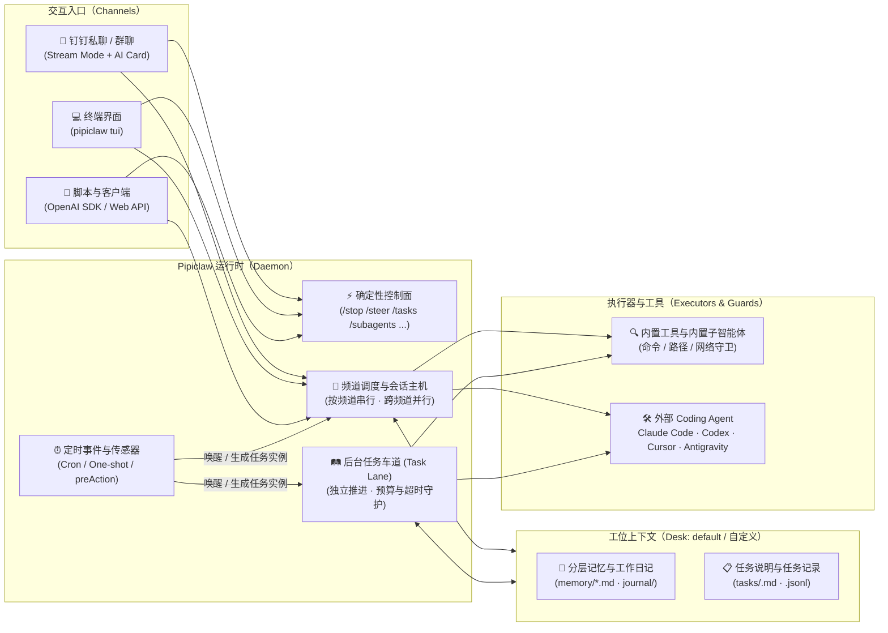

# Pipiclaw

<p align="left">
  <strong>简体中文</strong> | <a href="./README.en.md">English</a>
</p>

<p align="left">
  <a href="https://www.npmjs.com/package/@oyasmi/pipiclaw"></a>
  = 22.19.0">
  
  <a href="./LICENSE"></a>
</p>

> **把钉钉和终端变成永不下线的 AI 研发工作台——交办目标、合上电脑，让它调动你的模型与 Coding Agent 在后台持续推进，带着验证证据向你交付。**

**Pipiclaw** 是面向个人开发者、以钉钉为主要入口的 AI 编程助手运行时（Runtime）。你可以在钉钉、终端或脚本中交办目标，让它保留完整的工作上下文、在后台独立推进长程任务，并按需调度你已有的大模型、**Claude Code**、**Codex CLI**、**Cursor CLI**、**Antigravity CLI** 或自定义执行器。推进过程中，你可以随时查看进展、补充要求、暂停或接管，最终拿到可检查的代码、报告与验证依据。

**[核心亮点](#核心亮点) · [工作原理](#工作原理) · [典型场景](#典型场景) · [快速开始](#快速开始) · [常用命令](#常用命令) · [文档导航](#文档)**

---

## 核心亮点

### 🚀 1. 人走活不停：独立「任务车道」与定时事件

传统的命令行 AI 工具一旦关掉窗口或结束对话，上下文和在途工作就随之中断。Pipiclaw 将工作的连续性从单次聊天中解放出来：

- **后台任务车道（Task Lane）**：跨小时、跨会话的一次性复杂项目在后台独立的任务车道中推进，**与日常聊天互不阻塞**。每个任务由人类可读的 Markdown **任务说明**（目标、完成标准 DoD、**工作项**）和 JSONL **任务记录**（步骤、派发与结果）驱动，状态完全由运行时根据真实观察到的在途事实推导，不会因为模型“幻觉”而卡死在虚假等待中。
- **定时事件与传感器（Events）**：支持单次（`one-shot`）与周期（`periodic` Cron）触发。既能通过前置脚本（`preAction`）做**零 Token 消耗**的本地条件传感器，也能按事件模板每次自动派生独立的任务实例（例如每日代码巡检、周报汇总），上一次未完成时自动防重跳过。
- **确定性预算与止损**：内置步数与美元预算、空转检测、单步超时和连续报错守护。触及边界时自动暂停并通知你，绝不在后台失控烧钱。

### 🤝 2. 一套工作流，统领你手头的全部顶级 Coding Agent

不必在多个 CLI 窗口间来回切换、手动搬运上下文。Pipiclaw 让主智能体充当负责人，按能力、成本和执行边界把具体工作委派给最合适的执行器：

- **内置子智能体（Internal）**：在进程内隔离上下文中秒级启动，复用 Pipiclaw 的安全守卫，适合代码检索、日志筛查与快速分析。
- **外部重型执行器（External）**：直接拉起本机真实的 **Claude Code**、**Codex CLI**、**Cursor CLI**、**Antigravity CLI (`agy`)**、GLM 包装脚本或任意自定义命令，处理跨多文件实现、编写并反复运行测试等重度工程任务。
- **异步唤醒、会话续接与独立检查**：外部委派在后台运行（记录与管理产物保留 30 天），完成后自动唤醒发起频道；支持在已完成的外部会话上继续追问（Session 续接），也支持调用 CLI 强制只读的角色（如 `codex-review`）对改动做独立审查（`purpose: verify`）。

### 💬 3. 原生驻留钉钉 + 终端 TUI + OpenAI 兼容 Web API

- **免公网 IP 接入钉钉**：基于钉钉 **Stream Mode**，开发机或内网服务器安装即连，无需自建消息中转服务或公网回调地址。
- **AI Card 实时流式交互**：卡片实时展示思考过程、工具调用与阶段状态；模型正在忙时，直接发消息即可动态微调方向（`/steer`），或用 `/followup` 排队下一件事、用 `/stop` 立即中止；生成的报表、截图和导出文件直接作为**钉钉原生附件**交付。
- **一个大脑，多端同源**：单个机器人实例可同时服务多个私聊和群聊（不同频道并行推进，同一频道内串行防冲突）。终端界面（`pipiclaw tui`）与你自己的脚本客户端通过兼容官方 **OpenAI SDK（Responses API 已实现子集）** 的本地 Socket / TCP **Web API** 连接同一个助手。

### 🧠 4. 记得住约定、分得清场合：分层记忆与「工位（Desk）」

- **默认互通，按需隔离**：终端、钉钉私聊和群聊默认绑定在 `default` 工位下，共享长期记忆、工作日记、任务与文件，开箱即聊；需要把不同项目或用途隔开时，用 `/desk new <名字>` 即可开辟独立工位。
- **三层透明记忆，告别“关键词猜谜”**：
  - **工位记忆（`memory/*.md`）**：一事一文件，自动生成 `MEMORY.md` 索引并在会话首轮整份注入——只要在索引预算内，模型一眼看到全部约定，不会因为你没说中关键词而“失忆”。
  - **工作日记（`journal/YYYY-MM-DD.md`）**：按天记录进展、决策与卡点，不把临时进度污染成永久规则。
  - **自动反思与观察期**：在上下文压缩、开启新会话或频道空闲时自动整理记忆；新学到的日常知识先进入 30 天**观察期**，验证有用才转正；用 `/memory forget` 删除的条目会留下哈希防线，防止后台整理再次将其“复活”。空闲检查先过本地确定性闸门，无新内容时**零 Token 待机**。

### 🛡️ 5. 能自主，更能一秒接管：绕过模型的控制面与本地数据主权

- **不经过 LLM 的硬控制面**：`/help`、`/stop`、`/steer`、`/followup`、`/tasks`、`/subagents`、`/events`、`/desk`、`/status`、`/usage`、`/context` 等命令由运行时直接处理。**哪怕模型服务不可用或当前回合卡死**，你依然能在钉钉或终端实时查看状态、暂停任务，或用 `/subagents cancel` 直接终止外部子进程。
- **配置与数据完全归你**：支持内置 Provider、OpenAI 兼容网关、API Key 与订阅登录（`pipiclaw auth login`）。记忆、任务、角色、事件和账本全部是 `~/.pipiclaw/` 下可直接阅读和 Git 备份的纯文本文件；内置命令、路径与网络守卫及审计日志。

---

## 工作原理



### 核心概念速览

| 概念 | 是什么 | 解决什么问题 |
|---|---|---|
| **频道（Channel）** | 一个钉钉私聊、一个钉钉群，或一个 Web API / TUI 会话 | 保持每段对话历史独立，作为你交办、查看和接管工作的遥控器 |
| **工位（Desk）** | 一套命名的工作积累（默认 `default`，可按需新建） | 汇总同一工作上下文下的记忆、工作日记、任务、定时事件与工作目录 |
| **任务（Task）** | 后台任务车道里推进的一次性项目（`.md` 说明 + `.jsonl` 记录） | 让跨小时、跨多步的复杂交付在后台独立推进，不占用聊天，重启可恢复 |
| **事件（Event）** | 单次或 Cron 定时触发器，可带本地 `preAction` 门控或任务模板 | 回答“什么时候唤醒”，驱动定时提醒、零 Token 巡检或周期性生成任务实例 |
| **委派（Sub-Agent）** | 进程内轻量角色（`internal`）或外部 CLI 进程（`external`） | 回答“这一步由谁来做”，把已有订阅和异构 Coding Agent 纳入同一套工作流 |

---

## 典型场景

- **📱 随时随地的个人移动研发台**：在钉钉交办“把某模块迁移到新接口并补齐测试”，合上电脑；后台任务自动拆解工作项、调用 Claude Code / Codex 实现并跑通测试，再派 `codex-review` 独立核查 diff，最后把改动摘要与测试证据推回钉钉。
- **⏰ 零打扰的周期巡检与报告**：配置每日或每周定时事件模板，先用本地脚本检查仓库是否有新提交或异常日志，有变化时才生成后台任务深入分析并投递钉钉卡片与附件。
- **🔀 多模型与多 Agent 混合调度**：日常对话使用响应快或高性价比的模型，疑难架构与排障交给 `claude-high` / `codex-high` / `cursor-high`，明确批处理交给 `codex-flash` / `glm-flash`，长上下文协作交给 `agy-main`，充分利用手头每一份订阅额度。
- **🤝 个人多入口与小团队共享协作**：在多个钉钉群和私聊中维持各自独立的对话，默认共享同一份项目积累；需要为特定专项隔离背景时，随时切换工位。
- **🔌 用官方 OpenAI SDK 把助手接入自有工作流**：开启 Web API，用几行 Python / JS 代码从 CI 脚本、内部工具或自定义前端调用你的个人助手，共享工位记忆与工具生态。

> [!NOTE]
> **适用边界说明**：Pipiclaw 面向个人开发者（及共同使用同一个助手的小范围协作），支持自托管与单实例运行。它不是多租户 SaaS 平台，也不提供操作系统级沙箱；**外部智能体（External Agents）会绕过 Pipiclaw 的内置命令/路径守卫**，其真实权限由目标 CLI 自身的 sandbox 参数、运行系统账号与宿主环境共同决定。

---

## 快速开始

下面按顺序完成**安装 → 30 秒终端验证 → 钉钉接入 → 外部 Coding Agent 启用**。如果你已经有明确目标，可直接跳到对应小节。

<details>
<summary>💡 <b>偷懒方式：让你常用的 AI Agent（Claude Code / Codex / Cursor 等）帮你一键安装配置</b></summary>

把下面这段话直接复制给你的本机 AI Agent：

```text
请帮我安装并初始化 Pipiclaw：

1. 检查 Node.js >= 22.19.0，不满足就停止并说明。
2. 执行 npm install -g @oyasmi/pipiclaw；权限失败时不要自行 sudo。
3. 运行一次 pipiclaw 初始化 ~/.pipiclaw/；它因 channel.json 仍是模板而提示补全并退出是正常现象。
4. 询问我要使用 API key、自定义 provider，还是 pipiclaw auth login 支持的订阅登录；不要编造缺失值。
5. 如果我要接入钉钉，逐项收集 clientId、clientSecret、可选的 cardTemplateId 和 allowFrom，写入 channel.json 的 dingtalk 段，并清除所有 your-* 占位值。
6. 配置完成后先询问是否启动。终端模式用 pipiclaw tui；钉钉模式用 pipiclaw，启动后直接私聊或在群里 @机器人，无需创建或绑定工位。
7. 如实列出做过的操作、修改的文件、验证结果和仍缺少的信息，不要假装成功。
```

</details>

### 1. 环境要求与安装

- **Node.js**：`>= 22.19.0`
- **操作系统**：Linux / macOS（Windows 请使用 WSL2）

```bash
npm install -g @oyasmi/pipiclaw
pipiclaw tui --help
```

首次实际启动 `pipiclaw` 或 `pipiclaw tui` 时，会自动初始化 `~/.pipiclaw/`（可通过环境变量 `PIPICLAW_HOME=/your/path` 整体迁移）：

```text
~/.pipiclaw/
├── channel.json      # 渠道开关与配置：钉钉应用 (dingtalk)、Web API (webapi)
├── auth.json         # 模型凭据与登录态
├── models.json       # 自定义模型提供方与网关配置
├── settings.json     # 默认模型与运行时设置
├── tools.json        # Web 搜索/抓取、任务等能力开关
├── security.json     # 命令、路径与网络守卫策略
└── workspace/        # 共享规则 (AGENTS.md / SOUL.md)、skills/、sub-agents/，以及默认工位 desk-default/
```

### 2. 最快体验：30 秒在终端跑通

终端模式无需配置钉钉凭据，只需一个可用模型。任选一种方式配置凭据：

```bash
# 方式 A：通过环境变量提供 API Key
export ANTHROPIC_API_KEY=sk-ant-...

# 方式 B：登录 SDK 支持的订阅 Provider
pipiclaw auth login
```

启动交互式终端（首次运行会自动初始化默认工位 `default`）：

```bash
pipiclaw tui
```

或者用脚本化的一句话测试真实调用链路：

```bash
pipiclaw tui --print "只回复：Pipiclaw 模型调用成功"
```

> 看到模型实际回复才代表调用链路已跑通（`--help` 或 `/model` 仅代表 CLI 和模型目录可见）。如需接入 OpenAI 兼容网关、本地模型或固定默认模型，请查看[配置速查](https://github.com/oyasmi/pipiclaw/blob/main/docs/configuration.md)。

### 3. 接入钉钉（无需公网 IP）

前往[钉钉开放平台](https://open-dev.dingtalk.com/)创建企业内部应用：

1. 获取应用的 **`Client ID`** 和 **`Client Secret`**
2. 添加应用能力：**机器人**
3. 消息接收模式选择：**Stream 模式**（无需公网服务器）
4. *（推荐）* 创建 AI Card 卡片模板并记录 **`Card Template ID`**（流式体验最佳）

编辑 `~/.pipiclaw/channel.json`（务必清除所有 `your-*` 占位值）：

```json
{
  "dingtalk": {
    "enabled": true,
    "clientId": "your-dingtalk-client-id",
    "clientSecret": "your-dingtalk-client-secret",
    "robotCode": "",
    "cardTemplateId": "",
    "cardTemplateKey": "content",
    "allowFrom": []
  },
  "webapi": { "enabled": false, "socket": true }
}
```

- **必填项**：仅 `clientId` 和 `clientSecret` 为硬性必填；`robotCode` 留空时自动回退到 `clientId`；`cardTemplateId` 可暂留空（后续正式使用强烈建议开启 AI Card）。
- **访问控制**：`allowFrom: []` 表示允许所有发送者；灰度测试期建议填入你的钉钉 `staffId`。
- **Web API**：若同时想用官方 OpenAI SDK 从外部脚本连接助手，可将 `webapi.enabled` 设为 `true`（详见 [Web API 手册](https://github.com/oyasmi/pipiclaw/blob/main/docs/webapi.md)）。

启动常驻守护进程：

```bash
pipiclaw
```

现在打开钉钉，直接**私聊机器人**或把它**拉进群聊后 @它**——无需手动创建或绑定工位，新频道首次发消息会自动接入默认工位。先发 `/model` 检查模型，再发一条普通消息验证：

```text
请介绍一下你自己，并说明你现在能做什么
```

*(若首条消息未跑通，请参考[部署与排障](https://github.com/oyasmi/pipiclaw/blob/main/docs/deployment-and-operations.md)排查。)*

### 4. 启用外部 Coding Agent 委派（Claude / Codex / Cursor / Antigravity）

先在运行 Pipiclaw 的同一系统账号下安装并登录你拥有的 CLI（如 `claude`、`codex`、Cursor 的 `agent` 或 Antigravity 的 `agy`）。

随包附带了按执行器、能力与成本组织好的推荐条目（`flash` / `main` / `high` 及只读审查 `codex-review`）。按需复制你实际拥有账号的一两个主力条目到工作区即可：

```bash
mkdir -p ~/.pipiclaw/workspace/sub-agents
PIPICLAW_PACKAGE_DIR="$(npm root -g)/@oyasmi/pipiclaw"

# 示例：启用 Claude Code 与 Codex 的主力条目，以及只读独立审查条目
cp "$PIPICLAW_PACKAGE_DIR"/examples/sub-agents/agents/{claude-main,codex-main,codex-review}.md \
  ~/.pipiclaw/workspace/sub-agents/
```

*(仓库同样提供 `cursor-main`、`cursor-high`、`agy-main`、`glm-high`、`glm-flash` 等条目，详见[示例配置说明](./examples/sub-agents/README.md)。)*

无需重启进程，直接在聊天中发送：

```text
/subagents roles
```

确认条目状态为可用后，直接用自然语言向主智能体交代目标与验收要求，它会自行选择合适的执行器：

```text
请把这个跨模块实现交给合适的执行器，完成后对最终改动做一次独立检查，把结论和验证依据发给我。
```

> [!IMPORTANT]
> 外部智能体不经过 Pipiclaw 的命令和路径守卫，且除 `codex-review` 外的示例条目默认开启了放开权限的 CLI 参数。启用前请务必阅读[智能体委派指南](https://github.com/oyasmi/pipiclaw/blob/main/docs/sub-agents.md)中的安全边界说明，并在常驻 `pipiclaw` 守护进程下运行长时委派。

### 5. 可选：启用联网搜索与网页抓取

`web_search` 与 `web_fetch` 默认关闭。编辑 `~/.pipiclaw/tools.json`，将 `tools.web.enable` 设为 `true` 即可启用（支持 DuckDuckGo、Tavily、Jina、SearXNG，默认免 Key 使用 DuckDuckGo）。完整配置见[配置速查](https://github.com/oyasmi/pipiclaw/blob/main/docs/configuration.md)。

---

## 常用命令

Pipiclaw 的斜杠命令分为**运行时直接处理（回合进行中随时可用、不经过模型）**和**会话级命令**两类：

### 随时可用（由运行时直接响应，模型忙或卡住时仍有效）

| 命令 | 作用 |
|---|---|
| `/help [命令名]` | 查看当前版本的完整命令列表，或某个命令的子命令与示例（如 `/help tasks`） |
| `/status` | 查看运行状态、当前模型、上下文占用、运行时长、版本与后台任务概况 |
| `/stop` | 停止当前聊天回合并清空后续排队消息（暂停后台任务请用 `/tasks pause`，终止委派请用 `/subagents cancel`） |
| `/steer <消息>` | 在当前工具调用结束后，动态调整正在运行的回合方向（忙时直接发普通消息默认按此处理） |
| `/followup <消息>` | 将请求排入队列，等当前回合完整结束后再执行 |
| `/tasks [show\|log\|msg\|pause\|resume\|cancel\|archive\|doctor]` | 查看、对话（`msg`）、暂停、恢复或取消后台长程任务 |
| `/subagents [list\|show\|output\|cancel\|roles]` | 查看运行中/已完成的委派详情、输出日志、角色目录，或直接终止（`cancel`） |
| `/events <list\|show\|delete\|history>` | 查看、删除定时事件或检查触发历史 |
| `/desk [list\|new <名字>\|bind <名字>]` | 查看工位绑定、创建新工位，或将当前频道切换到另一个工位 |
| `/usage [7d\|month]` | 查看本工位与全局的模型 Token 消耗与花费明细 |
| `/context [detail]` | 透视实际发给模型的系统提示词分段、工具定义与上一轮上下文占用 |
| `/skills [list\|show <name>]` | 查看已加载的工作区与用户共享技能 |
| `/new` | 开启全新对话会话 |

### 空闲时可用（需等当前回合结束）

| 命令 | 作用 |
|---|---|
| `/memory [status\|list\|show\|forget\|journal]` | 查看工位长期记忆、观察期条目、某天的工作日记，或直接删除并屏蔽某条记忆（`forget`） |
| `/model [provider/modelId\|modelId]` | 查看当前模型，或通过精确名称/唯一子串切换模型 |
| `/thinking [off\|minimal\|low\|medium\|high\|xhigh\|max\|cycle]` | 查看或切换当前模型的思考推理档位 |
| `/compact [压缩要求]` | 手动压缩当前会话上下文，可附加保留重点的要求 |
| `/session` | 查看当前会话的消息统计、Token 用量与模型信息 |
| `/reload` | 重新加载技能、工具与资源配置，保留当前对话历史 |

完整交互说明见[交互与命令](https://github.com/oyasmi/pipiclaw/blob/main/docs/interaction-and-commands.md)。

---

## 文档

完整文档索引位于 **[docs/README.md](https://github.com/oyasmi/pipiclaw/blob/main/docs/README.md)**。你可以按手头的问题直接进入对应专题：

| 我想了解 / 解决 | 推荐文档 |
|---|---|
| 💬 私聊、群聊、AI Card、忙时消息与斜杠命令细节 | [交互与命令](https://github.com/oyasmi/pipiclaw/blob/main/docs/interaction-and-commands.md) |
| 🤝 接入 Claude Code / Codex / Cursor / Antigravity 与编写角色 | [智能体委派](https://github.com/oyasmi/pipiclaw/blob/main/docs/sub-agents.md) · [示例说明](./examples/sub-agents/README.md) |
| 📋 后台任务车道、定时事件、Cron 模板与预算守护 | [事件与任务](https://github.com/oyasmi/pipiclaw/blob/main/docs/events-and-tasks.md) |
| 🧠 分层记忆、工作日记、观察期与遗忘机制 | [记忆](https://github.com/oyasmi/pipiclaw/blob/main/docs/memory.md) |
| ⚙️ 配置模型、企业网关、代理、Web 工具与工作区 | [配置速查](https://github.com/oyasmi/pipiclaw/blob/main/docs/configuration.md) · [配置字段参考](https://github.com/oyasmi/pipiclaw/blob/main/docs/configuration-reference.md) |
| 🔌 用官方 OpenAI SDK 从脚本或自有前端连接助手 | [Web API](https://github.com/oyasmi/pipiclaw/blob/main/docs/webapi.md) |
| 🧩 沉淀个人与项目的可复用方法（Skills） | [Skills 指南](https://github.com/oyasmi/pipiclaw/blob/main/docs/skills.md) |
| 💡 会用之后，如何最大化放大个人研发产出 | [使用杠杆（Leverage）](https://github.com/oyasmi/pipiclaw/blob/main/docs/leverage/README.md) · [设计哲学](https://github.com/oyasmi/pipiclaw/blob/main/docs/design-philosophy.md) |
| 🛡️ 默认安全守卫、路径/命令边界与外部 Agent 授权 | [安全指南](https://github.com/oyasmi/pipiclaw/blob/main/docs/security.md) |
| 🚀 常驻进程部署、升级、备份、并发边界与排障 | [部署与运维](https://github.com/oyasmi/pipiclaw/blob/main/docs/deployment-and-operations.md) · [并发与容量](https://github.com/oyasmi/pipiclaw/blob/main/docs/scaling-and-concurrency.md) |
| 🏗️ 源码模块分层、运行时拓扑与架构设计 | [架构](https://github.com/oyasmi/pipiclaw/blob/main/docs/architecture.md) · [运行机制](https://github.com/oyasmi/pipiclaw/blob/main/docs/runtime-mechanisms.md) |

---

## 开发

```bash
npm install
npm run build
npm run check      # lint + typecheck + arch + deadcode + unit test
```

- **日常最小验证**：`npm run typecheck` 与 `npm run test`
- **架构与依赖方向检查**：`npm run arch`
- **确定性全栈测试（离线、零 API 成本）**：`npm run test:e2e`
- **真实模型冒烟测试**：`npm run test:e2e:live`

---

## 许可证

本项目基于 [GNU Affero General Public License v3.0 (AGPL-3.0)](./LICENSE) 开源。
