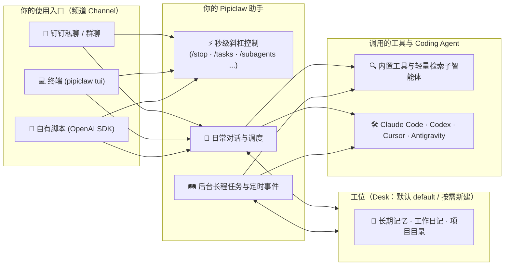

<div align="center">

# Pipiclaw

**住进钉钉与终端的全天候个人 AI 研发助手**

交办目标，合上手机——让它记住你的项目约定，统筹你手头的大模型与 Coding Agent 在后台持续推进，带着验证证据向你交付。

<p>
  <strong>简体中文</strong> · <a href="./README.en.md">English</a> · <a href="https://github.com/oyasmi/pipiclaw/blob/master/docs/README.md">完整文档</a>
</p>

<p>
  <a href="https://www.npmjs.com/package/@oyasmi/pipiclaw"></a>
  <a href="https://github.com/oyasmi/pipiclaw/actions/workflows/ci.yml"></a>
  = 22.19.0">
  
  <a href="./LICENSE"></a>
</p>

**[为什么用它](#为什么用-pipiclaw) · [真实体验](#真实工作流体验) · [快速开始](#快速开始) · [核心能力](#核心能力) · [常用命令](#常用命令) · [常见问题](#常见问题) · [文档导航](#文档导航)**

</div>

---

## 为什么用 Pipiclaw

你手头可能已经有 **Claude Code**、**Codex CLI**、**Cursor** 或各类大模型订阅，但日常研发依然有三个明显的断层：

1. **人走活就停**：命令行工具绑死在终端窗口里——出门、开会或关掉窗口，正在跑的工作就断了，没法在手机上随时交办和跟进。
2. **多工具来回倒手**：查日志用一个模型、写代码开 Claude Code、做 Code Review 又切去 Codex，上下文全靠人肉复制粘贴。
3. **每次重头交代背景**：新开一个会话，项目的目录约定、发布禁忌、个人偏好又要重新说一遍。

**Pipiclaw 把这些碎片串成一个真正属于你的个人助手**：它常驻在你的开发机或服务器上，免公网 IP 接入钉钉，同时提供终端界面与兼容官方 OpenAI SDK 的本地接口。你在哪里说话，它就在哪里接单、记忆、调度执行器，并把可验收的结果推回给你。

| 对比维度 | 普通聊天机器人 | 单个终端 Coding CLI | **Pipiclaw** |
|---|---|---|---|
| **随时随地触达** | 手机可聊，但碰不到本机代码与环境 | 能改代码，但你必须守在电脑终端前 | **钉钉私聊/群聊 + 终端 + SDK 同源连接** |
| **长耗时复杂任务** | 单轮问答为主，超时即断 | 占用当前窗口，关掉或断网即停 | **独立后台任务通道，跨小时推进，与聊天互不阻塞** |
| **多工具协同** | 单一模型孤立回答 | 各跑各的 CLI，手动搬运上下文 | **统一调度内置模型与 Claude / Codex / Cursor / Antigravity** |
| **跨会话记忆** | 换个窗口就忘，或靠脆弱的关键词检索 | 仅限静态规则文件 | **自动沉淀长期记忆 + 按天工作日记，可查可删** |
| **失控接管能力** | 只能干等生成结束 | 在电脑前按 `Ctrl-C` | **手机/终端随时 `/stop`、`/steer`、暂停任务或强杀子进程** |

---

## 真实工作流体验

下面是你在日常研发中使用 Pipiclaw 的典型一幕：

```text
09:15  [地铁上 · 钉钉私聊]
你 ──▶ "把用户导出接口改成流式响应并补齐大文件单测，改完让 codex-review 独立检查一遍再发我。"

09:16  [后台建单推进 · 不占聊天]
助手 ─▶ 建立后台长程任务，拆解工作项，拉起本机 claude-main 编写代码并运行测试。
       （与此同时，你依然可以在同一个钉钉窗口里正常问它别的线上问题，互不卡顿。）

09:32  [中途随时微调]
你 ──▶ "/tasks" 查看进度，顺手发一句："/tasks msg export-stream 记得兼容带 BOM 的 CSV 导出"

09:48  [独立复核与交付]
助手 ─▶ claude-main 测试通过 → 自动拉起只读的 codex-review 核查改动 diff → 汇总改动说明、
       测试输出与压测对比表，作为钉钉卡片与原生文件附件推送到你的手机。
```

除此之外，你还可以用它做：

- **⏰ 零打扰的每日巡检**：设置 Cron 定时事件，先跑本地脚本检查仓库是否有新提交或报错日志——**没变化时零 Token 消耗**，发现异常才自动建单深入排查并推钉钉报告。
- **🔀 把每份订阅用在刀刃上**：日常快问快答用高性价比模型；架构攻坚派给 `claude-high` / `codex-high` / `cursor-high`；批量机械修改交给 `codex-flash` / `glm-flash`；长上下文分析交给 `agy-main`。
- **🗂️ 多项目干净隔离**：默认所有入口共享一套记忆；需要把公司项目、个人副业或专项实验分开时，发一句 `/desk new side-project` 即可切换独立「工位」。
- **🔌 几行代码接入自有脚本**：开启内置 Web API，直接用官方 Python / JS `openai` SDK 在 CI 或内部脚本里调用你的助手。

---

## 快速开始

按顺序只需几分钟：**终端 60 秒跑通 → 按需接入钉钉 → 按需挂载外部 Coding Agent → 后台常驻运行**。（需要国内模型网关直接复制模板、`curl` 接口验证与钉钉后台逐项避坑说明？可直接阅读完整 **[快速上手指南（docs/quickstart.md）](https://github.com/oyasmi/pipiclaw/blob/master/docs/quickstart.md)**。）

<details>
<summary>💡 <b>偷懒捷径：复制这段话给你本机的 Claude Code / Codex / Cursor，让它帮你装好</b></summary>

```text
请帮我安装并初始化 Pipiclaw：

1. 检查 Node.js >= 22.19.0，不满足就停止并说明。
2. 执行 npm install -g @oyasmi/pipiclaw；权限失败时不要自行 sudo。
3. 运行一次 pipiclaw webapi key list（或 pipiclaw auth status）初始化 ~/.pipiclaw/，并把终端输出的初始默认 Web API Key（pk_...）如实保留告知我。
4. 询问我要使用环境变量 API key、自定义 provider（写入 ~/.pipiclaw/models.json，内附示例），还是由我自己运行 pipiclaw auth login 登录订阅账号；不要编造缺失值。
5. 如果我要接入钉钉，逐项收集 clientId、clientSecret、可选的 cardTemplateId 和 allowFrom，写入 channel.json 的 dingtalk 段并将 dingtalk.enabled 设为 true。
6. 配置完成后先询问是否启动。终端对话用 pipiclaw tui（在项目下可加 --cwd .）；常驻服务用 pipiclaw（默认已开启本机 Web API Socket 与 http://127.0.0.1:8787/v1）。
7. 如实列出做过的操作、修改的文件、验证结果和仍缺少的信息，不要假装成功。
```

</details>

### 第 1 步：安装并立即跑通（免配钉钉，开箱即用）

环境要求：**Node.js `>= 22.19.0`**，支持 **Linux / macOS**（Windows 请使用 **WSL2**）。

```bash
npm install -g @oyasmi/pipiclaw
```

首次运行 `pipiclaw` 或 `pipiclaw tui` 时，会自动创建 `~/.pipiclaw/` 配置目录、**默认开启本机 Web API（本机 Socket + `http://127.0.0.1:8787/v1`，并自动生成一把默认密钥 `pk_...`）**；若尚未检测到模型凭据，还会直接引导你完成登录。

你也可以提前任选一种方式配好模型：

```bash
# 方式 A：交互式登录订阅账号或填写 API Key（登录完可直接设为默认模型）
pipiclaw auth login

# 方式 B：通过环境变量设置 API Key（以 Anthropic 为例）
export ANTHROPIC_API_KEY=sk-ant-...
```

启动终端对话（进入具体代码仓库时可加 `--cwd .` 将默认工位绑定到当前目录）：

```bash
pipiclaw tui
```

或者直接启动常驻后台服务（本机 `pipiclaw tui` 与 OpenAI SDK 脚本均可直连）：

```bash
pipiclaw
```

你也可以用单次命令快速验证模型链路是否真正调通：

```bash
pipiclaw tui --print "只回复：Pipiclaw 已就绪"
```

> 如需配置 OpenAI 兼容中转网关、DeepSeek / 通义 / GLM / 本地 Ollama，直接参考自动生成的 `~/.pipiclaw/models.json` 内置 `_examples` 样例，或查看[配置速查](https://github.com/oyasmi/pipiclaw/blob/master/docs/configuration.md)。

### 第 2 步：按需接入钉钉（免公网 IP）

得益于钉钉 **Stream 模式**，你的电脑或内网服务器只要能上网就能直连钉钉，无需公网 IP、域名或内网穿透：

1. 打开[钉钉开放平台](https://open-dev.dingtalk.com/)，创建一个**企业内部应用**，获取 **`Client ID`** 和 **`Client Secret`**。
2. 在应用中添加**机器人**能力，消息接收模式选择 **Stream 模式**并发布。
3. *（推荐）* 创建一个 AI Card 卡片模板并记录 **`Card Template ID`**，即可获得丝滑的实时流式输出体验。

编辑 `~/.pipiclaw/channel.json` 的 `dingtalk` 段，将 `enabled` 改为 `true` 并填入凭据：

```json
{
  "dingtalk": {
    "enabled": true,
    "clientId": "填入你的 Client ID",
    "clientSecret": "填入你的 Client Secret",
    "robotCode": "",
    "cardTemplateId": "填入卡片模板 ID（可先留空）",
    "cardTemplateKey": "content",
    "allowFrom": []
  },
  "webapi": {
    "enabled": true,
    "socket": true,
    "tcp": "127.0.0.1:8787",
    "tls": null,
    "keys": [{ "name": "default", "sha256": "...", "desks": ["default"] }]
  }
}
```

- `clientId` 与 `clientSecret` 是仅有的两个必填项；`robotCode` 留空会自动使用 `clientId`。
- `allowFrom: []` 表示允许应用可见范围内的成员对话；只想自己用时可填入你的钉钉 `staffId`。

启动服务：

```bash
pipiclaw
```

现在打开手机或桌面钉钉，**直接私聊机器人**，或把它拉进群聊后 **@它** 即可开始对话！建议先发 `/status` 检查状态，再发一句日常指令试试。

### 第 3 步：接入 Claude Code / Codex / Cursor / Antigravity（可选）

如果你本机已经安装并登录了 `claude`、`codex`、Cursor 的 `agent` 或 Antigravity 的 `agy`，两行命令就能把它们纳入 Pipiclaw 统一调度：

```bash
mkdir -p ~/.pipiclaw/workspace/sub-agents
PIPICLAW_PACKAGE_DIR="$(npm root -g)/@oyasmi/pipiclaw"

# 按你实际拥有的账号挑选复制（此处以 Claude、Codex 主力档与只读审查档为例）
cp "$PIPICLAW_PACKAGE_DIR"/examples/sub-agents/agents/{claude-main,codex-main,codex-review}.md \
  ~/.pipiclaw/workspace/sub-agents/
```

*(安装包内还附带了 `claude-high`、`codex-high`、`codex-flash`、`cursor-main`、`cursor-high`、`agy-main`、`glm-high`、`glm-flash` 等配置，详见[委派示例说明](https://github.com/oyasmi/pipiclaw/blob/master/examples/sub-agents/README.md)。)*

**无需重启**，直接在钉钉或终端发送 `/subagents roles` 看到状态可用后，就能直接用自然语言发号施令了：

```text
请把这个模块的重构交给合适的外部执行器完成，跑通测试后再做一次独立只读审查，最后把结论发给我。
```

> [!IMPORTANT]
> **权限提醒**：外部 Coding Agent 是独立 CLI 进程，不经过 Pipiclaw 内置的命令与路径守卫（除只读的 `codex-review` 外，示例模板默认开启了自动执行参数）。启用前请了解[智能体委派安全边界](https://github.com/oyasmi/pipiclaw/blob/master/docs/sub-agents.md)。

### 第 4 步：托管为 24 小时后台服务（推荐）

确认跑通后，建议用 `pm2` 或 `systemd` 在开发机、Mac mini 或常开云主机上托管运行，真正实现“关掉终端也不掉线”：

```bash
# 快速使用 pm2 常驻后台
pm2 start pipiclaw --name pipiclaw && pm2 save
```

完整的 `systemd` 服务配置、环境变量隔离与排障方法见[部署与运维指南](https://github.com/oyasmi/pipiclaw/blob/master/docs/deployment-and-operations.md)。

---

## 核心能力

### 💬 1. 丝滑的多端实时交互

- **AI Card 实时流式卡片**：在钉钉里实时呈现思考进度与正在执行的工具；遇到长耗时操作，不用傻等——直接发消息就能中途纠偏（`/steer`），或用 `/followup` 把下一件事排好队。
- **原生文件直达手机**：生成的 Markdown 报告、CSV 数据表、截图或导出压缩包，直接作为钉钉原生附件发送给你。
- **开放的本地与远程接口**：终端 `pipiclaw tui` 和你自己的 Python / JS 脚本都通过内置的 **OpenAI Responses 兼容 Web API** 连向同一个助手（详见 [Web API 手册](https://github.com/oyasmi/pipiclaw/blob/master/docs/webapi.md)）。

### 🛤️ 2. 不占聊天的后台长程任务与定时事件

- **独立后台推进**：复杂工程任务进入专属后台通道逐步完成，每一步工作项与执行记录清晰落盘，进程重启后自动恢复推进，不会因为一次对话结束而半途而废。
- **预算与异常熔断**：每个任务都受步数上限、花费预算、超时与连续报错保护；遇到需要你拍板的问题或触及预算边界时，主动暂停并在钉钉呼叫你。
- **单次提醒与周期巡检**：支持定时提醒、Cron 周期巡检与本地脚本前置过滤，让助手从“你戳一下才动一下”升级为按节奏主动交付。

### 🤝 3. 内外兼修的多智能体委派

- **主助手统筹全局**：主助手负责理解你的真实意图、维护上下文并验收结果；查资料、筛日志等轻量活交给毫秒级启动的**内置子智能体**，跨文件编码与测试迭代交给 **Claude Code / Codex / Cursor / Antigravity**。
- **后台异步完成即唤醒**：外部 Agent 在后台慢慢跑，跑完自动回到原频道向你汇报；你还可以在已跑完的外部会话上继续追问，或者用 `/subagents cancel` 随时终止。

### 🧠 4. 透明、克制、可遗忘的分层记忆

- **长期记忆 + 工作日记**：重要的项目规范与个人偏好按条存入 `memory/*.md`，新开会话自动完整加载，无需猜关键词；当天的阶段性进展自动归入按天的**工作日记**（`journal/`），不把临时状态混成永久规则。
- **观察期与彻底遗忘**：后台自动整理的日常新知先进入 30 天**观察期**；过时或错误的信息只需发一句 `/memory forget <名称>` 即可物理删除并永久屏蔽，绝不会在后续整理中“死而复生”。

### 🛡️ 5. 随时一秒接管，数据 100% 归你

- **不经过大模型的硬控制开关**：`/stop`、`/tasks`、`/subagents`、`/status`、`/usage` 等核心控制命令由本地运行时直接响应。**哪怕模型接口宕机或回复卡住**，你依然能瞬间查状态、停任务、杀进程。
- **纯文本本地存储**：所有配置、记忆、任务说明、工作日记与花费账单都是 `~/.pipiclaw/` 下的纯文本文件，随时可读、可改、可用 Git 备份；内置命令、路径与网络访问守卫。

### 一张图看懂日常协作结构



| 日常概念 | 一句话理解 |
|---|---|
| **频道（Channel）** | 你和助手说话的窗口（一个钉钉私聊、一个群聊，或一个终端会话），各自对话历史独立。 |
| **工位（Desk）** | 一套独立的工作台（含记忆、日记、任务、定时事件与代码目录）。默认所有频道共用 `default` 工位；想隔离项目时新建切换即可。 |
| **任务（Task）** | 交办给后台慢慢推进的复杂事项，不阻塞当前聊天，支持随时查看、追问、暂停或追加预算。 |
| **事件（Event）** | 定好时间自动唤醒助手的闹钟或 Cron 巡检器，支持先跑本地脚本判断“有没有事需要处理”。 |
| **委派（Sub-Agent）** | 助手喊来干具体活的帮手——可以是内置轻量检索员，也可以是你本机的 Claude Code / Codex 等重装工具。 |

---

## 常用命令

在钉钉聊天框或终端中输入 `/` 即可使用控制命令（发送 `/help` 查看全量列表，发送 `/help <命令名>` 查看详细示例）：

### ⚡ 随时可用（即使助手正在回复、甚至模型卡住时也能立即生效）

| 命令 | 你什么时候会用到它 |
|---|---|
| `/help [命令名]` | 忘记命令用法时，查看总表或某个命令的具体示例（如 `/help tasks`） |
| `/status` | 一眼看清当前运行状态、所用模型、上下文占用与后台任务概况 |
| `/stop` | 立即叫停当前正在生成的聊天回复，并清空排队的后续消息 |
| `/steer <补充内容>` | 助手正在干活时，不等它停下就顺手微调方向（忙时直接发普通消息默认就是这个效果） |
| `/followup <下一件事>` | 助手正忙时，把下一条请求排好队，等当前回复完整结束后再执行 |
| `/tasks [show\|msg\|pause\|resume\|cancel...]` | 查看后台长程任务进度、向任务传话（`msg`）、暂停、恢复追加预算或取消任务 |
| `/subagents [list\|show\|output\|cancel\|roles]` | 查看正在跑的 Claude / Codex 等委派任务、看实时输出，或用 `cancel` 直接强行终止 |
| `/events <list\|show\|delete\|history>` | 查看已设定的定时提醒与周期巡检，检查触发历史或删除事件 |
| `/desk [list\|new\|cwd\|bind]` | 查看工位列表、新建工位或设置工作目录（注：将当前频道切换工位的 `bind` 需等当前回复结束） |
| `/usage [7d\|month]` | 查看当前工位和全局的 Token 消耗与账单花费明细 |
| `/context [detail]` | 查看当前到底给大模型发了多少系统提示词、工具和上下文 |
| `/skills [list\|show <名称>]` | 查看已加载的可复用技能清单 |
| `/new` | 清空当前聊天上下文，开启一段全新的对话（长期记忆仍保留） |

### 🛋️ 空闲时可用（等当前这一轮回复结束后使用）

| 命令 | 你什么时候会用到它 |
|---|---|
| `/memory [status\|list\|show\|forget\|journal]` | 查看助手记住了哪些规则、翻看某天的工作日记，或用 `forget` 彻底删掉某条记忆 |
| `/model [模型名或关键词]` | 查看当前模型，或按名称/子串快速切换主力模型 |
| `/thinking [low\|medium\|high\|cycle...]` | 调整模型的思考推理深度（日常对话调低省时间，复杂排障调高保质量） |
| `/compact [保留重点说明]` | 当对话变长时手动压缩上下文，可顺带叮嘱“保留某某结论” |
| `/session` | 查看当前这段对话的消息轮数与累计用量 |
| `/reload` | 修改了外部技能（Skills）或配置文件后，免重启热加载生效 |

---

## 数据存在哪、怎么改配置

Pipiclaw 的所有配置与数据都集中存放在 `~/.pipiclaw/`（可通过环境变量 `PIPICLAW_HOME` 改到任意路径），买新电脑或迁移服务器只需备份这一个文件夹：

```text
~/.pipiclaw/
├── channel.json      # 钉钉机器人凭据、AI Card 模板与 Web API 开关
├── auth.json         # 模型登录凭据（通常由 pipiclaw auth login 自动维护）
├── models.json       # 自定义模型接口（OpenAI 兼容网关、本地模型等）
├── settings.json     # 默认模型、备用模型切换与全局偏好
├── tools.json        # 联网搜索/网页抓取（默认关闭，可免 Key 开 DuckDuckGo）等开关
├── security.json     # 命令、路径与网络访问守卫规则
└── workspace/        # 你的个人化资产：
    ├── SOUL.md       # 定制助手的性格、语气与回复习惯
    ├── AGENTS.md     # 跨项目通用的工作守则与红线要求
    ├── skills/       # 你沉淀的可复用工作流技能（同时支持读取 ~/.agents/skills/）
    ├── sub-agents/   # 启用的外部 Coding Agent 角色文件
    └── desk-default/ # 默认工位的长期记忆 (memory/)、工作日记 (journal/) 与任务记录 (tasks/)
```

细节随查随改，详见 **[配置速查手册](https://github.com/oyasmi/pipiclaw/blob/master/docs/configuration.md)**。

---

## 常见问题

<details>
<summary><b>1. 接入钉钉需要买云服务器、域名或公网 IP 吗？</b></summary>

**完全不需要。** Pipiclaw 采用钉钉官方的 Stream 长连接模式，只要运行它的电脑或内网主机能正常访问互联网，就能主动连上钉钉收发消息。
</details>

<details>
<summary><b>2. 我把笔记本电脑合上盖子，它还能继续跑后台任务吗？</b></summary>

Pipiclaw 是运行在你自己机器上的本地程序：如果装在笔记本上且合盖进入系统休眠，进程也会随之暂停（唤醒后会自动恢复连接与未完任务）。如果你想**全天候 24 小时随时在手机上使唤它**，推荐把它装在常开的台式开发机、Mac mini、家用服务器或云主机上。
</details>

<details>
<summary><b>3. 调用 Claude Code / Codex / Cursor 会额外收费吗？安全吗？</b></summary>

Pipiclaw 本身不收取任何中转费用，它直接调用你本机已安装并登录的官方 CLI，消耗的是你原有的订阅额度或 API Key。
**安全边界请注意**：Pipiclaw 是面向个人开发者（及小范围熟人共享同一助手）的自托管工具，不是多租户隔离平台。外部 Coding Agent 作为本机子进程运行，拥有当前系统账号的真实读写与执行权限，**不受 Pipiclaw 内置命令/路径守卫限制**。建议在专门的工作目录或独立系统账号下运行。详见[安全指南](https://github.com/oyasmi/pipiclaw/blob/master/docs/security.md)。
</details>

<details>
<summary><b>4. 如何开启联网搜索？如何升级版本？</b></summary>

- **开启联网**：编辑 `~/.pipiclaw/tools.json`，将 `tools.web.enable` 设为 `true` 即可（默认使用免 API Key 的 DuckDuckGo，也支持配置 Tavily、Jina、SearXNG）。
- **版本升级**：执行 `npm install -g @oyasmi/pipiclaw@latest` 并重启 `pipiclaw` 进程即可，`~/.pipiclaw/` 下的所有记忆与配置都会完好保留。
</details>

---

## 文档导航

完整的用户手册位于 **[文档中心（docs/README.md）](https://github.com/oyasmi/pipiclaw/blob/master/docs/README.md)**，按场景即查即用：

| 你想做什么 | 对应指南 |
|---|---|
| ⚡ 从零安装、配模型（含国内网关）、测 API 与钉钉避坑 | [快速上手指南（Quick Start）](https://github.com/oyasmi/pipiclaw/blob/master/docs/quickstart.md) |
| 💬 玩转私聊、群聊、AI Card 输出模式与斜杠命令 | [交互与命令](https://github.com/oyasmi/pipiclaw/blob/master/docs/interaction-and-commands.md) |
| ⚙️ 配置自定义模型、中转网关、网络代理与联网搜索 | [配置速查](https://github.com/oyasmi/pipiclaw/blob/master/docs/configuration.md) · [配置字段参考](https://github.com/oyasmi/pipiclaw/blob/master/docs/configuration-reference.md) |
| 🤝 接入与定制 Claude Code / Codex / Cursor / Antigravity | [智能体委派指南](https://github.com/oyasmi/pipiclaw/blob/master/docs/sub-agents.md) · [角色示例库](https://github.com/oyasmi/pipiclaw/blob/master/examples/sub-agents/README.md) |
| 📋 用好后台长程任务、Cron 定时巡检与预算保护 | [事件与任务](https://github.com/oyasmi/pipiclaw/blob/master/docs/events-and-tasks.md) |
| 🧠 管理长期记忆、工作日记、观察期与彻底遗忘 | [记忆管理](https://github.com/oyasmi/pipiclaw/blob/master/docs/memory.md) |
| 🧩 把常用研发流程打包成可复用的个人/项目技能 | [Skills 指南](https://github.com/oyasmi/pipiclaw/blob/master/docs/skills.md) · [内置工具总览](https://github.com/oyasmi/pipiclaw/blob/master/docs/tools.md) |
| 🔌 用官方 OpenAI SDK 从外部脚本或自定义前端接入 | [Web API 手册](https://github.com/oyasmi/pipiclaw/blob/master/docs/webapi.md) |
| 💡 进阶实践：如何真正把 AI 助手从“扳手”用成“车床” | [使用杠杆（Leverage）](https://github.com/oyasmi/pipiclaw/blob/master/docs/leverage/README.md) · [设计哲学](https://github.com/oyasmi/pipiclaw/blob/master/docs/design-philosophy.md) |
| 🚀 24 小时后台托管、备份迁移、权限守卫与故障排查 | [部署与运维](https://github.com/oyasmi/pipiclaw/blob/master/docs/deployment-and-operations.md) · [安全指南](https://github.com/oyasmi/pipiclaw/blob/master/docs/security.md) · [并发与容量](https://github.com/oyasmi/pipiclaw/blob/master/docs/scaling-and-concurrency.md) |

---

## 从源码构建与参与贡献

如果你想从源码本地构建、调试或参与项目开发：

```bash
git clone https://github.com/oyasmi/pipiclaw.git
cd pipiclaw
npm install && npm run build && npm run check
```

了解模块架构、运行机制与开发规范，请阅读[架构文档](https://github.com/oyasmi/pipiclaw/blob/master/docs/architecture.md)、[运行机制](https://github.com/oyasmi/pipiclaw/blob/master/docs/runtime-mechanisms.md)与 [AGENTS.md](https://github.com/oyasmi/pipiclaw/blob/master/AGENTS.md)。欢迎提交 Issue 与 Pull Request！

---

## 许可证

本项目基于 [GNU Affero General Public License v3.0 (AGPL-3.0)](./LICENSE) 开源。
