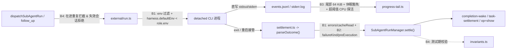

# 073：外部 Sub-agent 卫生加固、失败分级、探活与委派护栏

| 字段 | 内容 |
| --- | --- |
| 状态 | 已实施，见[验收记录](acceptance.md) |
| 日期 | 2026-11-26 |
| 来源 | OpenMausBot 外部 Agent 驱动对照分析（`server/drivers/{claude*,codex*,retry,acp/quiet-status}.ts`、`server/{contracts,resume-recovery,turn-watchdog}.ts`） |
| 前置 | [040 异步委派与外部代理](../archive/040-async-delegation-and-external-agents/design.md)、[042 委派一致性加固](../archive/042-delegation-consistency-hardening/design.md)、[064 任务车道](../064-task-lane/design.md)、[066 Cursor CLI harness](../066-cursor-cli-harness/design.md)、[068 Antigravity CLI harness](../068-antigravity-cli-harness/design.md) |
| 范围 | 覆盖 B1（适配器卫生与解析补齐）、B2（失败结构化分级与零副作用判定）、B3（进程树 CPU 探活、宿主机休眠豁免与尾部读取）、B4（在途重复委派拦截与形式化不变量校验）；**明确不做** B5（通用 ACP harness） |

---

## 1. 要解决的问题

Pipiclaw 的外部 Sub-agent 底座（`detached` 短进程 + 文件直写 `events.jsonl`/`stderr.log` + 崩溃后 `pidStartedAt` 接管 + 幂等结算 + Checkout RW 租约与托管 Worktree）在异步研发委派场景下结构清晰、抗崩溃能力强。但对照 OpenMausBot 在生产中驱动 Claude Code / Codex CLI 等外部代理的实战细节，当前实现存在四类具体短板：

### 1.1 外部 CLI 环境污染、隐性 Token 浪费与解析遗漏（B1）

| 问题 | 当前源码事实 | 实际影响 |
|---|---|---|
| Claude Code 自动记忆与后台任务未关闭 | `src/subagents/external/claude-code.ts` 未注入 `CLAUDE_CODE_DISABLE_AUTO_MEMORY=1`、`CLAUDE_CODE_DISABLE_BACKGROUND_TASKS=1`、`CLAUDE_CODE_DISABLE_CRON=1` | 每次无头调用白耗约 4k system prompt tokens，按 cwd 写入第二套记忆与 desk memory 冲突；短生命周期委派退出后可能残留原生后台任务或 cron |
| 嵌套与路由环境变量未剥离 | `src/subagents/external/run.ts` 的 `SENSITIVE_ENV_VAR_NAMES` 已剥离 27 个 API Key 和 `DINGTALK_*`，但未剥离 `CLAUDECODE`、`CLAUDE_CODE_ENTRYPOINT`、`CLAUDE_CODE_OAUTH_*`、`ANTHROPIC_BASE_URL`、`ANTHROPIC_CUSTOM_HEADERS`、`CLAUDE_CODE_USE_BEDROCK/VERTEX/FOUNDRY` | daemon 若在 Claude Code 终端内启动或配置了中转代理，外部 `claude` 子进程会被静默劫持或触发嵌套检测报错 |
| Claude Code 错误 `result.errors` 未读取 | `claude-code.ts` 只读取 `record.result` 与 `record.subtype` | Claude Code 2.1.x 在 `is_error: true` 时常把真实原因（如 `"No conversation found with session ID: ..."`）放在 `record.errors: string[]`，当前会丢失关键诊断 |
| Codex CLI `cached_input_tokens` 未解析 | `codex-cli.ts` 只读取 `input_tokens` 与 `output_tokens` | `/usage` 与 run 记录缺失 `cacheRead`，且未区分新增输入与缓存命中 |

### 1.2 协议层失败缺少结构化分级与“未触达执行”判定（B2）

当前只在 `spawn` 之前区分 `missing-binary` / `launch-failed` / `cancelled`（Spec 042 D2）。进程一旦启动，无论 0.5 秒后因 **OAuth 过期 / 未登录**、**5 小时或周配额耗尽**、**无效模型名**、**无效 resume sessionId** 退出，还是因 **429/529 瞬态过载** 失败，都会塌缩为无结构的 `status: "failed"`：

- 主模型与 TaskLane 无法判断“应该立刻停下来汇报用户”还是“未产生任何副作用，可以安全重试”；
- `follow_up` 对已确认 `resume_rejected` 的 run 仍可能被模型反复尝试。

### 1.3 Stall 检测误报、宿主机休眠失真与全量重读（B3）

`src/subagents/external/progress-tail.ts` 当前每 15s 轮询 `events.jsonl` 与 `stderr.log` 的 `mtimeMs`，静默满 10 分钟即报 `stalled`，且每次进度检查都全量 `readFile(eventsPath)`：

1. **长编译/长测试误报**：外部代理执行长达 15 分钟的 `cargo build` / `pytest` / 全量构建期间不会向 `events.jsonl` 写新帧，但子进程树 CPU 正在满载运转，此时报 `stalled` 会误导主模型或 TaskLead 取消健康任务。
2. **宿主机休眠误报**：笔记本合盖休眠 20 分钟后唤醒，墙钟 `Date.now()` 跳过 20 分钟，下一次 tick 立刻触发 `stalled`。
3. **尾部读取冗余**：长任务产生十几 MB `events.jsonl` 时，每 15s 全量读入字符串并 `split("\n")` 造成不必要的内存分配。

### 1.4 缺少在途重复委派护栏与状态不变量校验（B4）

- 模型在上下文抖动或并行扇出时，偶尔会对同一 `(agent, workingDirectory, task)` 连续派发两个完全相同的 `running` 委派（非写锁冲突的只读角色尤其容易中招），白白烧掉双份时间和额度。
- `SubAgentRunManager` 的内存表、持久化 JSON、租约表与结算幂等标记之间缺少统一的纯函数不变量校验器，回归只能靠零散断言覆盖。

---

## 2. 目标与非目标

**目标**

1. **B1 卫生加固**：补齐外部进程嵌套/路由环境变量隔离、Claude Code 默认卫生环境变量、`result.errors` 解析与 Codex `cached_input_tokens` 解析，不破坏任何既有角色配置。
2. **B2 失败分级**：为外部 run 引入结构化 `failureKind` 与保守的 `failurePreExecution` 判定，在 completion wake、TaskLane 结算日志、`subagent_run op=show` 与 `/subagents show` 中提供可行动的下一步指引。
3. **B3 探活升级**：`progress-tail.ts` 支持宿主机休眠豁免、仅在超阈值时触发的进程树 CPU 增量探活，以及固定尾部窗口读取。
4. **B4 委派护栏与不变量**：拦截同作用域下完全重复的在途（`running`）派发，阻止对已失效 session 的无效 `follow_up`，并新增面向测试的 `checkSubAgentInvariants()`。
5. 保持 Pipiclaw 现有护城河：**短生命周期 detached 进程、文件直写、重启无损接管、不新增外部依赖、不破坏模块分层**。

**非目标**

| 不做 | 理由 |
|---|---|
| 通用 ACP 外部 harness（B5） | 现有 4 个结构化 CLI 已稳定运行在无状态短进程模型上；引入进程内 ACP 长连接会破坏重启接管并带来大量厂商兼容补丁负担。复议条件：实际需新增 ≥ 2 个仅支持 ACP 的 CLI 时单独立项 |
| 强行默认追加 `--strict-mcp-config` / `--setting-sources project` / `--disallowedTools` | 部分用户角色可能依赖本机 `~/.claude` 中的 MCP 配置，且老版本 Claude CLI 对未知 flag 会直接硬报错退出。先通过向后兼容的环境变量止血，文档中推荐高隔离角色显式配置上述 flag |
| `external/run.ts` 内隐式自动重试 | 静默二次 spawn 会破坏单 `runId` ↔ 单次审计记录 ↔ 单份 `events.jsonl` 的一一对应关系。先通过 `failureKind` + `failurePreExecution` 把确定性信号交给主模型与 TaskLead；若后续统计显示 `transient_upstream` 导致显著 TaskLane 步数浪费再复议 |
| 常驻外部进程池、交互式权限 Broker、Mid-turn Steer、MCP Proxy 挂载 | 与 Pipiclaw “pi 为主引擎、外部 CLI 为异步委派 worker”的定位冲突 |
| 拦截已完成的历史同款派发 | 改完代码后用相同验证 prompt 再次 `verify` 是正当工作流，只拦截 `status === "running"` 的在途重复派发 |
| 新增 `settings.json` 键或角色 frontmatter 字段 | 全部通过现有 `env:` 覆盖机制与运行时默认行为完成，零配置面膨胀 |

---

## 3. 总体数据流



---

## 4. 设计决策

### D1 外部进程环境隔离与 Harness 默认环境变量（B1）

1. **环境变量剥离分层（`src/subagents/external/run.ts`）**：
   - 保留现有 `SENSITIVE_ENV_VAR_NAMES`（27 个 LLM API Key）及 `DINGTALK_*` 前缀过滤，并在实际剥离时写入 `invocationWarnings`。
   - **新增路由与 OAuth 凭证剥离名单**（同样记入 `invocationWarnings`，角色 `env:` 可显式加回）：
     - `CLAUDE_CODE_OAUTH_TOKEN`、`CLAUDE_CODE_OAUTH_REFRESH_TOKEN`、`CLAUDE_CODE_OAUTH_SCOPES`、`CLAUDE_CODE_OAUTH_TOKEN_FILE_DESCRIPTOR`、`CLAUDE_CODE_API_KEY_FILE_DESCRIPTOR`
     - `ANTHROPIC_BASE_URL`、`ANTHROPIC_CUSTOM_HEADERS`
     - `CLAUDE_CODE_USE_BEDROCK`、`CLAUDE_CODE_USE_VERTEX`、`CLAUDE_CODE_USE_FOUNDRY`
   - **新增嵌套运行标识静默剥离名单**（`NESTING_ENV_VAR_NAMES`：`CLAUDECODE`、`CLAUDE_CODE_ENTRYPOINT`）：无条件剥离且**不写入** `invocationWarnings`，避免在 Claude Code 终端里启动 daemon 时每次委派都产生无意义告警；角色 `env:` 若显式传入仍可覆盖。
2. **Harness 默认卫生环境变量（`BuildInvocationResult.defaultEnv`）**：
   - `BuildInvocationResult`（`src/subagents/external/harness.ts`）新增可选字段 `defaultEnv?: Record<string, string>`。
   - `external/run.ts` 合并顺序严格为：`{ ...envFilterResult.filtered, ...invocation.defaultEnv, ...input.env }`，确保角色配置的 `env:` 优先级最高。
   - `claude-code` 返回：
     ```ts
     defaultEnv: {
       CLAUDE_CODE_DISABLE_AUTO_MEMORY: "1",
       CLAUDE_CODE_DISABLE_BACKGROUND_TASKS: "1",
       CLAUDE_CODE_DISABLE_CRON: "1",
     }
     ```
   - 其余 harness（`codex-cli`、`cursor-cli`、`antigravity-cli`、`exec`）暂不设 `defaultEnv`。

### D2 `claude-code` 与 `codex-cli` 解析补齐（B1）

1. **`claude-code`（`parserVersion: 2 → 3`）**：
   - 在 `record.type === "result" && isError` 分支中，按如下优先级提取 `errorMessage`：
     1. 若 `Array.isArray(record.errors)`，提取所有非空字符串 `trim()` 后用 `"; "` 连接；
     2. 否则使用非空 `record.result`；
     3. 否则使用 `record.subtype`（`claude-code reported ${record.subtype}`）或兜底文案。
   - 记录帧级执行信号供 D3 使用：
     - 区分合成拒绝帧（`record.type === "assistant"` 且 `(record.is_api_error_message === true || message.model === "<synthetic>")`）与真实模型输出帧；
     - 合成拒绝帧**不写入** `lastAssistantText`，仅作为拒绝错误文本候选；
     - 记录是否观察到任何非合成 `assistant` 文本或 `tool_use` 块。
2. **`codex-cli`（`parserVersion: 1 → 2`）**：
   - 在 `turn.completed` 的 `usage` 解析中读取 `cached_input_tokens`：
     - OpenAI / Codex 口径中 `input_tokens` 包含 `cached_input_tokens`，而 Pipiclaw `UsageTotals`（`src/usage/totals.ts`）中 `input` 为新增输入、`cacheRead` 为缓存读取、`total = input + output + cacheRead + cacheWrite`。
     - 因此换算为：
       ```ts
       const rawInput = finiteNonNegative(rawUsage.input_tokens);
       const output = finiteNonNegative(rawUsage.output_tokens);
       const cacheRead = Math.min(rawInput, finiteNonNegative(rawUsage.cached_input_tokens));
       const input = Math.max(0, rawInput - cacheRead);
       const total = rawInput + output; // 等价于 input + cacheRead + output，不重复计数
       ```
     - 若 `cached_input_tokens` 缺失，退化为 `cacheRead = 0, input = rawInput`，与现有行为完全兼容。
   - 同时记录是否观察到任何 `agent_message` 或工具类 item（`command_execution`、`file_change`、`mcp_tool_call`、`web_search` 等），供 D3 判定 `preExecution`。

### D3 外部失败结构化分级与零副作用判定（B2）

新增纯模块 `src/subagents/external/failure-classify.ts`（Layer 7 内部，零 I/O）。

1. **类型定义**（定义于 `src/subagents/run-record.ts`，供 `harness.ts`、`settlement.ts`、`completion-wake.ts`、`commands.ts` 共用，避免循环引用）：
   ```ts
   export type ExternalFailureKind =
     | "auth_required"
     | "quota_exceeded"
     | "invalid_model"
     | "resume_rejected"
     | "transient_upstream"
     | "schema_drift"
     | "timeout"
     | "runtime_error";
   ```
2. **输入与隐私铁律**：
   - 分类器**只消费** `terminationReason`、`protocolStatus`、`exitCode`、`errorMessage`、`stderrTail` 及适配器提供的结构化提示（如 `resumeMismatch?: boolean`、`authRefused?: boolean`、`quotaRefused?: boolean`）。
   - **严禁扫描 `finalText` 正文**，防止代理在回答中引用报错日志导致误判。
3. **判定优先级（终态永远先于瞬态）**：
   1. `terminationReason === "timeout"` → `"timeout"`。
   2. `resumeMismatch === true` 或错误文本匹配会话失效模式（`no conversation found with session id`、`no such thread`、`session .* not found`、`conversation .* not found`、`invalid session`）→ `"resume_rejected"`。
   3. `authRefused === true` 或匹配鉴权模式（`401`、`403`、`unauthorized`、`invalid api key`、`authentication_failed`、`authentication required`、`not logged in`、`logged out`、`oauth ... expired/revoked`、`please sign in / log in`）→ `"auth_required"`。
   4. `quotaRefused === true` 或匹配配额/订阅耗尽模式（`usage_limit_reached`、`usage limit`、`hit your .* (limit|budget)`、`weekly/daily/monthly/session/5-hour limit reached`、`out of (usage|credits|extra usage)`、`402`、`insufficient_funds`、`quota`、`billing`）→ `"quota_exceeded"`。**必须在 `429 / rate_limit` 之前匹配**，防止把订阅周配额耗尽误判为可重试限流。
   5. 匹配模型无效模式（`model not found`、`unknown model`、`unsupported model`、`provider.no-route`、`does not exist for model`）→ `"invalid_model"`。
   6. `protocolStatus === "unparsable"` 或（`requiresProtocolTerminal && exitCode === 0 && protocolStatus === "absent"`）→ `"schema_drift"`。
   7. 匹配瞬态上游故障模式（`429`、`rate limit`、`too many requests`、`overloaded`、`529`、`500/502/503/504`、`service unavailable`、`bad gateway`、`econnreset`、`econnrefused`、`socket hang up`、`fetch failed`、`unexpected_eof`）→ `"transient_upstream"`。
   8. 其余所有失败 → `"runtime_error"`。
4. **`preExecution`（零副作用启动前拒绝）保守判定**：
   - 仅当 `status === "failed"` 且满足以下**全部**条件时置 `preExecution = true`，其余一律为 `false`（不确定的情况永远保守按已执行处理）：
     - `failureKind !== "timeout"` 且非取消；
     - 适配器明确回报 `observedExecutionActivity === false`（未观察到任何真实模型文本输出，且未观察到任何工具调用/命令执行事件）；
     - `usage` 为空，或 `input + output === 0`（若 `costKnown`，同时要求 `cost.total === 0`）；
     - 对 `requiresProtocolTerminal === false` 的 `exec` harness，恒为 `false`（无结构化事件无法证明未产生副作用）。
   - `ExternalOutcome` 新增可选字段 `observedExecutionActivity?: boolean`、`failureKind?: ExternalFailureKind`、`preExecution?: boolean`；`buildExternalSettleInput()` 在分类出 `status === "failed"` 时统一填充 `failureKind` 与 `failurePreExecution`（适配器若已给出明确提示则保留，否则由 `classifyExternalFailure()` 归类）。

### D4 失败分级的可观测与下一步指引（B2）

1. **持久化字段（向后兼容）**：
   - `RunRecord`、`SettleInput`、`PendingSettlement` 新增可选字段：`failureKind?: ExternalFailureKind`、`failurePreExecution?: boolean`。
   - `applyPendingSettlement()` 与 `createPendingSettlement()` 透传这两个字段；历史无此字段的 JSON 记录正常加载。
2. **Completion Wake（`src/subagents/completion-wake.ts`）**：
   - 当 `record.status === "failed"` 时，在首行状态之后追加一行结构化失败说明与可行动指引（由纯函数 `formatFailureGuidance(kind, preExecution)` 生成）：

   | `failureKind` | 下一步指引（模型可见） |
   |---|---|
   | `auth_required` | `Do not retry automatically; report to the user that the external CLI needs re-authentication.` |
   | `quota_exceeded` | `Do not retry automatically; report to the user that the external CLI quota or usage limit is exhausted.` |
   | `invalid_model` | `Do not retry with the same role; report the invalid model configuration to the user.` |
   | `resume_rejected` | `Do not call follow_up on this run again; start a fresh subagent delegation carrying the needed context.` |
   | `transient_upstream`（`preExecution: true`） | `Failed before execution with a transient upstream error (no side effects observed); safe to retry once.` |
   | `transient_upstream`（`preExecution: false`） | `Failed mid-run with a transient upstream error; inspect artifacts/workspace before deciding whether to follow_up or retry.` |
   | `schema_drift` | `CLI output did not match the expected protocol; inspect subagent_run op=show and events.jsonl before retrying.` |
   | `timeout` | `Hit wall-time budget; inspect partial output/worktree, then follow_up or split the task.` |
   | `runtime_error` | `Inspect subagent_run op=show or stderr.log before retrying.` |

3. **TaskLane 结算日志（`src/tasks/loop-log.ts` + `src/subagents/task-settlement.ts`）**：
   - `TaskSettleRecord` 新增可选字段 `failureKind?: string`、`failurePreExecution?: boolean`（保持 `string` 类型，Layer 2 `tasks` 绝不导入 Layer 7 `subagents`）。
   - `creditTaskForRun()` 在 `record.status === "failed"` 时透传它们，使 TaskLead 在下一步 delta brief 中直接感知失败类型。
4. **自诊断与人类视图**：
   - `subagent_run op=show`（`src/tools/subagent-manage.ts`）：若存在 `failureKind`，输出 `failureKind: <kind>${record.failurePreExecution ? " (pre-execution, no side effects observed)" : ""}`。
   - `/subagents show`（`src/subagents/commands.ts`）：增加中文失败分类行（如 `失败分类：需要重新登录（未进入执行）`）。

### D5 进程树 CPU 探活、宿主机休眠豁免与尾部读取（B3）

1. **进程组 CPU 采样（`src/shared/host-process.ts`）**：
   - 新增 `sampleProcessGroupCpuMs(pgid: number): Promise<number | undefined>`：
     - 调用 `execFileAsync("ps", ["-eo", "pgid=,time="], { timeout: 1_000 })`（Linux 与 macOS 均原生支持）。
     - 解析 `TIME` 格式 `[[dd-]hh:]mm:ss[.cc]` 为毫秒，累加所有 `pgid === pid` 行的 CPU 时间。
     - 若命令失败、超时或无匹配行，返回 `undefined`（调用方保守退回纯文件静默判定）。
   - **热路径零开销**：正常每 15s tick 绝不调用 `ps`，仅当 `effectiveSilentMs >= STALL_THRESHOLD_MS` 时才采样。
2. **宿主机休眠豁免（`src/subagents/external/progress-tail.ts`）**：
   - 维护 `lastTickAt = Date.now()` 与 `accumulatedSleepMs = 0`、`sleepBaseOutputAt = startedAt`。
   - 每次 tick 计算 `gap = now - lastTickAt; lastTickAt = now`。
   - 若 `gap > 3 * POLL_MS`（45s），判定发生宿主机挂起/休眠，累加 `accumulatedSleepMs += gap - POLL_MS`。
   - 若检测到 `lastOutputAt > sleepBaseOutputAt`（有新输出），重置 `sleepBaseOutputAt = lastOutputAt; accumulatedSleepMs = 0`。
   - 有效静默时长：`effectiveSilentMs = Math.max(0, now - lastOutputAt - accumulatedSleepMs)`。
3. **CPU 增量确认机制（`progress-tail.ts`）**：
   - `ExternalProgressTailInput` 新增可选 `pid?: number`、`sampleCpuMs?: (pgid: number) => Promise<number | undefined>`（测试注入缝）与 `onActivityState?: (active: boolean) => void`。
   - 当 `effectiveSilentMs >= STALL_THRESHOLD_MS` 且尚未报 stall 时：
     - 若无 `pid`，立即按现有逻辑触发 `onStall(effectiveSilentMs)`。
     - 若有 `pid`：
       - 第 1 次超阈值：采样 `cpu1 = await sampleCpuMs(pid)`。若 `cpu1 === undefined`，直接触发 `onStall`；否则记录 `pendingCpuCheck = { cpuMs: cpu1, at: now }`，等下一次 tick（15s 后）复检。
       - 下一次 tick：采样 `cpu2 = await sampleCpuMs(pid)`。若 `cpu2 !== undefined && cpu2 - pendingCpuCheck.cpuMs >= CPU_ACTIVE_DELTA_MS`（`50` ms）：判定进程树仍在活跃计算（长编译/跑测），**不触发 `onStall`**，回调 `onActivityState(true)`，并将下一次复检冷却设为 `CPU_RECHECK_INTERVAL_MS`（`120_000` ms，2 分钟后再采一次）。
       - 若 `cpu2 === undefined || cpu2 - pendingCpuCheck.cpuMs < CPU_ACTIVE_DELTA_MS`：确认既无文件输出又无 CPU 推进，回调 `onActivityState(false)` 并触发 `onStall(effectiveSilentMs)`。
   - `SubAgentRunManager` 用纯内存 `Map<string, boolean>` 记录 `externalCpuActive`（不落盘、结算时清理），供 `subagent_run op=show` 展示：
     - 若 `lastOutputAt` 已静默超过阈值但 `isExternalCpuActive(runId) === true`，显示 `last output: <N>s ago (process group CPU active — likely running a long build or test)`，不再显示 `possibly stalled`。
4. **尾部读取优化（`progress-tail.ts`）**：
   - `checkProgress` 改用 `open(eventsPath, "r")` + `stat` + 仅读取末尾 `PROGRESS_TAIL_BYTES = 65_536`（64 KiB）字节；若起始偏移 > 0，丢弃首段不完整残行（首个 `\n` 之前），再从后往前找第一条可映射的进度行。

### D6 跨 Run 委派护栏与形式化不变量校验（B4）

1. **在途重复委派拦截（`src/subagents/dispatch.ts`）**：
   - 在 `dispatchSubAgentRun()` 创建工作树/获取租约**之前**，对 `runManager.list()` 中所有 `status === "running"` 的记录做精确匹配检查：
     - 作用域相同：有 `taskId` 时要求 `other.taskId === runContext.taskId`；无 `taskId` 时要求 `other.taskId === undefined && other.channelId === options.runtimeContext.channelId`。
     - 目标相同：`other.agent === config.name`、`other.purpose === runContext.purpose`、且未传 `worktree: true` 时 `other.workingDirectory === runContext.workingDirectory`。
     - 任务相同：新增纯字段 `taskDigest?: string`（`sha256(params.task.trim())` 前 16 位十六进制）持久化在 `RunRecord` 上（不存全文，避免 `RunRecord` 膨胀），比较 `other.taskDigest === currentDigest`。
   - 命中时抛 `RecoverableToolError`：
     `An identical delegation to "${config.name}" is already running (runId=${existing.runId}). Wait for it to finish, inspect it with subagent_run op=show, or adjust the task or workingDirectory if you intended separate work.`
2. **无效 `follow_up` 预检拦截（`src/subagents/external/dispatch.ts`）**：
   - 在 `dispatchExternalFollowUp()` 校验 `record.sessionId` 之后，检查 `record.failureKind`：
     - 若 `record.failureKind === "resume_rejected"`，直接抛 `RecoverableToolError`（引导新开 `subagent` 委派，避免反复重放已失效 session）。
     - 若 `record.failureKind === "auth_required" || record.failureKind === "quota_exceeded" || record.failureKind === "invalid_model"`，抛 `RecoverableToolError` 明确提示该 run 因账号/额度/模型配置失败，应先由用户修复后再新开委派。
3. **形式化不变量校验器（`src/subagents/invariants.ts`）**：
   - 导出纯函数 `checkSubAgentInvariants(input): SubAgentInvariantViolation[]` 与断言包装 `assertSubAgentInvariants(input): void`，校验以下 6 条不变量：
     - `INV-1`（终态完整）：`isTerminal(r.status)` ⇒ `r.settledAt !== undefined && r.finishedAt !== undefined && r.settlementPending === undefined`。
     - `INV-2`（在途干净）：`r.status === "running"` ⇒ `r.settledAt === undefined`。
     - `INV-3`（结算顺序）：`r.usageRecorded === true || r.wakeEnqueued === true` ⇒ `r.settledAt !== undefined`。
     - `INV-4`（租约一致性）：提供活跃租约快照时，任何终态 run 不得仍出现在活跃租约表中；且任意两个 `running` run 的活跃租约路径冲突时，不得同时存在 `write` 与 `write`/`read`。
     - `INV-5`（失败字段约束）：`r.failureKind !== undefined` ⇒ `r.status === "failed"`；`r.failurePreExecution === true` ⇒ `r.status === "failed" && r.failureKind !== "timeout"`。
     - `INV-6`（磁盘一致，可选）：提供磁盘 `RunRecord` 映射时，每条内存记录的 `status`、`settledAt`、`usageRecorded`、`wakeEnqueued` 与磁盘一致。
   - 仅用于测试与诊断（不挂在生产热路径）。

---

## 5. 不变量

| 编号 | 不变量 | 机器证据 |
|---|---|---|
| I1 | 角色 `env:` 永远覆盖 `defaultEnv` 与被剥离的父进程环境变量 | 单元测试：`subagent-external-run.test.ts` |
| I2 | `CLAUDECODE` / `CLAUDE_CODE_ENTRYPOINT` 剥离不产生 `invocationWarnings` 噪音；路由/凭证变量剥离必产生告警 | 单元测试：`subagent-external-run.test.ts` |
| I3 | `codex-cli` 的 `usage.total === usage.input + usage.output + usage.cacheRead + usage.cacheWrite`（零重复计数） | 单元测试：`codex-cli-harness.test.ts` |
| I4 | `classifyExternalFailure` 终态模式（`quota_exceeded`/`auth_required`/`resume_rejected`）永远优先于瞬态模式（`429`/`rate_limit`），且永不扫描 `finalText` | 单元测试：`external-failure-classify.test.ts` |
| I5 | `preExecution === true` 绝不出现在有真实文本输出、工具调用、非零 token 或 `exec` harness 的 run 上 | 单元测试：`external-failure-classify.test.ts` + 各 harness 测试 |
| I6 | 正常静默 < 10 分钟的 run 零 `ps` 进程树采样调用；宿主机休眠时间不计入静默时长 | 单元测试：带 mock `sampleCpuMs` 与可控时钟的 `progress-tail` 测试 |
| I7 | 在途重复拦截只作用于 `status === "running"`，绝不阻断已完成 run 的正当重跑或 `worktree: true` 并行写 | 单元测试：`subagent-dispatch` 测试 |
| I8 | Layer 2 `tasks` 不导入 Layer 7 `subagents`；`npm run arch` 零新增基线 | `npm run arch` |
| I9 | 不修改 `subagent` / `subagent_inline` / `subagent_run` / `subagent_list` 的工具参数 Schema | 现有工具 schema 测试 |

---

## 6. 代码落位（严格遵守分层）

| 文件 | 所属层 | 职责 | 预估改动 |
|---|---|---|---|
| `src/shared/host-process.ts` | Layer 0 `shared` | 新增 `parsePsElapsedCpuMs()` 与 `sampleProcessGroupCpuMs(pgid)` | +45 行 |
| `src/tasks/loop-log.ts` | Layer 2 `tasks` | `TaskSettleRecord` 新增可选 `failureKind?: string`、`failurePreExecution?: boolean` | +6 行 |
| `src/subagents/run-record.ts` | Layer 7 `subagents` | 新增 `ExternalFailureKind`；`RunRecord`/`SettleInput`/`PendingSettlement`/`RegisterRunInput` 增加 `failureKind`、`failurePreExecution`、`taskDigest` | +25 行 |
| `src/subagents/external/harness.ts` | Layer 7 `subagents` | `BuildInvocationResult.defaultEnv`；`ExternalOutcome` 新增 `observedExecutionActivity`/`failureKind`/`preExecution` | +15 行 |
| `src/subagents/external/failure-classify.ts`（新） | Layer 7 `subagents` | `classifyExternalFailure()`、`formatFailureGuidance()`、`formatFailureKindZh()` | ~130 行 |
| `src/subagents/external/claude-code.ts` | Layer 7 `subagents` | `parserVersion = 3`、`defaultEnv`、`result.errors` 解析、合成拒绝帧区分与 `observedExecutionActivity` | +45 行 |
| `src/subagents/external/codex-cli.ts` | Layer 7 `subagents` | `parserVersion = 2`、`cached_input_tokens` 拆分与 `observedExecutionActivity` | +25 行 |
| `src/subagents/external/cursor-cli.ts`、`antigravity-cli.ts` | Layer 7 `subagents` | 补充 `observedExecutionActivity` 与 `resume_rejected` 标记 | 各 +15 行 |
| `src/subagents/external/run.ts` | Layer 7 `subagents` | 扩充剥离名单 + 静默剥离嵌套变量 + 合并 `defaultEnv` | +25 行 |
| `src/subagents/external/settlement.ts` | Layer 7 `subagents` | 调用 `classifyExternalFailure()` 填充 `failureKind` / `failurePreExecution` | +20 行 |
| `src/subagents/external/progress-tail.ts` | Layer 7 `subagents` | 64 KiB 尾部读取 + 宿主机休眠豁免 + 超阈值 CPU 增量探活 | +75 行 |
| `src/subagents/dispatch.ts`、`external/dispatch.ts` | Layer 7 `subagents` | `taskDigest` 在途重复拦截；`follow_up` 预检失效 `failureKind` | +35 行 |
| `src/subagents/runs.ts`、`completion-wake.ts`、`task-settlement.ts`、`commands.ts` | Layer 7 `subagents` | 内存 `externalCpuActive` 状态、透传 `pid`、渲染失败分级与指引 | +55 行 |
| `src/subagents/invariants.ts`（新） | Layer 7 `subagents` | `checkSubAgentInvariants()`、`assertSubAgentInvariants()` | ~95 行 |
| `src/tools/subagent-manage.ts` | Layer 8 `tools` | `op=show` 展示 `failureKind` 与 `CPU active` 状态 | +15 行 |

所有文件均远低于 800 行预算，不新增顶层目录，不改变任何跨层依赖方向。

---

## 7. 文档同步（实施时完成）

| 位置 | 改动 |
|---|---|
| `docs/subagents.md`（或现有外部代理手册） | 说明 Claude Code 默认卫生环境变量、高隔离推荐 flag、失败分级含义与 CPU 探活行为 |
| `dev-docs/specs/README.md` | 登记 073 状态（实施后更新为已实施并附验收记录） |

---

## 8. 风险与对策

| 风险 | 对策 |
|---|---|
| 某个角色依赖宿主机的 `ANTHROPIC_BASE_URL` 指向公司代理 | 剥离动作会写入 `invocationWarnings`，并在 `op=show` / `/subagents show` 中明确提示“可通过角色 `env:` 加回”；与现有 `ANTHROPIC_API_KEY` 处理策略完全一致 |
| `ps -eo pgid=,time=` 在极简容器环境不可用或输出格式差异 | `sampleProcessGroupCpuMs` 解析失败或超时（1s）一律返回 `undefined`，静默退回原有纯文件 mtime stall 判定，绝不阻塞或抛异常 |
| `CPU_ACTIVE_DELTA_MS = 50` 对真正死循环（busy-spin）进程会推迟 stall 告警 | 符合预期：stall 本就只是告警而非强杀，最终兜底边界仍是 `maxWallTimeSec` 墙钟超时（Spec 040 D3） |
| 失败分类正则误把普通报错归为 `auth_required` 或 `quota_exceeded` | 仅扫描 `errorMessage` 与 `stderrTail`，绝不扫描 `finalText`；且只影响文案指引与 `follow_up` 预检，不改变底层 `status: "failed"` |
| `taskDigest` 拦截用户明确想同时跑两个相同任务的罕见需求 | 报错为 `RecoverableToolError`，明确引导通过 `worktree: true`、不同 `workingDirectory` 或细化 `task` 区分；且只拦 `running` 状态，已完成的不受影响 |

---

## 9. 分阶段实施与验证

### 实施顺序
- **阶段 A（B1 + B2，P0）**：`run-record.ts`、`harness.ts`、`failure-classify.ts`、`claude-code.ts`、`codex-cli.ts`、`cursor-cli.ts`、`antigravity-cli.ts`、`external/run.ts`、`settlement.ts`、`completion-wake.ts`、`task-settlement.ts`、`loop-log.ts`、`subagent-manage.ts`、`commands.ts`。
- **阶段 B（B3 + B4，P1）**：`host-process.ts`、`progress-tail.ts`、`runs.ts`、`dispatch.ts`、`external/dispatch.ts`、`invariants.ts`。

### 验证分层（遵循 `AGENTS.md` 测试准入与规模控制）
1. **单元测试**：
   - 优先扩展现有测试文件：`test/claude-code-harness.test.ts`（`defaultEnv`、`result.errors`、合成拒绝帧）、`test/codex-cli-harness.test.ts`（`cached_input_tokens` 拆分）、`test/host-process.test.ts`（`parsePsElapsedCpuMs`）、现有 `progress-tail` / `subagent` 测试（休眠豁免、CPU 增量探活、64 KiB 尾部读取、在途重复拦截、`follow_up` 预检）。
   - 仅新增 1 个聚焦纯逻辑测试文件：`test/external-failure-classify.test.ts`（覆盖终态优先于瞬态、`finalText` 不参与分类、`preExecution` 保守边界与 `checkSubAgentInvariants`）。
2. **确定性 E2E（`npm run test:e2e`）**：
   - 在 `test/e2e/deterministic/external-run.test.ts` **扩展现有链条（默认零净增用例）**：
     - 验证外部 CLI 返回未登录/配额拒绝帧后，持久化 `RunRecord.failureKind` 与 `failurePreExecution === true`、completion wake 携带禁止盲目重试的指引、且后续 `follow_up` 被预检拒绝；
     - 在外部运行与重启接管链条的结算检查点接入 `assertSubAgentInvariants()`。
   - 合入前对新增断言执行 mutation check（破坏对应分类/拦截逻辑确认用例变红）并记入测试注释。
3. **行为评测**：
   - B2 会调整失败时的 completion wake 指引文案，实施阶段 A 后按 `AGENTS.md` 运行 `npm run eval -- plan --changed-since <ref>`，若命中相关 dev 用例且本机有凭证则执行并记录 run id。

---

## 10. 验收标准

1. `claude-code` 委派默认携带 3 个卫生环境变量、静默剥离 `CLAUDECODE`/`CLAUDE_CODE_ENTRYPOINT`、告警剥离路由变量、角色 `env:` 可覆盖，且 `result.errors` 正确落入 `failureReason`。
2. `codex-cli` 正确将 `cached_input_tokens` 拆入 `usage.cacheRead`，`total` 零重复计数。
3. 模拟 Claude/Codex/Cursor/Antigravity 的鉴权拒绝、周配额耗尽、429 瞬态拒绝与无效 resume 会话，均正确落盘 `failureKind` 与保守 `failurePreExecution`，并在 wake、`op=show`、`/subagents show` 与任务日志中体现。
4. 模拟静默超 10 分钟但进程组 CPU 持续增长的外部进程不触发 `onStall` 且 `op=show` 显示 CPU 活跃；模拟 60s 休眠跳变不误报 stall；大 `events.jsonl` 仅读取尾部 64 KiB。
5. 同作用域下重复派发在途任务被 `RecoverableToolError` 拦截；`assertSubAgentInvariants()` 在确定性 E2E 关键节点全绿。
6. `npm run check`（含 `typecheck`、`arch`、`test`）与 `npm run test:e2e` 全部通过。
