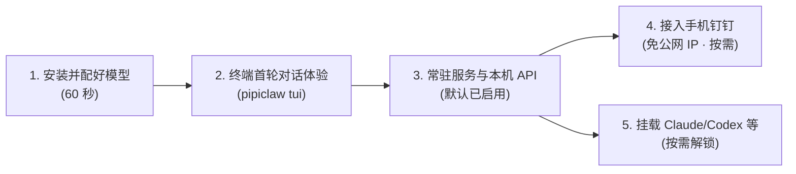

# 快速上手指南（Quick Start）

> **适合谁**：第一次安装 Pipiclaw，希望在几分钟内顺畅跑通对话、看懂核心玩法，并按需接入本机脚本、钉钉手机端与外部 Coding Agent 的开发者。
> **读完你会得到**：一套开箱即用的个人 AI 研发助手——终端即开即聊、本机 HTTP API 就绪、手机钉钉随时交办，且避开所有新手常见配置坑。

整套上手流程采用**渐进解锁**设计：**不需要先去钉钉建应用**，装好就能在终端和本机接口直接用；跑顺之后，再花 5 分钟按需挂上钉钉或外部 Coding Agent。



<details>
<summary>💡 <b>不想手敲命令？复制这段话发给你本机的 Claude Code / Codex / Cursor，让它替你装好</b></summary>

```text
请帮我安装并初始化 Pipiclaw：

1. 检查 Node.js >= 22.19.0，不满足就停止并说明。
2. 执行 npm install -g @oyasmi/pipiclaw；权限失败时不要自行 sudo。
3. 运行一次 `pipiclaw auth status` 初始化 ~/.pipiclaw/，并把终端打印出的初始默认 Web API 密钥（pk_...）如实保留告知我。
4. 询问我要使用环境变量 API Key、自定义网关（写入 ~/.pipiclaw/models.json，内附示例），还是由我自己运行 `pipiclaw auth login` 登录订阅账号；不要编造缺失值。
5. 如果我要接入钉钉，逐项收集 clientId、clientSecret、可选的 cardTemplateId 和 allowFrom，写入 channel.json 的 dingtalk 段并将 dingtalk.enabled 设为 true。
6. 配置完成后先询问是否启动。终端对话用 `pipiclaw tui --cwd .`；后台常驻服务用 `pipiclaw`（默认已开启本机 Web API Socket 与 http://127.0.0.1:8787/v1）。
7. 如实列出做过的操作、修改的文件、验证结果和仍缺少的信息，不要假装成功。
```

</details>

---

## 第 1 步：检查环境并安装（1 分钟）

Pipiclaw 运行在 **Linux / macOS**（Windows 请使用 **WSL2**），要求 **Node.js `>= 22.19.0`**：

```bash
node -v
# 确认输出 >= v22.19.0（若版本偏低，可用 nvm install 22 && nvm use 22 升级）

npm install -g @oyasmi/pipiclaw
pipiclaw --version
```

> [!TIP]
> 如果全局安装提示目录无写权限（`EACCES`），不建议直接 `sudo`，推荐使用 `nvm` / `fnm` / `volta` 管理用户态 Node.js，或配置用户级全局目录（`npm config set prefix ~/.npm-global` 并将 `~/.npm-global/bin` 加入 `PATH`）。

---

## 第 2 步：配置一个可用模型（三选一）

其实你现在直接敲 `pipiclaw tui`，程序也会自动初始化 `~/.pipiclaw/` 并弹出交互式模型登录引导。你也可以根据手头拥有的账号，从下面三种方式中**任选最顺手的一种**提前配好：

### 方式 A：交互式登录订阅账号或填写官方 API Key（最省心）

如果你有 **Claude Pro/Max**、**ChatGPT Plus/Pro（Codex）**、**GitHub Copilot**、**OpenRouter** 等订阅或官方 API Key：

```bash
pipiclaw auth login
```

- 按上下键或序号选择**认证方式**（订阅 OAuth 或 API Key）与**供应商**。
- 登录成功后，命令行会直接让你**一键选择默认模型**并自动写入 `~/.pipiclaw/settings.json`。
- **SSH 无头服务器提示**：如果运行在没有浏览器的远程服务器上，加上 `--device-code` 即可在本地电脑/手机浏览器输入验证码完成授权：
  ```bash
  pipiclaw auth login --device-code
  ```

### 方式 B：接入国内大模型 / OpenAI 兼容网关 / 本地 Ollama

如果你使用 **DeepSeek、通义千问（百炼）、硅基流动、智谱 GLM、火山方舟、企业内部 OneAPI/NewAPI 网关** 或本地 **Ollama**：

1. 先初始化一次配置目录（若尚未运行过）：
   ```bash
   pipiclaw auth status
   ```
   > 首次执行会在终端打印一把自动生成的本机 Web API 默认密钥 `pk_...`，顺手复制存一下即可（忘了随时能重置）。

2. 编辑 `~/.pipiclaw/models.json`，在 `providers` 下填入你的网关信息（以下以 DeepSeek 为例，其他 OpenAI 兼容接口只需改 `baseUrl`、`apiKey` 和 `models`）：
   ```json
   {
     "providers": {
       "deepseek": {
         "baseUrl": "https://api.deepseek.com/v1",
         "api": "openai-completions",
         "apiKey": "DEEPSEEK_API_KEY",
         "compat": {
           "supportsDeveloperRole": false,
           "supportsReasoningEffort": false
         },
         "models": [
           { "id": "deepseek-chat" },
           { "id": "deepseek-reasoner", "reasoning": true }
         ]
       }
     }
   }
   ```
   *(注：`apiKey` 既可以写环境变量名如 `"DEEPSEEK_API_KEY"` 并在终端 `export DEEPSEEK_API_KEY=sk-...`，也可以直接填写真实 `sk-...` 字符串，文件权限会自动收紧为仅当前用户可读的 `0600`。)*

3. 编辑 `~/.pipiclaw/settings.json`，把刚配好的模型设为默认模型：
   ```json
   {
     "defaultProvider": "deepseek",
     "defaultModel": "deepseek-chat",
     "defaultThinkingLevel": "medium"
   }
   ```

### 方式 C：直接用环境变量（零文件编辑）

如果你习惯用环境变量管理内置供应商密钥（默认模型为 Anthropic `claude-sonnet-4-5`）：

```bash
export ANTHROPIC_API_KEY=sk-ant-...
```

> [!NOTE]
> **服务器访问海外模型需要走代理？**
> 只需设置 `export PIPICLAW_PROXY=http://127.0.0.1:7890`——它只会代理发往大模型接口的请求，日后接入钉钉时不会干扰钉钉国内直连。详见[配置速查：LLM 请求走代理](./configuration.md#4-让大模型请求走代理pipiclaw_proxy)。

---

## 第 3 步：跑通终端对话，3 分钟感受核心能力

先用一行命令验证大模型链路已经彻底打通：

```bash
pipiclaw tui --print "只回复一句话：Pipiclaw 已就绪！"
```

看到回复后，进入你手头的任意一个代码仓库，用 `--here` 一键打开该仓库专属工位（或用 `--cwd .` 让默认的 `default` 工位直接指向当前目录）：

```bash
cd /path/to/your-project
pipiclaw tui --here
```

> **工位（Desk）与工作目录怎么理解？**
> 每个工位拥有独立的记忆、任务和绑定的项目目录：
> - 想为当前仓库建独立记忆与任务空间：直接用 `pipiclaw tui --here`（已有同目录工位会自动复用，没有则自动按目录名创建）；
> - 想让手机钉钉默认连接的 `default` 工位也操作这个仓库：用 `pipiclaw tui --cwd .`（或在聊天里发 `/desk cwd /项目绝对路径`）。只需设一次即持久生效！

进入对话界面后，推荐依次试一下这 **4 个小动作**，立刻体会它和普通命令行工具的区别：

1. **秒级查状态（不耗 Token）**：输入 `/status` 回车，查看当前生效的模型、思考档位与上下文占用；输入 `/help` 查看所有控制命令。
2. **读代码干真活**：发送 `帮我看一下当前项目的目录结构，用三句话总结核心入口在哪`。你会看到它实时展示工具调用进度并给出结论。
3. **中途实时纠偏（Steer）**：让它做一件稍微耗时的事（比如 `检查项目里最近 5 次 git 提交分别改了什么`），**趁它还在执行工具、没回复完时**，直接输入一句：`只用看最近 2 次就行，用表格输出` 并回车——它不会傻等跑完，而是在下一步立刻按你的新指示转向！
4. **跨会话记忆**：告诉它一句你的个人规矩，比如 `记住：在这个项目里跑测试一律用 npm test，不要直接调 jest`。退出终端（连按两次 `Ctrl-C` 或输入 `/exit`）再重进，或者发 `/memory list` 查看长期记忆。

---

## 第 4 步：启动后台常驻服务与本机 Web API（2 分钟）

在终端体验顺畅后，直接运行不带参数的 `pipiclaw` 即可启动**后台常驻服务（Daemon）**：

```bash
pipiclaw
```

你会看到清晰的中文启动看板：
- 本机 **Web API 已默认启用**：同时监听本机 Unix Socket 与 `http://127.0.0.1:8787/v1`。
- 此时打开**第二个终端窗口**：
  - 敲 `pipiclaw tui`：它会自动连上刚才启动的常驻服务（不再重复起新进程），与后台共享同一个工位、记忆与长程任务！
  - 用任意脚本或 `curl` 调你的助手（把 `<你的密钥>` 换成首次初始化时打印的 `pk_...`；如果刚才没存，直接运行 `pipiclaw webapi key add dev` 生成一把新的，**无需重启服务立即生效**）：

```bash
curl http://127.0.0.1:8787/v1/responses \
  -H "Content-Type: application/json" \
  -H "Authorization: Bearer pk_替换成你的密钥" \
  -d '{
    "model": "pipiclaw",
    "input": "你好！请列出你当前所在的工作目录。"
  }'
```

它兼容官方 **OpenAI Responses SDK**（Python / Node.js 改一行 `base_url="http://127.0.0.1:8787/v1"` 就能调，详见 [Web API 手册](./webapi.md)）。

---

## 第 5 步：免公网 IP 接入钉钉（5 分钟，手机随时派活）

想在地铁上、会议室里用手机随时给家里的开发机或云主机派活？Pipiclaw 使用钉钉官方 **Stream 长连接模式**——**不需要买域名、不需要公网 IP、不需要配内网穿透**，机器能上网就能连！

### 5.1 在钉钉开放平台创建机器人（避坑清单）

1. 登录 **[钉钉开放平台后台](https://open-dev.dingtalk.com/)**（若你没有企业组织，钉钉支持个人免费创建一个测试企业/团队，1 分钟即可开通）。
2. 进入 **应用开发 → 企业内部开发 → 钉钉应用 → 创建应用**，填个名字（比如 `我的研发助手`）。
3. 在左侧菜单点 **凭证与基础信息**，复制保存 **`Client ID` (AppKey)** 和 **`Client Secret` (AppSecret)**。
4. 在左侧菜单点 **添加应用能力 → 添加「机器人」**：
   - 完善机器人图标与简介；
   - ⚠️ **关键一步**：将 **消息接收模式** 切换为 **`Stream 模式`**（千万不要选 HTTP 模式）并保存。
5. ⚠️ **新手最容易漏掉的一步**：点击左侧 **版本管理与发布 → 创建新版本 → 保存并直接发布**（如果没发布版本，在钉钉客户端里是搜不到机器人的，或者发消息没有任何反应）。

*(可选加分项：想要丝滑的实时思考与工具进度流式卡片？可在[钉钉卡片平台](https://open-dev.dingtalk.com/fe/card)新建一个 AI 卡片模板，放置一个绑定变量名为 `content` 的 Markdown 文本组件并发布，复制模板 ID 填入下方 `cardTemplateId`。想先跑通完全可以留空 `""`，普通 Markdown 消息照样正常对话！)*

### 5.2 开启 `channel.json` 中的钉钉开关

编辑 `~/.pipiclaw/channel.json`，只改 `dingtalk` 段里的 3 处（`enabled` 改为 `true`，填入真实的 `clientId` 和 `clientSecret`）：

```json
{
  "dingtalk": {
    "enabled": true,
    "clientId": "dingxxxxxxxxxxxx",
    "clientSecret": "你的真实ClientSecret",
    "robotCode": "",
    "cardTemplateId": "",
    "cardTemplateKey": "content",
    "allowFrom": [],
    "busyMessageDefault": "steer",
    "responseMode": "full_progress_then_plain_final",
    "cardAutoLayout": true
  },
  "webapi": {
    "enabled": true,
    "socket": true,
    "tcp": "127.0.0.1:8787",
    "tls": null,
    "keys": [
      { "name": "default", "sha256": "保留原有的哈希即可", "desks": ["default"] }
    ]
  }
}
```

- `allowFrom: []` 表示企业内可见范围成员都能和它说话；如果只想让你自己一个人用，把你的钉钉 `staffId` 填进去即可（如 `["manager1234"]`）。

### 5.3 重启服务并在手机钉钉开聊

按 `Ctrl-C` 停掉刚才前台跑的 `pipiclaw`，重新启动：

```bash
pipiclaw
```

看到终端日志出现 `Connected and listening` 后：
- 打开手机或桌面钉钉，顶部搜索框直接搜你的**机器人名称**发起私聊（或把它拉进研发群 **@它**）；
- 先发一句 `/status` —— 秒回状态卡片即代表全链路打通！

---

## 第 6 步：解锁进阶装备（按需选用）

到这里你已经完成了全部核心上手！接下来可以根据日常习惯，花 1–2 分钟解锁它的完全体能力：

### 🤝 1. 挂载本机的 Claude Code / Codex / Cursor / Antigravity
如果你机器上已经装好并登录了 `claude`、`codex`、Cursor `agent` 或 Antigravity `agy`，把安装包自带的角色模板拷进工作区即可**免重启热生效**：

```bash
PIPICLAW_PACKAGE_DIR="$(npm root -g)/@oyasmi/pipiclaw"

# 按你本机实际装有的 CLI 挑选复制（示例包含主力编码档与只读独立审查档）
cp "$PIPICLAW_PACKAGE_DIR"/examples/sub-agents/{claude-main,codex-main,codex-review}.md \
  ~/.pipiclaw/workspace/sub-agents/
```

在钉钉或终端发一句 `/subagents roles`，看到状态可用后，就能直接交办重活了：
> *"把导出模块重构为流式处理并补齐单测，交给 claude-main 完成，跑通测试后再让 codex-review 独立审查一遍 diff 把结论发我。"*

> [!IMPORTANT]
> 外部 Coding Agent 作为独立本机 CLI 进程运行，不经过 Pipiclaw 内置命令与路径守卫（除只读的 `codex-review` 外，示例模板默认开启自动执行参数）。详情请阅读[智能体委派指南](./sub-agents.md)。

### 🌐 2. 开启联网搜索与网页抓取
默认联网工具关闭。编辑 `~/.pipiclaw/tools.json`，把 `tools.web.enable` 改为 `true`（默认使用免 API Key 的 DuckDuckGo，也支持配置 Parallel、Tavily、Jina、SearXNG），在聊天框发送 `/reload` 即刻生效。

### 🛡️ 3. 用 `pm2` 托管为 24 小时常驻后台
不想每次关终端窗口就断连？用 `pm2` 一行命令常驻后台：

```bash
pm2 start pipiclaw --name pipiclaw && pm2 save
```

生产服务器推荐的 `systemd` 服务配置、日志轮转与备份恢复详见[部署与运维指南](./deployment-and-operations.md)。

---

## 新手常见问题速查（FAQ）

<details>
<summary><b>Q1：启动时报 <code>127.0.0.1:8787</code> 端口已被占用怎么办？</b></summary>

说明你本机有其他程序（例如 Cloudflare Wrangler 等）占用了 `8787` 端口。打开 `~/.pipiclaw/channel.json`：
- 想换个端口：把 `"tcp": "127.0.0.1:8787"` 改成 `"127.0.0.1:18787"`；
- 只用钉钉和 `pipiclaw tui`、不需要 HTTP 接口：直接改成 `"tcp": null` 即可（`pipiclaw tui` 走本机 Unix Socket，不受关闭 TCP 影响）。
</details>

<details>
<summary><b>Q2：为什么我在代码目录里发消息，助手却说当前目录是空的？</b></summary>

每个工位（Desk）默认工作目录是 `~/.pipiclaw/workspace/desk-default/`。只需在聊天框发送：
```text
/desk cwd /你的项目绝对路径
```
或者从终端进入项目目录执行一次 `pipiclaw tui --cwd .`，该工位就会持久记住这个代码仓库路径（钉钉端和终端共享该工位目录）。如果你同时推进多个互不相干的代码仓库，直接在各个仓库目录下执行 `pipiclaw tui --here`（或在聊天里用 `/desk new <新工位名> <项目绝对路径>`）即可为每个仓库建立独立工位。
</details>

<details>
<summary><b>Q3：钉钉里给机器人发消息没有反应，怎么排查？</b></summary>

按顺序检查这三项，99% 能立刻定位：
1. **看终端日志**：发消息时 `pipiclaw` 终端有没有打印 `agent.turn.started`？如果完全没动静，回钉钉开放平台检查机器人是否选了 **Stream 模式**、且在 **版本管理与发布** 中点击了**发布**。
2. **看白名单 `allowFrom`**：检查 `~/.pipiclaw/channel.json` 中 `dingtalk.allowFrom`——测试阶段建议先设为 `[]`（填姓名或手机号无效，必须填钉钉 `staffId`）。
3. **看卡片模板 ID**：如果填了 `cardTemplateId` 却报错，先把它改为空字符串 `""` 重启测试普通消息，确认对话跑通后再核对卡片模板变量名是否为 `content`。
</details>

<details>
<summary><b>Q4：忘记了首次初始化打印的默认 Web API Key 怎么办？</b></summary>

出于安全设计，Pipiclaw 从不在磁盘存储明文密钥（只存 SHA-256）。直接执行下面两行命令即可重置一把新密钥（运行中的服务会自动热加载，无需重启）：
```bash
pipiclaw webapi key remove default
pipiclaw webapi key add default
```
</details>

---

## 下一步去哪看？

- 📘 **[交互与命令手册](./interaction-and-commands.md)**：掌握 `/steer`、`/followup`、`/stop`、`/desk`、`/tasks` 等全套丝滑控场技巧。
- ⚙️ **[配置速查手册](./configuration.md)**：一页搞懂 `~/.pipiclaw/` 下 6 个配置文件各自管什么。
- 🛤️ **[事件与长程任务](./events-and-tasks.md)**：让助手在后台跨小时推进复杂工程，或设置零 Token 消耗的 Cron 定时巡检。
- 💡 **[使用杠杆（Leverage）](./leverage/README.md)**：进阶实战心法——如何把日常研发真正从“手拧扳手”升级为“自动车床”。
