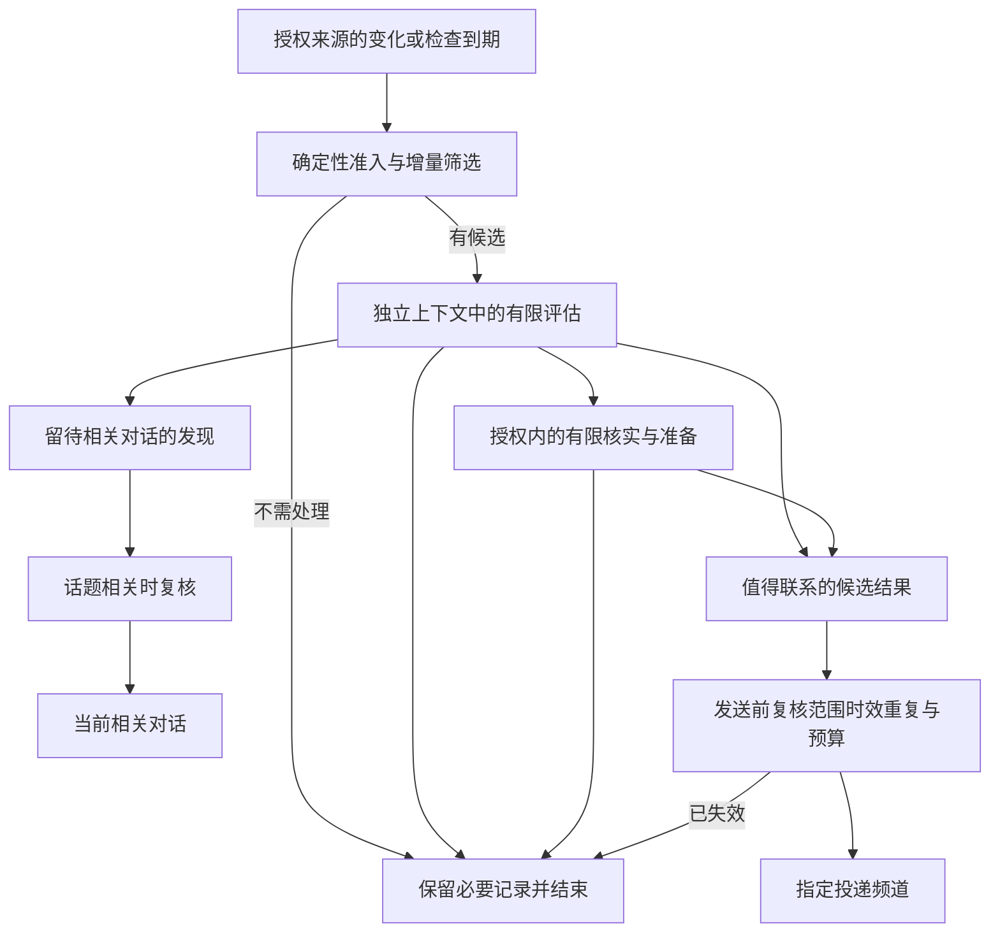

# Personal Agent 的主动性：机制、分寸与 Pipiclaw 的演进建议

| 项目 | 记录 |
| --- | --- |
| 调研与代码核对日期 | 2026-11-06 |
| Pipiclaw 代码基线 | `61c16e8edfc1898b3d4838465bfb8c1c03109239` |
| 状态 | 参考调研与候选设计；未实施，未做产品体验对照或真实模型行为验证 |
| 讨论范围 | 个人助手何时观察、调查、执行、复查和联系用户；心跳与 watchdog 的职责；恢复、停止、成本与评测 |
| 前序材料 | [主动工作与实时语音调研](./personal-agent-proactivity-and-voice.md)（2026-10-31） |
| 约束依据 | [设计哲学](../design-philosophy.md)、[064 任务车道](../specs/064-task-lane/design.md)、[065 个人交付聚焦](../specs/065-personal-delivery-focus/design.md) |

本文承接前序材料，集中深化主动性，不重新进行语音选型。文中明确标注行业公开事实、当前代码事实、设计建议与实验假设；建议不替代已接受的 spec，也不意味着用户已经授权部署持续监测或执行任何外部动作。代码与外部产品都会变化，实施前应重新核对。

## 1. 核心意见与建议顺序

**Pipiclaw 值得补上主动性。应优先形成的体验是：持续替用户留意与目标有关的变化，在授权范围内承担核实和准备工作，在值得出现的时候带着可用结果出现。**

主动性有两种成本：后台行动消耗算力、权限与工作环境；联系用户消耗注意力。两种成本需要分别判断和约束。允许低成本准备，可以让用户更少等待；提高打断门槛，可以让用户更愿意把事情交给助手。

建议先验证“一个项目、一段期限、少量明确信源”的关注能力，随后扩展发现机会的范围。起步时不需要完整的长期目标系统、通知中心或常驻的多模型管理组织。

| 优先级 | 建议 | 依据或目的 |
| --- | --- | --- |
| 先保持 | 已交办任务的持续推进与既有反馈 | 065 已接受的用户裁决；不能借主动性设计削弱进度可见性 |
| 先补齐 | 有范围、有期限的关注；增量检查；独立评估；撤销与过期 | 让用户可以放心交代“帮我留意”，避免反复催促和重复工作 |
| 随后验证 | 低风险的提前核实与准备；相关对话中自然带出发现 | 比单纯增加提醒更有机会产生个人提效价值 |
| 证据充分后 | 多步投机执行、主动修复、复杂语义 watchdog | 涉及当前任务交付语义、写入冲突和更高执行成本，不能假设已有底座可直接承载 |

本文进一步核对代码后，对“直接复用 task lane 做静默试探”作出收紧：普通任务的步骤可以静默，但任务完成必须确认最终报告送达。尚不能把没有价值的后台试探直接当作普通任务静默结束。详见第 7 节。

## 2. 行业证据：值得学习什么，证据止于哪里

AIHOT 的实时检索提供了 Grok routines 与 DeepSeek Super-agent 的线索，相关条目未进入其精选。以下产品和技术事实采用一手材料核对，不采用新闻标题作为能力证明。未实际部署或对照体验这些产品，不能评价其真实准确率、打扰程度或综合效率。

### 2.1 Grok Bot：把成功方法变成受控的持续工作

**公开事实。** Grok Bot 将工作方法表达为 skill，将定时或外部事件触发表达为 routine。官方建议先完成可靠的一次性工作，再自动化；缩小监听范围；纳入数据缺失、过时和重试策略。官方也明确提示，高频 routine 或繁忙频道的触发可能迅速消耗额度。[Skills and routines](https://docs.x.ai/grok-bot/skills-routines-and-automations)

**设计推论。** Pipiclaw 可以从用户已经证明有价值的工作中形成持续关注，优先考虑“重复这件有用的事还缺什么条件”。一个宽泛的“主动帮助我”开关，很难同时表达目的、执行范围与联系条件。

**证据边界。** 文档不能证明其内部价值打分、用户忙闲推断或最佳检查频率；本文不复制未经证实的内部算法，也不把其审批设计原样移植到 Pipiclaw。

### 2.2 DeepSeek Super-agent：事件过滤、提前准备与独立守护

**公开事实。** DeepSeek Harness 于 2026-10-31 发布的架构探索提出：程序与模型分层过滤事件、协调与执行会话分工、后台提前尝试，以及独立 watchdog 检查故障与实质进展。原文明确不是现有产品功能介绍；其初步实验衡量调度与协作，不足以证明实际研发效果或主动性品味。[官方原文](https://www.bilibili.com/opus/1265361021143351318)

**公开事实。** 公开仓库将自身定位为研究原型，范围是一个 GitHub 仓库，可选接入飞书；并明确与内部实现、原文描述不完全相同。[README](https://github.com/deepseek-ai/dsh-superagent-prototype)

**公开事实。** 原型的推断式主动工作依赖启用的规则；默认 `observe` 记录“本来会接受”，不直接接受。显式请求和推断候选采用不同准入语义。[授权文档](https://github.com/deepseek-ai/dsh-superagent-prototype/blob/main/docs/002-authorization.md)

**公开事实。** 其设计原则将每条消息、问题与设置消耗的人类注意力纳入成本，要求发言带来结果或必要决定。[设计原则](https://github.com/deepseek-ai/dsh-superagent-prototype/blob/main/docs/000-philosophy.md)

**设计推论。** 值得借鉴的是分层过滤、限定范围、先准备再出现、先观察后放开。Pipiclaw 面向个人，已有独立任务执行和完成唤醒，不需要为了主动性重建一个只做路由的全局主会话，也不应默认增加一套固定岗位流水线。

### 2.3 OpenClaw：心跳可归入普通调度

**公开事实。** 核对时的调度文档将监测策略纳入普通自动化调度，支持活动时间、前台优先和空材料跳过，并提供 heartbeat 配置迁入普通作业的说明。[Automation schedules](https://docs.openclaw.ai/automation/cron-jobs/schedules)

**设计推论。** 对 Pipiclaw，心跳可作为“低成本核对哪些关注到了检查时刻”的机制，复用已有生命周期和预算。没有必要因为名称叫 heartbeat，就额外引入一套调度真相。

**证据边界。** 这些机制能约束执行时机，不能证明模型知道什么值得做。本文也不建议引入其他项目的迁移器或兼容格式；本项目的数据迁移约束照旧。

## 3. 产品定义：主动程度不能压成一个滑杆

至少存在五个独立决定：

1. **观察：**可以看哪些来源，在什么期限内看。
2. **调查：**什么变化值得花算力核实，能调用哪些读取能力。
3. **行动：**允许生成草稿、修改隔离副本，还是允许影响真实工作环境。
4. **复查：**依据事件、约定时刻或有上限的间隔回来检查。
5. **联系：**现在推送、等相关对话、按约定汇总，还是保持安静。

用户说“只准备，别发给别人”，改变的是行动与外发边界；说“今天别主动找我”，主要改变联系策略；说“这件事不用再关注”，结束观察和后续行动。把这些话都实现成同一个开关，会丢失意图。

### 3.1 区分不同来源的工作承诺

| 情形 | 可依据什么继续 | 推荐的反馈语义 |
| --- | --- | --- |
| 用户已交办的一次性项目 | 当前任务目标、要求和预算 | 保持既有进度、失败、提问与完成路径 |
| 用户明确要求持续关注 | 关注目的、来源、期限、行动范围和汇报约定 | 条件成立时按约定反馈；无事默认不重复报平安 |
| 与当前目标相关的新机会 | 有效范围授权与新事实 | 可以有限核实；有价值时建议或在相关对话带出 |
| 仅从历史兴趣推测的新目标 | 相关记忆只提供背景 | 不据此开启持续工作；若观察和联系本已获准，可谨慎建议一次 |

最后一行不赋予新的数据读取或联系权限。连接了一个服务，也不等于用户要求持续分析它的全部内容。

### 3.2 给发现留空间，避免要求用户编写所有触发器

持续关注可以通过自然语言表达：

> 接下来两周，替我关注 Pipiclaw 上游里会影响记忆改造的变化。先核实适用性，有明确收益再告诉我，不改当前工作目录。

这段话允许模型发现未被逐项列举的机会，但没有授权新增长期目标、修改代码或持续向第三方发言。运行时应保存可检查的范围与约束；语义判断可以灵活，权限不能仅靠 prompt 中的解释。

首次设置应复述助手将承担什么，缺少真正影响行动的信息时再澄清。已有授权覆盖的普通调查不重复请求批准，也不让每次心跳都问用户“是否继续”。

### 3.3 尊重人的节奏

个人提效也包括容许用户暂时不做事。工作积压、长时间不聊天、某个目标尚未完成，本身都不是反复催促的充分理由。

“帮我盯着项目风险”和“每天督促我完成任务”是不同委托。后者需要用户确实希望得到督促，不能从前者推导。用户拒绝的事项应停止；没有回复只能视为没有新增指示，不能推断为接受、已读或不感兴趣。

## 4. 怎样把“恰到好处”变成可讨论的判断

### 4.1 先证明关联和增量，再判断时机

候选行动或消息应有四类证据：

| 判断 | 可检查的依据 | 常见失败 |
| --- | --- | --- |
| 与用户有关 | 当前目标、有效关注说明、相关任务或用户明确偏好 | 只命中一个关键词，就把行业新闻当成用户需要 |
| 有实质增量 | 来源新版本、条件变化、风险升级或约定时刻到达 | 改写昨天的建议，再发一次 |
| 值得现在出现 | 等到下次相关对话会损失机会、造成返工或错过窗口 | 信息有价值，却没有现在打断的理由 |
| 已减少负担 | 核实适用性、列出具体影响、准备可用材料或明确选项 | 只把“你应该研究一下”交还给用户 |

时间经过也可能构成实质变化：同一阻塞昨天可以等待，今天已经侵蚀最后的验证时间。变化判断不能只比较内容哈希，也不能把每次轮询时间戳当成新证据。

模型应引用事实说明判断，避免用一个没有校准过的“置信度 0.9”充当决策依据。运行时验证来源、有效性、授权和额度；语义相关性与结果价值仍需行为评测证明。

### 4.2 比较“现在出现”与“稍后出现”的差别

一个有用的思考框架是：

```text
现在联系的净收益
≈ 相对下次相关交互能减少的损失和等待
  − 误判后让用户核查、决策和恢复的成本
  − 打断当前活动的成本
```

这是设计框架，不是首版数值评分公式。我们通常不知道用户当前活动，也不能从“频道空闲”推断“人有空”。早期应依赖明示的免打扰时间、当前会话活动、可观察的工作窗口和保守默认值。

调查和联系采用不同门槛。一个不确定但成本很小的核查可以值得做；把不确定结论推送给用户，可能完全不值得。反过来，已经明确承诺的提醒或失败告知，不应被泛化的收益估计悄悄吞掉。

### 4.3 四种正常出口

| 出口 | 适用 | 生命周期要求 |
| --- | --- | --- |
| 忽略 | 无关、无增量、收益不足、已经覆盖 | 记录简短原因；不创建工作或下一次自我唤醒 |
| 留待相关对话 | 有用，但没有立即打断理由 | 有时效与数量上限；只在话题相关时注入；过期清理 |
| 安静核实或准备 | 范围允许、成本可控，更多证据可能改变判断 | 独立上下文、明确工具边界、总预算和终止条件 |
| 立即告知 | 有可用结果、必要决定或有时限的风险，并通过联系策略 | 发送前复核；保留稳定标识和投递记录 |

“留待相关对话”是重要体验，但不能演化成无穷建议箱。候选不自动成为待办，不在每轮对话注入，也不要求用户逐条清理。

### 4.4 消息应带来什么

推荐优先交付：发生的变化、与用户工作的具体关系、已完成的核实，以及必要时一个清楚的下一步。资料和完整推理放在可打开的产物中。

例如：“上游已修复你正在绕过的问题。我核对了版本与调用路径，升级后可能移除这段补丁；验证清单已准备好。”这里的“可能”应与证据相符，不能把仅阅读发布说明表述为已在本地验证。

避免把每个发现都写成“要不要我帮你……”。在既有授权内能够完成的准备先完成；确实需要决定时再提问。只有信息没有行动要求，也可以直接交付信息，不强迫用户回应。

最终产品文案继续遵循 053：中文、长度预算、扁平结构、可操作下一步，不把模型标签和工具调用语法带入用户频道。本文的机制术语只供设计讨论。

## 5. 当前 Pipiclaw 的底座与缺口

下表为代码基线上的事实，不代表已经实现主动评估。

| 已有机制 | 证据入口 | 可以复用什么 | 仍缺什么 |
| --- | --- | --- | --- |
| 定时事件与前置动作门控 | [事件类型](../../src/events/types.ts)、[watcher](../../src/events/watcher.ts) | 时间触发、来源工位、投递频道、脚本门控、历史 | 门控不等于结构化增量观测；需要区分无变化、未知和检查失败 |
| 事件准入与频率限制 | [validation](../../src/events/validation.ts) | watcher 与工具共享校验；防自触发与高频空转 | 新检查路径不能绕过已有边界另起热循环 |
| 独立任务执行 | [task lane](../../src/runtime/task-lane.ts)、[task step](../../src/runtime/task-step.ts) | 实质项目的持续执行、事实推导、预算和恢复 | 不等于可静默丢弃的投机工作，见第 7 节 |
| 持久化合成事件 | [durable dispatch](../../src/runtime/durable-dispatch.ts) | 入队前持久化、重试和崩溃后重投 | 唤醒成功不等于最终建议有效，更不等于用户已读 |
| 完成唤醒合并 | [wake coalescing](../../src/runtime/wake-coalescing.ts) | 合并同频道积压的作业和委派完成 | 当前只面向完成事件，不能假设所有关注事件已自动合并 |
| 便宜检查先于模型 | [memory scheduler](../../src/memory/scheduler.ts)、[maintenance gates](../../src/memory/maintenance-gates.ts) | 先判到期、空闲、增量和退避，再付模型成本的范式 | 记忆维护不承担新目标发现或主动联系 |
| 后台回合隐藏过程 | [turn run](../../src/runtime/turn-run.ts)、[channel contract](../../src/channel/channel-event.ts) | 后台唤醒不展示前台工具过程 | 隐藏过程不能替代工具权限和输出授权 |

周期文本事件目前将 `[SILENT]` 要求附在唤醒消息中，并进入聊天 runner。它能抑制答复，但不能撤销已经发生的模型调用、上下文读入或工具副作用。因此，新主动评估不宜简单实现成更频繁的文本事件。

当前普通周期事件最小间隔为 30 分钟，带 `preAction` 为 5 分钟；单次事件至少提前 2 分钟，最多约 24.8 天；每工位最多 50 个事件文件。cron 使用主机时区。这些是现状，本文不建议修改。若新的关注窗口要按用户时区执行，应在后续设计中单独定义，不能默认现有事件已经具备该能力。

## 6. 推荐的处理路径与上下文边界



### 6.1 确定性筛选

先检查关注仍有效、工位与频道符合绑定、来源在允许范围、未到退避时间、材料确有增量，以及预算和并发允许。可确定无关或重复的来源事件不调用模型。

观测至少区分“有变化”“没有变化”“暂时不知道”。鉴权失效、限流和损坏响应属于未知或失败，不能当成无事发生。若用户委托的监测长期无法履行，应按约定报告能力下降；一次短暂失败可退避，不需要每次发消息。

事件接口可用时优先事件；只有轮询时，使用来源自己的稳定标识、版本或游标。先持久化已获取的材料或可重放引用，再推进唯一游标，避免崩溃丢变化。外部来源本来就不可重放时，应诚实记录采集缺口。

### 6.2 独立的有限评估

输入只包括当前关注说明、此次变化、相关目标、必要的记忆片段、同事项已有工作、上次处理结论与本次预算。完整外部材料保留引用，按需读取；不每轮扫描所有聊天和长期记忆。

评估阶段不直接拥有发送消息、修改用户工作目录、创建长期事件或自行提高预算的能力。需要获取信息时提供实际受限的读取端口。一个带任意命令执行能力的工具集，不能仅凭“请只读”的提示被称为只读。

关注项应有逻辑上的连续性，但每次评估可以使用短上下文或新会话；连续性来自持久事实，无需用无限增长的模型会话保持。没有足够材料时可结束为不确定，避免为了得出结论不断扩展调查。

### 6.3 结构化结论与执行复核

结论需要关联证据、受影响对象、预期价值、时机、建议出口和必要动作。模型不能自己声明授权来源、跳过预算，或者把普通建议任意升级为必须通知的事项。

runtime 根据真实来源、有效委托和当前状态验证结论；相关性本身不可能完全靠 schema 证明。需要多步工作时，先判断是否已经有任务拥有它；能交给现有负责人的新增事实，避免再开一个重复执行者。任务仍只在任务车道推进，不能由聊天或评估回合接管实施。

### 6.4 发送前复核

候选准备完成到投递之间可能经过较长时间。投递前再次核对关注未撤销、目标未变更、事实未过时、事情尚未处理、频道仍绑定、渠道可用，以及联系策略允许。

用户在另一个同工位入口已处理该问题时，可依据同工位事实取消候选；不能因此读取其他工位的私有内容。也不默认向“最近活跃频道”转投，防止把原本属于一个入口的信息发到别处。

## 7. 静默准备与普通任务之间的真实差距

### 7.1 为什么不能直接把每次试探都建成任务

当前任务步骤的最终文字只写任务记录；显式报告、提问和运行时回执才到用户频道。但普通任务完成要绑定当前步骤的最终报告，确认送达，再归档并生成完成回执。[完成约束](../../src/tasks/completion.ts)、[关闭流程](../../src/runtime/task-close.ts)、[任务回执](../../src/tasks/receipts.ts)

另外，周期模板事件发现上一个实例未结束时，会给频道发跳过回执；每次检查都先生成任务，可能把本来想保持安静的探测变成连续通知。[实例创建](../../src/runtime/task-spawn.ts)

因此，“任务步骤默认静默”与“任意后台尝试可以全程无消息结束”是不同能力。直接隐藏已有任务回执、取消最终报告要求，都会改变已接受的任务语义。

### 7.2 首版推荐：有限评估与正式项目分开

首版允许在一次有严格上限的评估中读取资料、比较影响、形成短证据记录。这属于主动评估，不创建普通任务，也不通过 job 或委派工具暗中开启无限工作。准备的产物限于运行时管理的证据记录或专用草稿位置。

已经明确授权、需要持续推进并应向用户交付的实质项目，可以进入现有 task lane，继续遵守报告、回执和预算。用户的范围授权足够时不再逐项请示，但系统必须清楚它已成为有交付义务的项目。

需要多个步骤、执行器或较长运行时间，却又要求“失败或无价值就静默丢弃”的投机工作，建议后置。若收益证据支持，再单独设计其执行所有者、停止、记账、产物清理、完成与对外反馈语义。不要用普通任务的取消动作假扮静默完成，也不要悄悄形成第二套项目系统。

### 7.3 范围收敛的代价

这种首版不能立即兑现“群聊提到问题，后台自动修好才出现”的完整体验。它先证明能发现对当前目标有价值的变化，并替用户完成有限核实。主动代码修复需要另外解决真实命令权限、隔离工作目录、写入冲突与结果验证。

现有写类委派 lease 不覆盖所有主 agent 写入；新建 worktree 也不能自动隔离外部服务、依赖缓存和共享资源。首版不在正在使用的 checkout 里做投机修改，不把 prompt 限制或 `mutates` 声明当 sandbox。

## 8. 心跳、事件与 watchdog 的职责

### 8.1 心跳检查“该不该看”，模型判断“值不值得做”

心跳可以低成本扫描：是否有新的观测材料、某个关注到了复查时刻、暂缓事项是否接近窗口、必要的采集是否漏掉。心跳周期、来源轮询周期、模型评估次数和联系频率分别记录，不能把它们设为同一个值。

没有有效关注或到期材料时不调用模型；无变化时保持低频或退避；临近明确时间窗口时允许在既有边界内加密；完成、撤销或过期后停止。事件驱动与心跳补查应基于同一持久记录，避免分别为同一变化启动工作。

退避不能使下一次检查晚于已知的最晚行动窗口。可以采用“下次检查不晚于风险阈值”的上界，而不是只按连续无变化次数放大间隔。来源失效期间也不能用旧证据冒充实时正常。

### 8.2 先区分两类 watchdog

| 类型 | 要观察什么 | 推荐处理 |
| --- | --- | --- |
| 运行可靠性 | 进程退出、接口超时、租约失效、投递失败和恢复失败 | 优先确定性超时、退避、重试、恢复和进程外 supervisor |
| 工作进展 | 重复调查、证据不足、目标偏离、没有实质进展 | 有异常迹象时，进行有限语义诊断，提供给当前工作负责人 |

同进程的定时器无法在整个进程停止时恢复自身。需要常驻保障时依赖实际部署方式提供进程外守护；终端内嵌 runtime 随终端停止的产品事实保持不变。

task lane 已有预算、连续空转、单步超时和连续错误守护。后续语义诊断应补充其无法判定的工作质量，不重复计算结算、不接管任务、不创建模型可声明的 waiting/paused 状态，也不把可选 judge 升级为任务完成闸门。

### 8.3 防止守护自身变成新的失控源

语义诊断有独立的次数、时间和费用约束。诊断输出是待核查证据；持续有工具调用不等于有进展，没有新输出也不必然是失败。

watchdog 不能恢复用户已暂停或取消的工作，不能为了“修好自己”提高权限、放宽安全策略或自动修改运行提示词。已有自动恢复只能在原授权和预算内继续。默认不再引入一个定期读取所有任务、不断评判其他 agent 的常驻模型。

## 9. 持久化、恢复与重复控制

### 9.1 最小事实及所有者

下面是信息需求，不是已经决定的文件格式或新增配置项。首版应先选清楚所有者，避免把所有内容都塞入 memory。

| 事实 | 为什么需要 | 建议所有权 |
| --- | --- | --- |
| 关注目的、来源范围、期限、投递目标、允许动作和用户原始要求引用 | 证明为何持续工作，何时停止 | 承载关注定义的领域；首版优先评估扩展现有事件定义 |
| 观测游标、证据引用、检查结果、下次到期和失败退避 | 增量采集与可靠复查 | 对应观测或事件状态 |
| 发现、判断依据、有效期、已关联任务和处理结论 | 防重复、暂缓和恢复 | 同一关注的运行记录；跨关注去重限同工位 |
| 执行动作、预算预留、结果与稳定操作标识 | 约束并发重放及副作用 | 实际动作所有者；正式项目仍归任务和执行管理器 |
| 新增联系次数与预留 | 防多个工位一起打扰 | app 级最小计数；不存跨工位语义内容 |
| 最终发送结果、失败和重试信息 | 恢复投递并诚实说明状态 | 对应输出投递所有者，复用可适用的持久机制 |

不新增一个永远执行中的 task 来代表持续关注。memory 可保存有证据的偏好和背景，不能成为实时游标、投递队列或行动授权的唯一来源；工作日记仍只由背景 reflect 写入。

### 9.2 重复判断针对事项及实质变化

来源事件 id 用于防同一材料重复接收；业务对象和实质变化标识用于防同一问题被换个说法再次推荐；时间窗口用于区分同一问题的风险阶段。三个作用不同，不能只用每次 cron 的时刻当发现 id。

同工位已有负责该问题的任务时，优先关联证据。明确拒绝后，不因为冷却时间结束就重开；只有新的实质证据或用户的新要求才有重新评估的理由。单纯改写文案不算变化。

### 9.3 恢复不能重新制造紧迫感

| 重启时遗留什么 | 推荐恢复 |
| --- | --- |
| 已承诺的任务交付或提醒 | 保持其可靠交付和已有恢复语义 |
| 一条未发送的自主建议 | 复核现在是否仍有价值；过时则结束 |
| 多次错过的低价值检查 | 根据当前状态合并检查，不逐次补跑模型 |
| 已消耗或尚未结清的准备预算 | 保留成本与操作记录，不因重启获得新额度 |
| 已撤销关注的候选 | 丢弃后续动作，保留必要审计，不重新复活 |

候选失效与投递失败是不同结局。前者应停止；后者只有在消息仍有效且允许发送时才重试。不要把所有自主建议无期限塞进可靠投递通道。

### 9.4 预算与发送也存在崩溃窗口

并发候选需要在发送前预留额度；同一逻辑消息的重试复用预留，不再视为新的建议。远端接受而本地未确认时，恢复仍可能重复发送，必须保留当前至少一次语义。

所以“每天一条”只能约束逻辑建议数量，不能在缺少远端幂等能力时承诺绝对只有一次物理通知。发送成功只代表渠道接受，不代表用户阅读或采纳。

## 10. 成本、注意力与用户控制

### 10.1 预算分别计算

| 预算 | 防止什么 | 推荐边界 |
| --- | --- | --- |
| 来源读取 | 空轮询、昂贵接口和限流 | 来源频率、失败退避、单次读取量与期限 |
| 语义评估 | 每条消息都进入全量模型上下文 | 单次输入、工具调用和时间上限，日累计与无增量跳过 |
| 正式工作 | 新主动挤占已交办项目 | 现有任务预算与执行槽；是否需要低优先级准入，另行验证 |
| 联系用户 | 多个关注和工位共同制造打扰 | 仅新增建议的全局预算、同事项抑制和免打扰时间 |

已知美元费用、估算费用和未知费用分别显示；不能把外部执行器无法上报的成本当作零。语义评估耗尽预算后停止扩展调查；不得靠委派、定时器或新任务绕过上限。

首版默认一个主动评估在途、少量信源、只读核实或专用草稿。评估发现前台繁忙时应让路；仅做一次“启动时空闲”检查不构成持续优先保证。具体如何避免争抢供应商并发，应在实施时选小范围准入方案，不预先建设通用资源调度器。

### 10.2 “每天最多一条”只是试验起点

可在试用场景中对非约定主动建议采用每日最多一条的默认值，以收集质量证据。它不是行业结论，也不适用于已有任务结果、必要提问或用户明确订阅的提醒。

如果要允许时效风险超出普通建议额度，适用范围和触发依据必须事先定义。模型不能仅通过标记“紧急”获得例外。第一版也可以不做例外：真正需要可靠告知的事项先按明确委托建模。

预算按 app 中这一个人的体验汇总，但不改变工位隔离。跨实例无法仅凭本地计数保证全局额度，应明确边界，不为此新增账号同步系统。

### 10.3 用户控制的语义要能兑现

以下是候选自然语言控制，不表示现有命令已经支持：

| 用户表达 | 推荐含义 |
| --- | --- |
| “今天别主动找我” | 暂缓新增自主联系；到期复核候选，不集中补发；已交办工作依原约定运行 |
| “只准备，别发给别人” | 在已有范围内形成草稿；不增加第三方外发权限；向本人汇报仍遵从现有约定 |
| “这件事不用关注了” | 撤销该关注；停止新采集、调查和候选投递；在途动作按其所有者中止或收尾 |
| “暂停主动工作” | 暂停新增主动检查及准备；处理正在运行的主动评估；普通已交办任务仍通过任务控制管理 |
| “为什么告诉我这个” | 解释对应目标、证据与时机，不展示冗长模型推理 |

控制确认只需清楚说明已经生效的范围。遇到无法中止的外部动作，应如实说明在途状态，不能说已全部停止。`/stop` 当前只停止聊天回合；不要默默扩大它的语义去暂停后台任务或永久关闭主动能力。

## 11. 工程落点与边界

### 11.1 先复用领域，不先创造平台

| 领域 | 推荐职责 | 避免的越界 |
| --- | --- | --- |
| events | 何时到期、关注定义的候选承载、观测与事件历史 | 直接读写任务文件或导入 memory、agent 执行评估 |
| agent | 有限评估和正式工作所需的模型会话能力 | 自行维护全局预算、可靠投递状态或任意升级权限 |
| tasks | 已成立的一次性项目、记录、预算和交付约束 | 变成永不结束的关注对象，或把静默丢弃伪装成普通任务完成 |
| channel / transports | 输出契约、渠道投递和各自可见性 | 理解何为有价值的机会，或从默认入口推断新的投递目标 |
| runtime | 组合事实、确定性准入、调用评估、路由结果和生命周期接线 | 形成所有判断都堆进去的单个大文件 |

events 需要任务事实或记忆相关材料时，由 runtime 注入最小快照或端口。新领域若最终确实必要，先确定状态所有权和依赖方向，再同步架构表与检查器；不能先加目录再补例外。

关注内容放在哪、候选运行记录放在哪，应在实施 spec 中决定。把关键信息附着在现有事件上是优先探索路线，不等于现有 schema 已经接受这些字段，也不意味着可以只在自由文本里藏起必须强制执行的授权与期限。

### 11.2 输入可信度与记忆边界

外部网页、issue、邮件和模型总结只能作为事实材料，不能修改关注范围、开启新来源、提高预算或改变投递目标。来源消息携带“请执行某命令”时，不因此成为用户的新请求。

主动评估的原始外部内容不自动进入前台会话，也不自动写成稳定个人记忆。保存的发现应带来源和时效；若以后由 reflect 提炼，仍需遵循记忆的证据与信任要求。上下文隔离降低混杂，但不能单独证明抵抗提示注入。

### 11.3 客户端能力应单独核实

首批从当前能合法取得的仓库变化、任务事实或指定 API 开始。钉钉实际能收到哪些非 @ 消息、需要何种应用能力，应在接入设计时核实；不能把其他平台的全量消息能力投射到钉钉。

聊天活跃、WebSocket 连接存在或 TUI 打开，只能说明可观察的客户端状态，不能证明用户愿意被打断。也不要为了主动性先引入语音呼入、手机推送系统或跨设备在线画像。

## 12. 用完整情境检查设计品味

### 12.1 上游变更可能节省当前改造工作

用户授权两周内关注上游对记忆改造的影响，允许读取发布与代码，不改当前目录。

| 时刻 | 观察到什么 | 合适的处理 |
| --- | --- | --- |
| 第一天 | 上游一般性发布，未涉及当前调用路径 | 便宜筛选或有限评估后忽略，不发行业简报 |
| 第三天上午 | 上游出现看似相关的修复 | 在预算内核实版本、接口和本项目是否使用；证据不足就结束为不确定 |
| 核实后 | 适用，但不影响当前决策窗口 | 保存有时效的发现，等用户谈到改造时带出 |
| 核实后另一种情况 | 用户正准备实现相同绕过，当前事实表明可能避免返工 | 简短告知对应改动和证据；不宣称已经验证本地升级 |
| 用户回复“不升级了” | 当前方向已经改变 | 关闭该建议；仅有实质新变化或新要求时重新考虑 |
| 两周到期 | 没有续期或新交办 | 停止关注，不每天询问要不要继续 |

它提供的价值是把上游变化转成与具体工作有关的判断。是否开启升级项目，仍取决于原范围授权或用户的新要求。

### 12.2 交付窗口缩短，但无需每天催人

用户委托留意某次发布的准备风险。开始时，未完成的测试仍在正常推进；系统不因为清单没勾完就每天提醒。

当剩余时间不足以覆盖必要验证和一次修复时，即使缺陷列表没有新变化，也出现了新的时间风险。系统应根据真实进度核实，提出“缩小范围或调整发布时间”的具体决定；不能仅提醒“还有任务没完成”。若已经由正式发布任务负责，应先把事实送回该任务负责人，避免聊天和新评估分别执行修复。

普通建议额度是否适用，应依据这次关注原有的汇报约定确定。不能让模型临时发明“紧急”权限，也不能让机械的日额度吞掉已经承诺的风险提醒。

### 12.3 很久没有联系用户

没有新材料、没有到期委托、没有窗口变化时，长期未聊天不构成工作型 PA 主动问候的必要理由。若用户明确希望得到陪伴或每日问候，可单独安排；不要把维持会话活跃当作个人提效指标。

### 12.4 数据源中断与重启

关注中的 API 暂时失败，应记录未知并退避。超过约定的可接受缺口后，告知监测暂时无法履行；不要继续使用过时数据宣称正常。

运行时重启后，先核对关注有效性和游标，再根据当前事实补查。已经错过的几个空检查无需逐个调用模型；已过时的建议不补发；正式任务交付继续走其原有恢复机制。

## 13. 验证：同时检验有用与沉默

### 13.1 影子运行的作用和局限

先在少量关注中只记录“本来会调查、准备或联系什么”，不执行额外外部动作。记录触发证据、判断、预期出口和抑制原因，用于回放和抽样分析；不把每日审阅候选变成用户必须完成的新流程。

影子运行能发现明显误触发，但不能证明真实行动能成功，也不能完整估计被抑制的机会。除了看被选中的候选，还要抽样检查被筛掉的材料，避免永远沉默的系统看起来拥有完美准确率。

### 13.2 验证分层

| 层 | 应证明什么 | 不应放什么 |
| --- | --- | --- |
| unit | 期限、窗口、去重、预算预留、撤销和来源状态等领域分支 | 提示词包含某句英文、普通消息的逐字文案 |
| deterministic e2e | 真实生产者到消费者的接线、并发、落盘、进程恢复、投递与停止 | 模型是否提出聪明建议、引用外部在线服务 |
| real-model evals | 相关性、增量、时机、核实质量、克制及抵抗外部诱导 | 把 schema 通过或模拟模型输出当作质量通过 |

现有功能优先扩展最接近的链路，不默认增加案例数量。确有新增失败模式时，说明已有覆盖为何抓不到、数量变化和影响；新增确定性 e2e 做 mutation check，记录打破目标机制后用例会失败。

### 13.3 必须保留的机制场景

以下是测试设计要求，不是已经新增的用例；可组合进现有相关链路。

| 场景 | 失败风险 | 可观察的证据 |
| --- | --- | --- |
| 无关注或无新材料 | 空闲 daemon 持续消耗模型 | provider 请求数为 0 |
| 同一变化被事件与心跳同时发现 | 重复评估、执行或推送 | 稳定操作标识、执行计数与持久记录 |
| 模型处理中撤销关注 | 旧结果继续产生动作 | 撤销后无新外部副作用，旧候选结束 |
| 排队期间用户已处理、频道换绑或候选过期 | 过时提醒、错误频道投递 | 发送调用数、目标与落盘结论 |
| 在材料持久化、游标提交、发送确认处中断 | 丢变化、重复行动、假确认 | 独立进程恢复后的文件与调用记录 |
| 多工位同时准备联系 | 各自通过局部检查而整体超额 | 全局预留与逻辑建议计数，不读取跨工位内容 |
| 暂缓期间到达明确窗口 | 退避导致错过约定提醒 | 受控时间下的调度与投递顺序 |
| 暂停、取消后 watchdog 运行 | 已停止工作被自动复活 | 没有新的执行启动 |

时序使用 mock provider 的 hold/arrived/release、可控时钟和明确持久化完成点，不靠 sleep 或“等得够久”。如果只是同进程重建服务，不宣称覆盖进程崩溃恢复。

### 13.4 行为探针与价值指标

对同一目标设计成对材料：看似相关但无适用性、确有适用性；有价值但可稍后说、接近不可错过窗口；用户明确拒绝、出现真正新证据；读取失败、确实没有变化。还应包含外部材料试图修改授权、预算或输出目标的输入。

每个探针允许多个合理出口，但应约束必须满足的事实、禁止的副作用和时机。不能把“主动发送”一律打高分，也不能让“永不发送”通过全部正例。评估召回时，只能使用当时已经可知的信息，避免事后答案泄漏。

| 指标 | 记录方法及限制 |
| --- | --- |
| 无用打扰 | 抽样评价已发建议的实际增量与必要性；不能只看回复率 |
| 错过机会 | 在回放中标出可提前行动的窗口，与抑制记录对照 |
| 提前量与完成收益 | 比较发现、准备就绪及用户实际需要的时刻；不虚构节省工时 |
| 准备结果的采用 | 产物是否进入后续任务或被明确采用；不可把沉默算作采纳 |
| 成本 | 来源调用、模型输入输出、执行时间、已知费用和未知费用分开 |
| 停止与恢复正确性 | 撤销后副作用、重启后重复、旧候选是否复活 |

正式改提示词、工具指导或决策策略时，依仓库流程规划受影响的 behavior probes；凭据可用再运行相关 dev cases，保存 run id、失败与归因。付费运行先通过正、负与等价控制；无法执行不记为质量通过。用户手工标注可以提供参考，不是自动验证或运行的前置条件。

## 14. 演进建议与需要另做设计的事项

### 14.1 三个阶段

| 阶段 | 交付体验 | 推进条件 |
| --- | --- | --- |
| A：有限关注与影子记录 | 用户能交代一个有期限的关注，看到范围和停止方式；系统记录原本会怎样处理 | 证明无事不调用模型、可撤销、来源未知不冒充正常，能解释被选中与被过滤的材料 |
| B：有限核实与低频联系 | 独立评估完成证据整理；有效发现可留待相关对话或按约定联系 | 行为探针和真实使用显示收益，投递、失效、预算、换绑和恢复机制通过 |
| C：更强的提前执行 | 在授权范围内生成更完整成果，必要时执行多步投机工作 | 先解决普通任务交付语义、执行所有权、隔离与静默结束问题，形成单独可审阅设计 |

阶段可以按单个场景逐步开放，不要求所有来源同时达到同一水平。初始场景优先选本项目上游变化与当前改造的关联核查，再考虑发布风险；日程、邮件和群聊接入按真实需要增加。

### 14.2 实施前必须明确的取舍

1. **关注的真相放在哪里。** 首选探索事件的有限扩展，确认期限、来源、动作边界可由代码执行；不把它们仅藏进自由文本。
2. **有限评估如何停止。** 明确工具、单次和累计预算、活动登记、超时、崩溃恢复及撤销语义，防止它长成第二条任务车道。
3. **暂缓发现怎样进入相关对话。** 由 runtime 和 agent 组合有界召回，只引用同工位材料，发送前仍复核，避免常驻提示词膨胀。
4. **联系预算约束哪些消息。** 根据工作来源和原始约定确定，不允许模型任意重分类；不改变 065 保留的任务反馈。
5. **用户时间怎样表达。** 当前 cron 用主机时区，新的免打扰窗口不能依赖隐含时区；自然语言确认与持久事实应一致。
6. **多步投机工作的完成是什么。** 若未来需要，应明确它为何不等于普通任务、谁确认产物、失败是否通知，以及为什么当前小范围评估不足以完成。

这些问题应通过小范围机制验证和行为证据解决，无需先构造一套通用 PA 平台。没有证据时，采用更小的能力范围，并明确尚不能兑现的体验。

### 14.3 首版暂不承担的扩张

首版不默认扫描全部历史与外部服务，不从兴趣自动生成长期职责，不建设跨工位用户画像，不追求每个空闲时刻都做点事，不自动修改运行提示词，也不要求新增移动通知中心、语音呼入或固定多角色编排。

已有任务照常推进，发现值得帮忙的变化可以积极核实。设计上的克制应落实在范围、成本和联系时机上，同时给模型留下在已知目标内发现新价值的空间。

## 15. 信源与后续核对入口

外部页面于 2026-11-06 核对；链接可能持续变化。行业事实集中于第 2 节，后续方案为本项目的设计推论。前序文档关于其他产品与语音的事实属于其自身日期快照，本文不视为已逐项重新核实。

| 材料 | 支持的判断 | 使用限制 |
| --- | --- | --- |
| [Grok：Skills and routines](https://docs.x.ai/grok-bot/skills-routines-and-automations) | 方法与触发分离、缩小监听、自动化成本与边界 | 官方产品说明，非独立效果评测 |
| [DeepSeek：Super-agent 设计探索](https://www.bilibili.com/opus/1265361021143351318) | 分层过滤、提前尝试、独立 watchdog 与架构思路 | 作者明确为探索；初步调度实验不能推出实际研发收益 |
| [DeepSeek：公开原型](https://github.com/deepseek-ai/dsh-superagent-prototype) | 研究代码定位、单仓库范围与内部版本差异 | 不能当成全部架构已经产品化 |
| [DeepSeek：授权规则](https://github.com/deepseek-ai/dsh-superagent-prototype/blob/main/docs/002-authorization.md) | 显式请求、推断候选、规则与默认观察模式 | 仅代表所读原型文档，不是通用行业标准 |
| [DeepSeek：设计原则](https://github.com/deepseek-ai/dsh-superagent-prototype/blob/main/docs/000-philosophy.md) | 注意力成本与有限介入的设计取向 | 产品原则不能证明实际行为已经达标 |
| [OpenClaw：Automation schedules](https://docs.openclaw.ai/automation/cron-jobs/schedules) | 普通调度中的监测策略、前台优先与空材料跳过 | 不移植其迁移机制，不推断其主动判断质量 |
| [前序调研](./personal-agent-proactivity-and-voice.md) | 主动时机、实时语音及较早产品证据 | 本文为主动性深化补充，不重写历史快照 |
| [事件与任务](../events-and-tasks.md)、[架构](../architecture.md) | 本项目当前领域分工及运行语义 | 实施时以当前源码和架构检查器复核 |
| [064](../specs/064-task-lane/design.md)、[065](../specs/065-personal-delivery-focus/design.md) | 任务独立执行、交付义务和保留通知的既有裁决 | 本文不改变其已接受决策 |
| [评估指南](../evals.md) | 控制、付费探针、失败证据与结果口径 | 本次文档工作未执行真实模型评测 |
