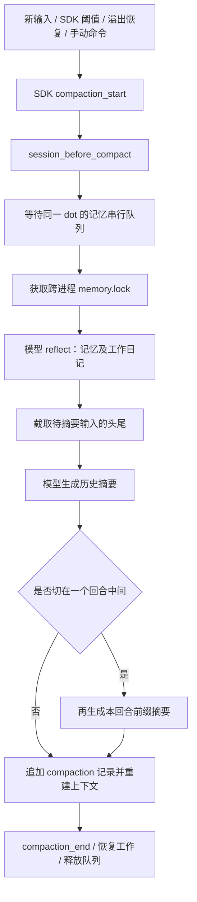

**会话压缩机制审查与优化建议**

审查日期：2026-10-22。基线：`89f1d70`，Pipiclaw `0.9.5-beta.1`，实际安装的 `@earendil-works/pi-coding-agent` / `pi-agent-core` / `pi-ai` 均为 `1.2.0`。

**结论：压缩慢有明确的结构性原因，取消和恢复还存在可复现的缺口。优先修复可恢复性，再把记忆整理移出关键路径，最后引入后台增量压缩。**

本次工作只新增审查文档，没有修改运行时。审查包含项目源码、已安装 SDK 实现、现有测试、离线受控探针及官方实践资料。没有读取生产会话或生产故障日志，没有执行真实模型调用。因此，下文的“已确认”指代码机制或离线复现；它们能解释用户报告的症状，但不能直接归因历史上某一次卡死，也不代表已经测得生产延迟分位数。

**一、当前机制：至少三种触发，两层策略，一条阻塞链**

| 入口 | 触发条件 | 执行行为 |
| --- | --- | --- |
| Pipiclaw 预防性压缩 | 当前上下文 + 即将发送的完整提示词和图片估值 ≥ 模型窗口的 75% | 新回合提交前直接 `await session.compact()`；忙碌期间的 steer 也经过这里 |
| SDK 自动压缩 | 上下文 > 窗口 − 16,384 tokens | 新输入之前、工具批次结束而下一次助手响应开始之前，以及回合结束后的检查路径；工具循环中也能触发 |
| SDK 溢出恢复 | provider 上下文溢出，或满足 SDK 恢复条件的输出截断 | 压缩后进行一次恢复尝试；并非无限 compact/retry |
| 手动 `/compact [要求]` | 用户命令 | SDK command extension 调用 `ctx.compact()`；该命令本身进入 handler 之前仍会经过 Pipiclaw 的预防性检查 |

75% 来自 [context-budget.ts](../../src/agent/turn/context-budget.ts:7)，调用位置为 [channel-runner.ts](../../src/agent/channel-runner.ts:327) 和 [turn-pipeline.ts](../../src/agent/turn/turn-pipeline.ts:301)。SDK 参数来自 [settings.ts](../../src/config/settings.ts:173)。项目只开放 `compaction.enabled`，数值参数固定在代码中；给 `settings.json` 写旧的 `reserveTokens` / `keepRecentTokens` 不会改变它们。

以 200,000 token 窗口为例，Pipiclaw 在预计达到 150,000 时阻塞压缩，SDK 的阈值则约为 183,616。不能把当前行为简单归结为“只有接近满窗口才压缩”，也不能认为只有 `/compact` 才会触发。

压缩主链如下；任意一段不结束，当前回合及其钉钉工作队列就不能正常结束：



SDK 保留最近约 20,000 个**估算** tokens 的消息，将更早部分摘要；找切点会维持工具调用/结果边界，不能理解为恰好保留最后 20,000 个真实 tokens。如果切在一个长工具回合内，SDK 会先生成历史摘要，再生成回合前缀摘要，两个请求是串行的。原始 JSONL 历史通常仍在，压缩主要改变下一次请求的活动上下文，不是删除整个会话文件。

**二、发现与优先级**

这里的 P0 表示优先修复的可用性问题，不表示已经证明整个进程发生 OS 级死锁。

| 编号 | 优先级 | 发现 | 直接影响 |
| --- | --- | --- | --- |
| F1 | P0 | 压缩前的记忆队列、reflect 不消费压缩取消信号 | 发新消息或停止之后仍可能长时间停在“正在压缩” |
| F2 | P0 | 记忆请求的鉴权位于超时和取消保护之外；整个压缩没有产品级总期限 | 某些等待可不受当前 45 秒超时保护 |
| F3 | P0 | `/stop` watchdog 只释放 runner busy 状态，没有释放旧 transport 队列 | 可以提示已释放，但下一条消息仍不能执行 |
| F4 | P1 | 同步记忆整理占据压缩关键路径，还会等待同 dot 的其他频道 | 一次压缩包含额外排队及 1–2 次 reflect 尝试 |
| F5 | P1 | 摘要沿用主模型、主会话思考档位和较大的输出预算 | 压缩承担高推理延迟，长回合还会串行生成第二份摘要 |
| F6 | P1 | 预防性压缩绕过 enabled 开关，还会在 slash command 和 steer 前执行 | 开关语义失效；手动命令二次压缩；steer 可能中断正在执行的工作 |
| F7 | P1 | 大输入直接丢弃中间部分，长期记忆不能保证承接被丢信息 | 压缩成功也可能失去任务约束、错误和中间决策 |
| F8 | P2 | 只有统一压缩提示，缺少阶段、时长、剩余操作和完整指标 | 用户不知道在排队、整理记忆、重试还是生成摘要 |

**F1：取消信号在前置钩子处断开，已复现。**

SDK 的 `session_before_compact` 事件带有 `signal`，但 [lifecycle.ts](../../src/memory/lifecycle.ts:303) 完全没有读取它，直接等待 `runBoundaryReflect()`。后者再等待 dot 队列和 `runReflect()`；`ReflectRunOptions` 也没有上游取消信号。

[interruptCompaction()](../../src/agent/channel-runner.ts:468) 只是调用 SDK `abortCompaction()`。SDK 将 signal 标为 aborted，不会自动让一个忽略 signal 的异步钩子结束。因而“检测到正在压缩 → 已发送取消 → 把新消息重新入队”并不保证新消息能及时开始。

离线探针使用真实 `createDotMemoryQueue()` 占住队列，再调用真实 lifecycle 的压缩钩子。取消后，`signal.aborted=true`，钩子仍未 settle；只有主动释放前项后才结束。这个结果不依赖网络或模型措辞。

**F2：45 秒不是完整保护范围，已复现其中的鉴权缺口。**

[reflect.ts](../../src/memory/reflect.ts:125) 的默认模型调用超时为 45 秒，[sidecar-worker.ts](../../src/memory/sidecar-worker.ts:245) 最多尝试两次，中间间隔 2 秒。因此，两次都耗尽模型调用预算时，仅这一段就约 92 秒，尚未包含排队、鉴权、文件操作和正式摘要。

更关键的是，[runSidecarTask()](../../src/memory/sidecar-worker.ts:142) 先 `await resolveApiKey()`，到第 201 行才建立超时，到第 209 行才监听取消。受控鉴权 Promise 不返回时，即便设置 `timeoutMs=10` 并取消，30ms 后任务仍未结束。这证明当前保护范围有洞；没有证据证明用户历史事故一定卡在鉴权。

另外，[dot-memory-queue.ts](../../src/memory/dot-memory-queue.ts:27) 的 150 秒仅覆盖获取跨进程锁，**不覆盖此前的进程内串行排队，也不是持锁执行整个任务的期限**。SDK 正式摘要路径传递 signal 并支持重试，但项目没有包住整个压缩生命周期的总期限和无有效进展期限。底层 provider/HTTP 客户端可能有各自超时，不能依靠它们保证产品恢复时间。

**F3：停止回执与实际可运行状态脱节，已复现。**

[stop-watchdog.ts](../../src/agent/stop-watchdog.ts:35) 在默认 15 秒后调用 `forceEndTurn()`；[channel-runner.ts](../../src/agent/channel-runner.ts:250) 仅改变 `TurnStateMachine`。真实 [ChannelQueue](../../src/dingtalk/channel-queue.ts:40) 仍停在 `await work()`，其 `processing=true`，新的普通消息继续排队。

探针组合真实 ChannelQueue、TurnStateMachine、stop watchdog，将旧 work 挂起并将 watchdog 宽限设为 0：watchdog 返回成功、runner 已空闲、下一条工作未执行、queue 仍非 idle。释放旧 work 后下一条才执行。这与“说已停止却仍不响应”的体验一致。

当前钉钉 `/new` 是更完整的应急边界：[bot.ts](../../src/dingtalk/bot.ts:338) 在 busy 和旧队列之前处理它，[turn-handler.ts](../../src/runtime/turn-handler.ts:214) 提交新的活动会话、退休旧 runner，并更换 transport 队列。这值得保留。不能说当前代码所有卡住都只能重启；但 `/new` 会开始新会话，不能替代保留原会话的透明恢复。

TUI 不具备与钉钉相同的这条恢复链：[turn-controller.ts](../../src/tui/turn-controller.ts:120) 的 stop 主要调用 `abort()`，忙碌 session commands 被拒绝，普通消息也没有先走 `interruptCompaction()`。两端必须一起设计控制语义。

**F4：记忆整理与会话压缩串联，是长等待的主要结构性来源。**

[lifecycle.ts](../../src/memory/lifecycle.ts:304) 明确等待 reflect 完成后才让 SDK 摘要。dot 队列按助手串行，且锁覆盖整个模型请求，因此另一频道的后台 reflect、记忆工具操作或另一进程都可能延迟本频道压缩。150 秒锁超时不能约束进程内前项不结束的情况。

后台维护要频道安静至少 10 分钟，reflect 间隔默认 20 分钟，见 [maintenance-tuning.ts](../../src/memory/maintenance-tuning.ts:20)。长时间持续工作的用户可能一直没有空闲维护机会，最终把整理成本集中到压缩边界。关闭 `memoryMaintenance.enabled` 只关闭后台调度，不会绕过 lifecycle 的这段边界整理。

**F5：摘要采用了主任务的性能配置，已捕获 SDK 请求参数。**

实际安装的 SDK `agent-session.js:2176` 将当前模型、当前 thinking level、会话 retry 设置传给压缩。`compaction.js:511` 将历史摘要输出上限设为 `min(floor(0.8 × reserveTokens), model.maxTokens)`；回合前缀为 `min(floor(0.5 × reserveTokens), model.maxTokens)`。

用真实 AgentSession、真实 SDK compaction、离线 stream stub 复现一个切分回合，捕获两次串行摘要请求：`maxTokens=13107, reasoning=medium`，随后 `maxTokens=8192, reasoning=medium`。这些是上限，不是每次必然生成的长度。连同此前 reflect，一次边界可能串行包含三次逻辑模型调用，失败重试还会增加请求数。通用摘要沿用主任务高推理配置没有性能上的必然性，需要独立评测。

**F6：预防性压缩没有统一策略边界，已复现开关与手动重复压缩。**

[maybeRunPreventiveCompactionForIncomingText()](../../src/agent/turn/turn-pipeline.ts:313) 只判断大小，不读取 compaction enabled。SDK 的手动 `compact()` 则本来就不受自动开关限制，二者组合导致 `compaction.enabled=false` 仍会自动压缩。探针注入明确返回 false 的 settings，压缩仍被调用一次。

新回合的预防性检查也没有跳过 session slash command。真实 SDK 探针在 160,010 / 200,000 token 上对 `/compact` 先运行预防性压缩，然后再次调用命令对应的 `compact()`，得到 `Already compacted`。实际压缩已经成功，用户却可能收到失败；而自定义压缩要求也没有用于第一次预防性压缩。`/model` 等原本可以零模型处理的命令也可能先付出压缩等待。

忙碌 steer 同样经过这个函数；SDK 手动 compact 会先 `await abort()`。这条路径在接近阈值时有中断主工作的风险，应交由安全的工具批次边界处理，不能在 steer 入队时直接调用手动压缩。

取消或失败后，该函数只记录 warning 并继续，没有失败冷却、同一历史版本的去重和压缩后收益校验。高占用上下文可以在后续输入再次触发同一段维护；打断压缩的新消息也可能在开始执行时再触发压缩。具体重复次数取决于上下文占用、SDK 阈值和消息到达时机。

**F7：当前防超限措施有信息损失风险，不能把“已整理长期记忆”视为完整备份。**

[boundCompactionMessages()](../../src/memory/lifecycle.ts:43) 把每个待摘要窗口限制为最多 48,000 prompt units / 144,000 字符，只保留头部 35%、尾部 65%，丢弃中间。这里的 prompt units 不是模型 tokenizer：CJK 单字算一个 unit，英文按词，且另有字符上限。

先 reflect 不足以证明被丢内容可以恢复到活动上下文：reflect 自身只取约 28,000 字符，排除 toolResult；长期记忆还刻意排除本次任务的临时进度。reflect 的失败会被捕获，之后仍继续截取和摘要，文本标记却仍声称 durable memory 已刷新。原始 JSONL 在磁盘上是一种恢复来源，但“磁盘存在”与“模型知道去哪找、能找到中段关键事实”是两项不同能力。

另外，旧摘要 `previousSummary` 不在该函数的输入预算内，最终摘要指令、旧摘要与输出预算也没有在这里统一计算。反复摘要的旧摘要要求大量保留既有信息，可能逐渐增大；小窗口模型、实际 provider 限制低于声明窗口时尤其需要验证。SDK 自身还会将每个 tool result 的摘要输入截为头部 2,000 字符，尾部错误未必进入摘要。不能把上述风险一概归因为“模型忘性大”。

**F8：状态展示和测量不足。**

[session-events.ts](../../src/agent/session/session-events.ts:330) 主要显示一次“正在压缩上下文…”，成功日志主要记录压缩前 tokens；`final_card_only` 还会隐藏这段进度。没有为用户区分排队、整理记忆、生成摘要和重试。SDK 有 `summarization_retry_*` 事件，项目当前的 SessionEvent 消费路径没有对应阶段展示。

所以长时间没有可见输出既可能是慢，也可能是等待或挂起。给 spinner 加动画可以改善感知，但不能解决 F1–F3。

**三、与当前官方实践的对照**

| 实践 | 官方证据 | 对 Pipiclaw 的启示 |
| --- | --- | --- |
| 后台生成摘要，完成后只替换被摘要的前缀，保留新增尾部 | [Anthropic 后台压缩](https://platform.claude.com/docs/en/build-with-claude/compaction-background) 明确要求记录快照范围、保留后来追加的消息、同一时间只运行一份压缩；该 API 能力目前标为 Beta | 这是可借鉴的并发协议；多 provider runtime 不能假定所有模型原生支持 |
| 先移出大工具结果和冗余工具参数，再做语义摘要；原文可恢复 | [LangChain Deep Agents](https://www.langchain.com/blog/context-management-for-deepagents) 采用这条处理顺序，并以目标延续和历史事实恢复检查压缩质量 | 减少真正需要交给模型摘要的体积，复用现有文件和 session_search 能力 |
| 清理幅度要足以抵偿缓存失效 | [Anthropic context editing](https://platform.claude.com/docs/en/build-with-claude/context-editing) 提供最小清理量和近期保留策略，并说明缓存影响 | 采用最小压缩收益和滞回，避免每轮小改历史导致反复失去前缀缓存 |
| 滚动压缩并保留近期重叠上下文 | [Google ADK context compression](https://adk.dev/context/compaction/) 提供间隔、重叠窗口，以及按 token 阈值和近期事件保留量的配置方式 | 按消息/工具事务边界选择窗口，避免固定比例截文本中段 |
| 会话摘要和结构化长期记忆各司其职 | [Anthropic context engineering](https://www.anthropic.com/research/effective-context-engineering-for-ai-agents) 同时讨论 compaction 和 structured note-taking | 将当前任务检查点与跨会话事实分开；不把写长期记忆变成压缩的前提 |

这些来源支持优化方向，不提供 Pipiclaw 的既定 SLA。下面的时间、阈值和摘要预算是本项目的候选起点，要通过本地机制验证和真实模型行为评测校准。

**四、建议方案及落地顺序**

**第一阶段：先确保用户能够停止和继续。**

- 给每次压缩建立统一 operation：`operationId`、session/generation、快照边界、开始时间、取消原因、阶段、终态。手动、预防性、SDK 自动和 overflow 都进入相同的生命周期观察与期限管理。
- 把上游 signal 传到排队、锁等待、鉴权、reflect、摘要和退避。总期限从进入操作开始计算，所有重试共享剩余预算，不能每次重试重新得到完整额度。取消后排队闭包即使稍后被调度，也必须在执行前检查，不能继续做失去需求的模型请求或写入。
- 区分“请求已取消”“Promise 已结束”“旧任务已失去提交权限”。只加 `Promise.race(timeout)` 不够：旧任务仍可能写会话。SDK 会话若不能在短宽限内收敛，应从原 JSONL 的最后有效状态重建 runner，而不是在原 session 上并发启动下一轮。
- 为 `/stop` 的强制恢复同步更换 transport 队列和 runner generation；保持当前会话引用，阻止旧事件、delivery、context 写入覆盖新工作。`/new` 保持显式开启新会话的语义。进程内可用 generation fencing，跨进程写入还需要真实 writer lease / 文件锁或同等提交协议；不能只靠关闭订阅来保护持久化。
- 统一 DingTalk/TUI 的停止、查看状态、开始新会话行为。停止摘要不取消已派发的外部委派，不破坏任务自己的 session 和完成通知结算。
- 预防性入口遵守 enabled；跳过直接执行的 session slash command。`/compact` 应只执行一次并保留用户要求。steer 先入队，不在其入队路径直接手动 compact。
- 给同一上下文版本的失败加冷却；用户主动取消的预防性压缩不得立即原样重启。仍有空间时继续原历史；已经没有安全空间时给出明确的恢复选择，不能无保护地把超限请求继续发出去。

候选验收目标：控制命令本地确认小于 1 秒；合作式取消的本地收敛小于 2 秒；底层不合作时在 3–5 秒内隔离旧 generation 并让下一条消息可以进入新 runner。网络消息实际送达耗时另计。这是应实现并测量的目标，不是本次测量结果。

**第二阶段：降低前台等待成本。**

把边界 reflect 从 `session_before_compact` 的同步前提改为持久化的后台待处理工作。压缩前固定原始 entry 范围和内容指纹，确保原 JSONL 或必要快照已可靠保存；后台按范围恢复、去重、续跑。不要只 `void runReflect()`：进程重启后必须还能发现未完成的整理工作。

长期记忆/日记继续由 memory 模块和 dot 队列维护，但用户当前任务的目标、限制、已验证结果、未完成事项由会话检查点承担。reflect 失败不应阻止压缩，也不应让压缩摘要假装已有完整长期记忆副本。

先保留 memory 全流程串行以控制改动风险。后续才优化长持锁：锁内读取版本和生成快照，锁外运行模型，锁内校验并提交；冲突时重建或重算提案，避免覆盖其他频道的记忆修改。不能简单把所有 reflect 并行化。

摘要使用独立执行配置：默认关闭或降低 thinking，候选目标摘要约 2–4k tokens，保留更低的总输出硬限及显式完整性检查。不要只缩小当前 13k 上限：SDK 会拒绝 `stopReason=length` 的不完整摘要，需要同时缩短输入、约束输出结构并保留旧状态。可选摘要模型属于合理的产品选择，但快模型必须验证中文约束、代码标识符、错误信息和原文检索能力。

对 split-turn 的两个摘要先尝试有总预算的单请求结构化输出；若保留两个独立请求，可评估并行生成，但会增加瞬时并发/限流负担。它不是首个性能修复点：先移除前置 reflect、降低推理开销和设置期限，收益更确定。

候选执行预算：单次摘要无有效内容进展约 15–20 秒触发处理；完整操作约 45–60 秒硬上限，且排队/鉴权/重试都消耗同一个预算。heartbeat 不算有效进展；慢 provider 的值需实测。前台无充分空间时，不自动串行尝试多个慢模型。

**第三阶段：把压缩转成后台准备、边界提交。**

推荐流程是“确定性减负 → 后台增量摘要 → 安全边界提交 → 必要时受限阻塞恢复”。


不要把 `session.compact()` 简单放进后台：SDK 手动 compact 会 abort 当前工作，而且它会更改活动 session。后台应是独立、无工具副作用的摘要 worker，主 session 仅在安全的请求边界采用已完成结果。

快照应绑定 `dot / conversation / sessionId / generation / baseCompactionId / throughEntryId / prefixHash`。允许摘要期间追加尾部；若历史被 context_edit、分支切换、另一份压缩、恢复或 `/new` 改变，旧候选必须失效。在 SDK 公开支持的投影和持久化协议上提交，避免新增对 SDK 私有字段的依赖；必要时推动上游提供 prepare/commit 接口。任何提交失败都保留原状态，不能半途清空历史。

同一 session 同时最多一个候选压缩。新消息到来时，只要有安全余量就继续，不默认取消后台候选。达到硬预算才等待已有候选的剩余期限或执行受限恢复。工具调用及其结果必须完整成组，不能在工具执行中间替换其来源上下文；provider 对 thinking block 的签名/有效性要求也需适配。

**触发时机应由有效预算和增长速度决定。**

定义 `W` 为模型、部署及 provider 实际接受的有效窗口，`P` 为下一次完整请求的投影输入，`O` 为该请求预留输出，`G` 为图片/token 估计误差及工具增长余量。首先保证：

```text
P + O + G <= W
```

输入统计要包含 system、tool schemas、消息、动态注入和图片；使用 provider usage 校准时避免再次把已经计入的 system/tools 重复相加。旧模型的 usage、压缩前 usage 和 provider 不同的 cache token 统计需要正确归一化。当前 SDK 在部分切点估算使用 chars/4，不能以此精确判断中文的“近期 20k”。

后台触发点的候选起点是有效输入预算的 60–70%，但更有意义的条件是：距离硬上限的剩余空间，是否足以覆盖“摘要 P95 耗时 × 上下文增长 P95 速度 + 安全余量”。长工具循环要在工具批次边界检查，而不是只在用户发下一条消息时检查。超大窗口还应评估工作上下文的绝对长度目标，避免因为窗口变大就推迟到巨大历史才整理。

提交后要求有足够收益，例如至少释放某个绝对 token 量和一定比例，且低于下一次触发阈值，形成滞回。连续低收益、不完整或失败的候选进入冷却并记录原因。这些数值继续作为内部算法常量/模型能力配置，不需要重新向用户暴露大量数字设置。

**先减掉可以重新获得的内容，保护不可替代的信息。**

大工具结果、重复文件内容、历史 write/edit 参数优先以版本化 artifact / 路径 / 命令 / entry id 替代。引用必须可恢复：仅当前文件路径未必能找回被覆写前的内容；需要时保留内容哈希或原始 artifact。不能盲目删除整个 tool result，必须维持工具调用协议和安全审计。

语义摘要保留当前目标、用户限制及禁止事项、关键决定、已验证与未验证的状态、下一步，以及精确的文件/错误/任务/run 标识。保护最近相关的完整回合，按语义选择更早窗口；单个超长回合分段摘要时，各段均有覆盖范围。用分段提炼或可检索引用代替任意丢弃中间 35%–65% 之间的内容。旧摘要应允许删过时项，防止“不断保留一切”导致摘要膨胀。

`session_search` 和磁盘原文是现有优势，但需要验证长消息中段的可恢复性；当前 corpus 单条扫描也有字符上限，不能宣称“有检索就不会丢”。不要为压缩另造一套运行时可写的全局知识文件。

**五、模块落点、交互与验收**

| 位置 | 建议职责 |
| --- | --- |
| `agent/session/` | session 级 compaction 生命周期、快照边界、期限、候选采用与 SDK 适配 |
| `agent/turn/` | 输入/工具批次的预算判断，steer 与手动命令的触发隔离 |
| `memory/` | 持久化 reflect 工作、来源范围、去重、记忆版本校验和串行提交 |
| `runtime/` | 旧 runner 隔离、恢复同一会话、transport 协调和重启恢复 |
| `dingtalk/`、`tui/` | 独立于维护长任务的控制命令、操作回执和阶段展示 |
| `usage/` 与日志 | 压缩及 reflect 的完整花费、阶段时长与恢复结果 |

遵守现有层次，不让 memory 反向依赖 agent，也不新增通用根目录协调器。现有 `src/index.ts` 公共导出不需要改变。

超过短等待后，用户应能看到类似“⏳ 正在整理较早的对话，已用时 12 秒。可以继续发送消息；用 `/stop` 停止，或用 `/new` 开新会话。”的阶段信息。只有真的支持继续发送时才这样提示。压缩成功、取消和超时要有明确终态；不要给出没有依据的完成百分比，不泄露模型摘要正文或内部工具调用语法。失败需带用户能够执行的下一步。

至少记录 operation id、触发原因、session/generation、队列等待、鉴权、reflect、摘要首个有效输出和总耗时、请求/重试次数、前后上下文大小、输入覆盖与截取情况、摘要模型/thinking、token/cost、取消到收敛耗时、隔离恢复耗时、候选失效原因。生产上先按 model/provider 比较 P50/P95/P99，避免只看“成功次数”而忽略被取消和超时的样本。

测试按项目三层约束组织：

- unit：期限从排队/鉴权开始、已取消闭包不执行、enabled 和 slash command 分流、同一范围 singleflight/冷却、小窗口与中文预算、非法/过期提交拒绝。优先扩展最近现有场景；不测普通提示文案。
- deterministic e2e：真实 inbound → runtime → SDK hook → 模型 hold 屏障 → `/stop` / `/new` → 下一条 provider 请求；旧请求始终不 release 时仍能恢复，并验证迟到结果不能覆盖新 session/投影/delivery。扩展现有 stop/concurrency/commands 链，避免用假 runner 的 `isBusy=false` 代替队列可执行证明。
- persistence e2e：真实子进程退出后，待 reflect 范围可恢复，已采用摘要不会二次提交，后台候选不会跨 `/new` 生效。进程内重新初始化不能代替 crash 恢复证明。
- behavior eval：强制在任务中间多次压缩，检查中文多轮限制、负面约束、精确错误/标识符、中段事实恢复和目标延续；与当前策略做 paired candidate runs，比较完成质量、压缩等待、总耗时和费用。先跑正/负/等价 controls，再付费调用；保留失败证据并归因。

新增正式 e2e 必须做 mutation check：断开信号、恢复 busy-only watchdog、放行旧 generation 提交等目标变异，场景必须变红。本次审查探针用于定位机制，没有作为新正式测试合入；unit/e2e 用例净增均为 0。

**六、本次验证与证据边界**

已执行两组离线探针（临时目录 `/tmp/pipiclaw-compaction-audit/`，不依赖真实凭据）：

| 探针 | 观察 |
| --- | --- |
| 真实 dot queue 被前项占用时取消 lifecycle hook | signal 已取消，hook 仍等待；释放前项后才结束 |
| sidecar 鉴权挂起，10ms deadline + abort | 30ms 后仍未结束；鉴权 Promise 被主动拒绝后结束 |
| 真实 ChannelQueue + TurnStateMachine + stop watchdog | watchdog 成功，runner 空闲，下一条仍堵在旧队列 |
| 注入 disabled settings 后执行预防性入口 | 仍调用一次 compact |
| 真实 SDK、160,010 / 200,000 上下文、`/compact` 对应的预防性→手动调用顺序 | 第一次保存压缩，第二次报 `Already compacted` |
| 同一 SDK split-turn 请求捕获 | 两次摘要依次请求 13,107 / 8,192 输出上限，均使用 medium reasoning |

探针为真实模块组合加受控依赖，其中 SDK 探针使用离线 stream stub；不是完整钉钉会话事故回放。30ms 仅用来证明 10ms 保护范围失效，不能用来估计线上卡住概率。

常规验证：构建、`npm run typecheck` 和 `npm run arch` 通过；压缩相关 7 个测试文件、39 个用例通过；`npm run test:e2e` 的 24 个文件、59 个用例全部通过（83.29 秒）。全量 `npm run test` 首次为 911 通过、1 失败：`subagent-restart-adoption.test.ts` 的存活进程接管场景 `waitFor timed out`；单独重跑该文件 5/5 通过。首次 unit 与 e2e 并行运行，但尚未证明并发负载是失败原因，保留该失败，不能宣称全量首次全绿。本次没有改动该测试或相关生产代码，也未放宽超时。

没有改动模型提示词，也没有执行付费行为 probes；本报告的摘要质量改进仍是待验证方案，不能记为质量通过。

建议按第一阶段→第二阶段→第三阶段分别交付。第一批工作的完成标准是“压缩依赖永不返回时，用户仍能通过应用内操作继续工作”；第二批才衡量前台等待降幅；第三批以后台压缩命中率、压缩后任务完成质量和每个有效工作周期的总成本决定是否推广。
