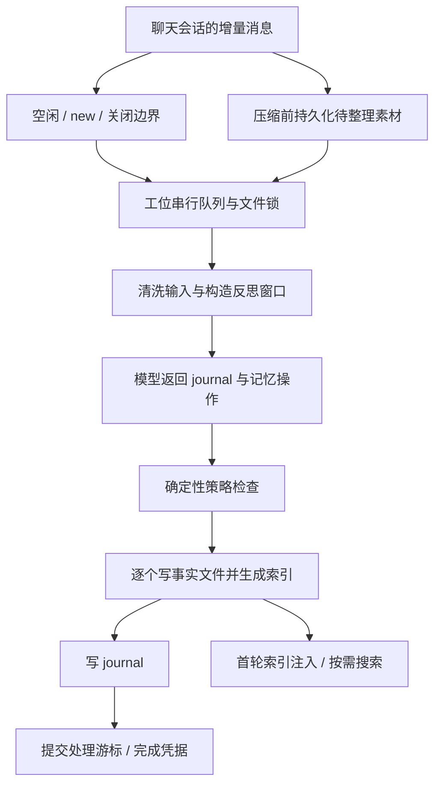

# 记忆管理设计与实现深度审查

审查日期：2026-10-30。基线：`e265956992ce7a7d7123636c95b431d6006566c4`，`0.9.5-beta.3`，Node.js `22.21.0`。

后续已按修复收益和复杂度完成[分诊与低复杂度修复方案](2026-10-30-memory-triage-and-plan.md)。该方案替代本文较宽泛的实施建议，明确部分修复、缓解与暂缓项；本文保留发现和验证证据。

本次只审查，不修改产品代码。阅读范围包括 `src/memory/` 全部实现、记忆工具、首轮上下文、会话压缩与切换、冷会话维护、运行时调度与关闭、内部代理的记忆注入，以及相关 unit、deterministic e2e、eval 场景。设计依据以当前实现、AGENTS.md 和 desk/Responses/compaction 的现行约束为准，未把旧 spec 的频道布局或迁移方案当成现状。未读取生产记忆、聊天历史、认证文件，复现使用临时目录和假模型。

## 评估结论

**核心方向适合 Pipiclaw 的定位，当前实现仍有影响可信度的正确性缺口。** 一事一文件、frontmatter 单一真相、生成索引、首轮注入、正文按需读、journal 与任务状态分开、后台单次反思，这套结构适合个人与小团队的几十到几百条记忆。建议继续使用。

当前最需要投入的是三项保证：**没有送进反思的素材不能被标成已处理；已经写入的操作能够在失败后安全重试；用户确认与遗忘的语义不能因入口不同而变化。** 此外，有两处应尽快修复的独立问题：名称参数导致的目录越界，以及名称冲突导致的同步死循环。

本次取得 11 项发现的复现证据。它们包含实现缺陷，也包含需要明确取舍的设计边界；后文分别说明。没有执行真实模型质量评测，因此本报告不宣称召回准确率、提炼正确率或抗记忆污染能力已经达标。

## 已有设计中值得保留的部分

| 设计 | 实现与评价 |
| --- | --- |
| 事实文件是唯一内容真相 | [store.ts](../../src/memory/store.ts) 从文件元数据生成索引，避免维护一套会漂移的影子记忆数据库；适合人工检查与修复 |
| 工位拥有记忆，会话拥有上下文 | [desk-memory-queue.ts](../../src/memory/desk-memory-queue.ts)、[turn-context.ts](../../src/agent/turn/turn-context.ts) 的职责合理，同工位多频道共享知识，各自保存对话 |
| 所有主要写入口共用串行队列和文件锁 | 解决同工位多频道同时反思、显式保存、删除的写入竞争；已有 e2e 验证，不能在优化时绕开 |
| 单文件写入采用临时文件、fsync、rename | [atomic-file.ts](../../src/shared/atomic-file.ts) 降低半文件风险；需要注意它不等于整个反思事务的原子性 |
| 压缩前先持久化素材，推理在后台进行 | [boundary-work.ts](../../src/memory/boundary-work.ts) 的待办与完成凭据是正确方向，已有 SIGKILL 恢复用例 |
| 低成本闸门先于模型调用 | [scheduler.ts](../../src/memory/scheduler.ts)、[maintenance-gates.ts](../../src/memory/maintenance-gates.ts) 的 dirty、空闲、间隔与退避检查有效控制无意义调用 |
| 把召回上下文从提炼输入中剥离 | [transcript.ts](../../src/memory/transcript.ts) 去掉 bootstrap 等注入块，排除工具结果，降低重复学习自己的风险 |
| 用户可直接检查和删除记忆 | `/memory` 的文件级控制面、审查日志、独立 sidecar 用量归属，是可解释性的重要基础 |
| 测试区分机制与质量 | [memory.test.ts](../../test/e2e/deterministic/memory.test.ts)、[compaction.test.ts](../../test/e2e/deterministic/compaction.test.ts) 验证持久化、注入、并发及恢复；真实模型行为由 evals 承担，分层正确 |

当前主链路如下。最明显的缺口出现在“反思成功”和“处理进度提交”之间，以及压缩与 `/new` 两种边界的可靠性不一致。



## 风险概览

P1 表示可能越界暴露内容、阻塞整个运行时，或造成自动记忆处理的重要完整性问题；P2 表示应修复的局部语义、召回或容量问题。优先级是本次审查判断，不表示问题已在生产发生。

| 编号 | 优先级 | 发现 | 证据 |
| --- | --- | --- | --- |
| R1 | P1 | `/memory show` 可越出当前工位目录读取 Markdown | 命令处理器实调复现 |
| R2 | P1 | 合法的 60 字符名称发生冲突时进入同步死循环 | 独立子进程超时复现 |
| R3 | P1 | 长反思窗口被裁剪，中间未读素材仍被游标越过 | 捕获实际反思 prompt 和落盘游标 |
| R4 | P1 | 记忆写入成功、后续写入失败后，重试会重复创建事实 | journal 写入故障注入复现 |
| R11 | P1 | 冷会话直接 `/new` 会留下未进入整理队列的旧会话 | 完整 runtime 入口复现 |
| R5 | P2 | 用户替换自动学到的事实后，仍保留 agent 来源和可自动删除属性 | save → reflect delete 链路复现 |
| R6 | P2 | `update` 可以写回被遗忘的完全相同内容 | forget → reflect update 链路复现 |
| R8 | P2 | 合并的新条目被拒绝后，旧条目的删除仍然执行 | condense 模式复现 |
| R7 | P2 | 索引常驻类型没有硬预算；workspace 前言绕过预算 | 两种输入均复现；前者含设计取舍 |
| R9 | P2 | workspace 背景的无 H2 正文、前言、标题无法被完整检索 | 搜索函数实调复现 |
| R10 | P2 | 观察期到期不等于读取失效，过期事实仍可注入 | 已过期条目的首轮注入复现；属于现有语义边界 |

## 逐项发现、影响与修复建议

### R1：记忆名称可作为路径使用，绕过工位读范围

位置：[commands.ts](../../src/memory/commands.ts) 的 `handleShow`（90 行起），以及 [store.ts](../../src/memory/store.ts) 的 `getMemoryEntryPath`（72 行）、`readMemoryEntry`（276 行附近）。

保存新条目会检查 `isValidMemoryName`，读取入口却直接拼接 `${name}.md`。因此：

```text
/memory show ../../desk-private/memory/private
```

会从当前 `desk-default/memory/` 越到相邻工位。复现中，返回的用户报告包含另一工位文件里的唯一标记。它不需要让模型调用通用文件工具，也没有经过那些工具的 path guard；当前能力限于进程可读、路径可定位且以 `.md` 结尾的文件，不能据此扩大成“任意文件读写”。

这与文档明确允许的通用文件工具跨目录访问是两件事：记忆命令自己应维持工位范围，特别是 Web API 身份可能只获准使用部分工位。

建议在 memory 域的共同入口统一验证名称，而非只修 `/memory show`；`show`、`forget`、`replaces` 使用同一规则。对人工创建的符号链接明确策略，不能仅凭合法文件名就把链接指向的外部内容当成本工位记忆。添加实际命令入口的越界拒绝验证，并检查拒绝前后外部文件字节不变。

### R2：名称冲突去重可能冻结整个 daemon

位置：[store.ts](../../src/memory/store.ts) 的 `dedupeMemoryName`（107 行起，核心为 113 行）。

当前逻辑先拼 `-2`、`-3` 等后缀，再把整个字符串裁到 60 字符。如果原名称已经是 60 字符，裁剪后的候选始终等于原名称：

```ts
const name = "a".repeat(60); // isValidMemoryName(name) === true
dedupeMemoryName(name, [name]); // 不返回
```

独立 Node 子进程已执行到 `valid=true`，随后在 2 秒期限被终止。这里是同步循环，生产触发后会占住 JavaScript 事件循环，影响所有工位和传输；常规模型超时不能打断它。60 字符的自动 slug 同样可能进入这条路径，不能把风险仅归于恶意名称。

建议按后缀长度先截短基础名称，再拼完整后缀，保证候选每次变化且仍满足命名规则。将当前“短名称冲突”测试扩展到最大长度及后缀位数增长边界；死循环的回归验证应放在可终止的独立进程中。

### R3：截断反思输入后仍提交完整窗口的处理游标

位置：[reflect.ts](../../src/memory/reflect.ts) 的 `buildPrompt`（196 行），[source-window.ts](../../src/memory/source-window.ts) 的 `throughEntryId`，以及 [reflect-job.ts](../../src/memory/reflect-job.ts) 的游标提交（102 行）。生命周期和持久化边界工作也调用相同反思函数。

增量窗口先取出所有未处理消息，再将序列化对话限制为 28,000 字符，保留约 35% 头部和 65% 尾部。反思成功后，游标却前进到原始窗口的最后一个 entry。

复现用一条约 50,000 字符的用户消息，把唯一事实放在中间。实际送给假模型的 prompt 不包含该事实，维护状态却已记录最后一个 entry。后续正常增量处理不会再看到这段中间素材。

这是处理进度错误，不是模型记性不好。原始会话仍在，用户可以主动搜索或人工重新整理，因此不能称为源数据永久丢失；但自动提炼路径确实静默漏处理了素材。

建议按完整消息和预算拆分窗口，每个分片提交自己实际覆盖的末端 entry。超大单条消息还需要分片位置；未读部分保持待办。`runReflect` 应返回明确的已处理范围，调用者不能自行把“调用返回”解释成“整个窗口全部处理完”。压缩前的待办只有在全部分片完成后才能删除。

验收重点是中段事实到达 provider 请求体，所有分片覆盖连续且无空洞，中途失败后只重试未提交部分。

### R4：单文件原子写无法保证整个反思可安全重试

位置：[reflect.ts](../../src/memory/reflect.ts) 的 `applyMemoryOps` → `appendJournalEntries`（389 行），[reflect-job.ts](../../src/memory/reflect-job.ts) 的游标提交，以及 [boundary-work.ts](../../src/memory/boundary-work.ts) 的动作、审查日志、游标和 `.done` 顺序（149 行起）。

实际执行顺序是先修改多个事实文件及索引，再写 journal，最后写游标或完成凭据。任一步骤失败，都可能形成“副作用已发生、处理进度尚未提交”的状态。串行锁防止并发，却不能解决失败重放。

复现让第一次 journal 写入失败：`deploy-window.md` 已存在，游标没有推进；退避后重试同一窗口及同一模型输出，得到 `deploy-window.md` 和 `deploy-window-2.md` 两个事实。反思路径没有显式 save 的近重复拦截，`add` 的名称去重反而把重放变成新记录。

压缩工作已有 `.done`，但它在副作用之后写入，只保护部分崩溃位置，不能覆盖“写事实后、写 checkpoint 前”的窗口。多条操作之间失败也存在同类问题。

建议扩展现有 `.memory-work/` 的恢复思路：模型输出通过校验后，先持久化确定的操作计划、分配好的目标名称、输入窗口和稳定操作标识；恢复时重放同一计划，不重新调用模型或分配新后缀。事实、journal 与提交进度需要同一套可恢复提交协议。派生索引可重建，不必把索引纳入复杂的多文件原子替换。

这个小型工作记录只负责执行恢复，不应重新成为存放全部记忆元数据的第二份内容真相。至少对“首条事实后、journal 后、checkpoint 前、完成凭据前”做故障注入，并保留真实进程退出的覆盖。

### R11：`/new` 的可靠性弱于压缩边界

位置：[ingress-commands.ts](../../src/runtime/ingress-commands.ts) 的 `handleNewSession`（77 行起），[lifecycle.ts](../../src/memory/lifecycle.ts) 的 `noteNewSessionBoundary`（280 行），[maintenance-context.ts](../../src/agent/maintenance-context.ts) 的冷上下文读取。

运行时先提交新 session 指针，然后仅在旧 runner 已存在时调用 `retireForNewSession`。旧 runner 的反思也只保存在内存中的 Promise 和消息快照里，没有使用压缩边界的持久化待办。

这造成两种情况：冷启动后旧会话没有 runner，直接 `/new` 不会给旧会话建立整理工作；有 runner 时，后台反思如果失败或进程退出，也没有同等的 durable work 保证重试。冷维护只打开新的 active session，不能自动找回旧窗口。

本次通过完整 runtime 复现第一种情况：预置有用户和助手记录的旧 session，维护状态置 dirty，不创建 runner，直接发送 `/new`，再手动运行真实维护调度器。active 指针已经切换，模型请求数仍为 0，没有生成 `.memory-work`，旧文件保留在磁盘。第二种情况是代码链路分析，未额外注入进程崩溃。

建议让 `/new` 在切换前持久化旧会话的未处理范围，冷会话也走相同协议；只等待本地持久化，不等待模型。可与 R4 共用一个边界工作机制。验收应覆盖冷 `/new`、热 `/new` 后推理失败和切换后立即退出三种路径，证明旧窗口最终整理且只产生一次效果。

### R5：用户明确替换的事实没有获得用户保存保护

位置：[memory-manage.ts](../../src/tools/memory-manage.ts) 的 save 分支（147 行），[store.ts](../../src/memory/store.ts) 的 update 合并（505 行），[reflect.ts](../../src/memory/reflect.ts) 的 `source === "user"` 删除保护（289 行）。

新增保存写 `source: user`，带 `replaces` 的保存却只更新内容、类型、正文及观察期，原 `source: agent` 被保留下来。复现先自动添加事实，再经真实 `memory_save` 替换；条目仍是 agent 来源，接下来反思提出的高置信度删除被接受。

用户同样明确说“记住”，仅因事实此前是否存在，保护强度就不同。

建议把“显式用户保存/确认”作为 memory 域中的统一操作。若 `source` 表示当前内容的权威来源，替换时提升为 user 即可；若还要保留首次提炼来源，应分别表达最小必要的来源与用户确认状态。两种方式选一种明确下来，不让自动反思自行提升用户确认属性。

### R6：遗忘阻挡只覆盖 add，update 可以绕过

位置：[store.ts](../../src/memory/store.ts) 的 update（494 行）和 add 的墓碑检查（约 531 行），以及 [tombstones.ts](../../src/memory/tombstones.ts)。

复现先遗忘一个事实，确认该 description 的哈希仍处于阻挡状态；再让反思把另一条已有记忆 update 为完全相同的 description，写入成功。这不涉及同义改写，直接绕过了现有精确哈希保证。

建议让所有自动内容写入统一执行墓碑检查，区分自动反思与明确重新授权。显式保存的 update 也应与 add 一样，在成功后撤销对应阻挡，否则重新授权语义不一致。

还需准确描述能力边界：当前哈希阻挡会归一化 Unicode、空白和大小写，但不能识别同义改写，也不会清除正文、journal、历史会话或模型当前上下文里的内容。不建议用模糊相似度直接大范围封禁相关知识。先修复精确内容绕过，再考虑把阻挡关联到事实身份和来源窗口，区分旧素材重放与用户重新陈述。

### R8：合并操作缺少保留内容成功后的删除条件

位置：[reflect.ts](../../src/memory/reflect.ts) 的 condense 提示、逐操作检查和删除入队（281 行起），[store.ts](../../src/memory/store.ts) 的顺序应用。

condense 要求模型删除被合并的旧条目，新增或更新合并后的条目。但确定性校验逐条处理：新条目因置信度、上限、墓碑或密钥被拒绝，不会阻止配套旧条目的删除。

复现压满索引后返回“低置信度的新合并条目 + 高置信度的旧条目删除”：新条目被拒绝，旧条目被删，且为旧内容留下墓碑。模型可能犯错本来就是策略检查存在的理由；这里不能只靠提示要求它把两边置信度写一致。

建议显式区分“事实失效的独立删除”和“合并后的替代删除”。后者关联到一个经过完整预检的 replacement，只有替代事实成功持久化后才能删原条目。与 R4 的恢复计划结合，避免留下半个合并。自动合并删除也不应不加区分地继承“用户明确要求忘记”的长期阻挡语义。

### R7：预算是局部策略，尚不是端到端硬约束

位置：[index-budget.ts](../../src/memory/index-budget.ts) 的常驻条目选择（42—53 行）与 workspace 前言（89 行），[reflect.ts](../../src/memory/reflect.ts) 的完整索引输入（203 行），[memory-manage.ts](../../src/tools/memory-manage.ts) 的保存 schema。

这里有三个不同问题，不能混为一个“裁剪 bug”：

- `user`、`feedback` 始终完整保留是明确设计取舍。只要这些条目本身超过预算，就会超出 1,400 units；单条 description 也没有长度限制。复现一条很长的 user 记忆即可超过预算。这说明预算目前不是硬上限。
- workspace 有 H2 时，首个 H2 之前的前言未经裁剪直接保留；复现长前言后超过 500 units。省略提示也没有预留完整开销，这是实现缺口。
- 后台反思读取完整索引，虽计算了 overBudget，却只把它用于开启 condense，没有对反思完整请求建立预算。主模型、内部代理和 sidecar 的上下文能力可能不同。

建议明确“优先保留”与“绝不超限”的优先级。对单条 description 设合理上限，过长事实引导拆分或移到正文。常驻内容也应有可解释的溢出方案，不能静默丢失关键限制；至少报告哪些内容未注入和如何读取。前言、包装文本、省略提示都计入最终预算。sidecar 按实际模型上下文大小分配输入，并将缩编分批执行，避免越超预算越无法整理。

### R9：共享背景的搜索覆盖依赖 Markdown 排版

位置：[search.ts](../../src/memory/search.ts) 的 workspace 分支（335 行），[markdown-sections.ts](../../src/shared/markdown-sections.ts) 的 H2 拆分。

workspace 只搜索 H2 段的 `content`。没有 H2 的文件完全不搜索，首个 H2 前的正文被忽略，关键词只出现在 H2 标题时也不参与打分。复现一个包含唯一英文事实的普通文本 `MEMORY.md`，查询该事实返回零条。

如果这部分背景又因首轮预算被省略，模型即使主动补查也可能找不到。

建议把全文拆成包含前言、标题和正文的可检索块；无 H2 时按整块搜索。返回可定位来源即可，不需要为此增加向量服务。扩展现有 workspace 搜索场景，覆盖正文和标题，不钉普通文案。

### R10：观察期到期之后，事实仍可能被使用

位置：[store.ts](../../src/memory/store.ts) 的 `expireProbationaryEntries`（578 行），[reflect.ts](../../src/memory/reflect.ts) 的反思前清理，以及 [turn-context.ts](../../src/agent/turn/turn-context.ts) 的无到期过滤读取。

到期删除只发生在 `runReflect` 的前置步骤。正常列举、搜索、首轮注入都不检查到期；调度器没有有意义的新素材时也不会调用反思。

复现写入 `expires: 2020-01-01` 的条目后直接构造首轮上下文，条目仍被列举并注入。这符合当前“下次反思时清理”的实现，不能表述成后台计时器失效，但与使用者容易理解的“到期即不再生效”有明显距离。

建议先决定 expiry 是读取有效期还是清理提示。如果是有效期，bootstrap、search、status 和内部代理应共用有效性判断，清理则作为零模型成本的维护动作。如果坚持延迟清理语义，文档和状态报告应明确区分“已到期”和“仍在观察期”。日期校验和本地日边界也应集中定义。

## 设计层面的进一步评估

以下是代码支持的风险判断和优化方向，不把它们计为额外已完整复现的产品故障。

### 学到了什么，仍缺少足够的证据与归属

反思输入包含用户和助手文本，`source: agent` 只表明后台写入，无法说明事实依据来自用户陈述、助手推断还是助手复述。同工位多人适用范围目前主要依靠自然语言描述和 playbook 约束。

`hasUserMessage` 只证明窗口里存在某个用户消息，不证明用户纠正了被更新的那条事实；模型自报 `confidence: 0.95` 也不是统计意义上的正确率。`touch` 无证据字段即可把观察期条目变成永久。剥离 bootstrap 是必要措施，但助手在回答中复述记忆后，仍可能被反思当作新的确认。

建议先引入很小的证据结构：与本次操作相关的用户 entry 引用、主体或适用范围，以及确认类型；在代码里校验引用属于当前实际处理窗口。永久授权、用户偏好覆盖和观察期转正尤其需要区分“用户确认”“助手使用”“仅被复述”。证据引用是可追溯性基础，依然不能由它直接推导内容为真，不应再复制整段来源文本或巨大 entry 列表进每条记忆。

### 首轮注入策略合理，但活跃会话会持有旧记忆

索引只在首轮、压缩后刷新，是明确接受的延迟，也有缓存与 token 收益，不应误报成 bug。代价是同工位另一频道的纠正、删除不立即反映到已活跃会话；忘记文件也不会从会话历史中擦除旧 bootstrap。

可以在现有文件变更基础上维护轻量 revision。下一回合发现变化时，仅注入有限的失效名称或变更摘要，提示按需搜索；不必每轮重复整份索引。它与 R6 是不同层面的保证：R6 管持久化写回，这里管已经进入模型上下文的数据。

### 搜索应先把扫描范围说清楚，再提升语义能力

[session-search.ts](../../src/memory/session-search.ts) 在关键词匹配前，先按时间取最近 `maxChunks` 条，默认 80、内部最大 500；[session-corpus.ts](../../src/memory/session-corpus.ts) 还存在文件数、总文档数及每条 20,000 字符的上限。工具没有日期范围或继续扫描参数。扩大关键词不能使排除在扫描范围之外的旧消息重新进入候选。工位公平分配发生在 corpus 层，之后的全局最近条数截断仍可能被高流量会话占满。

建议增加日期/会话过滤、继续扫描位置，以及“实际扫描的时间与文件范围、仍有多少历史未扫描”说明。对“上周”“上次讨论”优先允许定向查找。文件预算应约束成本，查询应能继续覆盖更早历史。

`memory_search` 当前检索本身有词法打分，文档说的“不做检索打分”准确含义应是“不在每轮用打分挑选注入索引”。先修 R9、完善范围与来源，再用真实改述问题测是否需要更多语义能力。没有证据说明现在就需要 embedding、图数据库或每回合 LLM 重排。

### 正确性修好后，再缩短持锁时间

[desk-memory-queue.ts](../../src/memory/desk-memory-queue.ts) 的锁覆盖整个反思模型调用。当前重试实现共享约 45 秒总 deadline，同工位的显式保存、遗忘可能等待推理；多个工作排队会进一步延迟。这不是丢更新的证据，恰恰是现有串行保证的成本。

建议先测显式操作的排队时延。确有必要时拆为“锁内取快照与 revision → 锁外推理 → 锁内校验与提交”；如果用户在推理期间更正或遗忘，必须重新检查目标版本和阻挡规则，不能提交旧推理结果。R4 的恢复与 R6 的遗忘检查完成之前，不应为了降低等待而简单解锁。

### 降级、审计和保留策略需要与记忆的重要性匹配

- [turn-context.ts](../../src/agent/turn/turn-context.ts) 将整个条目读取失败吞成空列表，workspace 和 journal 读取也吞掉所有异常。权限或真实 I/O 故障可能呈现为“没有记忆”。应区分不存在与损坏/拒绝访问，保留可诊断状态和合理重试；读时的单文件消失竞态不应导致整库缺席。
- `ReflectRunResult.discarded` 没有被 `reviewLogEntryFor` 写入审查日志；通过校验的 delete/update 的原因和证据也未完整保留。压缩边界日志只记 added/updated，缺少 delete、touch、拒绝项等；反思没有实质对话但已做观察期清理时，提前返回的日志渲染还会漏记清理动作。应统一记录实际结果及每个破坏性动作的理由，不把可观测性简化成计数。
- 已有输入密钥清洗和事实写入检查，但 journal 的模型输出没有对应清洗，审查日志中的模型 reason/error 也没有统一边界。建议复用现有清洗机制覆盖这些输出；不把正则当成“没有秘密泄漏”的证明。
- 墓碑通过普通 append 写入，而事实文件采用 fsync 原子发布。“先墓碑后删文件”处理了常规失败顺序，不能直接推出断电后的同等持久性。是否需要更强保证应与 R4 的提交协议统一评估，本次没有做断电试验。
- `.done`、墓碑、冷存储和 journal 的长期增长与保留政策需要明确；内存中的文件/冷上下文缓存也应评估淘汰。优先观察体积和耗时，不能未经安全条件证明就按年龄删除仍负责防重放的记录。

## 建议实施顺序与验收

| 阶段 | 范围 | 可验收结果 |
| --- | --- | --- |
| 1：关闭直接风险 | R1、R2、R5、R6、R9 | 专用记忆入口无法越界；最大名称冲突必定终止；用户替换保有保护；所有自动写入遵守精确遗忘；普通背景正文可搜索 |
| 2：保证整理完整性 | R3、R4、R11、R8 | 未读素材不提交；失败重试不创建重复事实；冷热 `/new` 都留下可恢复工作；替代内容未写成时不删原事实 |
| 3：统一容量与有效性 | R7、R10、扫描范围和审计 | 明确硬预算；过期语义一致；历史可继续查；每次删除、拒绝与恢复有足够证据 |
| 4：验证质量后再调策略 | 证据、适用范围、活跃会话刷新、锁等待优化 | 在真实场景中测量纠正、转正、归属、召回与误记，并用机制测试保证优化不破坏并发和恢复 |

阶段 1 中的小修可以先独立交付；阶段 2 需联合设计，避免为分片、重试和 `/new` 各加一套彼此不一致的恢复机制。继续遵守现有架构：策略、持久化和提交协议属于 `memory/`，模型工具保留薄适配职责，不向 `tools/` 继续堆放状态和策略。

测试应优先扩展现有高价值场景。建议把“保存 → 更正 → 遗忘 → 旧素材重放 → 明确恢复”做成一条能观察磁盘和请求的链；把“分片 → 部分写入失败 → 进程退出 → 恢复”放在真实进程层。新永久 case 的增长必须说明不可替代的风险，并按项目要求做 mutation check。本次临时探针只作为审查证据，没有并入永久测试集，unit/e2e 净增长均为 0。

行为质量方面，优先沿用已有 `M-extract-01`、`M-overflow-01`、`M-correction-01`，再补或扩展多人归属、反思自我确认、遗忘后旧材料重放、合并保真、长窗口中段约束等反例。应先跑实际目录和资格控制检查，再执行本地配置模型的定向场景；记录 run id、失败归因和未覆盖范围。不要把未执行、fixture 不合格或 provider 不可用算成质量通过。

## 本次验证记录与结论边界

| 检查 | 结果 |
| --- | --- |
| `npm run typecheck` | 通过 |
| `npm run arch` | 通过；基线为 0 条 R1、0 个 R2 循环、3 个既有 R3 超长文件 |
| `npm run test -- --reporter=dot` | 140 个文件、964 个测试通过；执行时尚未添加临时探针 |
| `npm run test:e2e` | 首次 27 个文件中 25 通过、2 失败；70 个测试中 68 通过、2 失败。失败均为 task recovery 测试的 daemon 启动 IPC 10 秒超时 |
| 对失败文件单独复查，`--maxWorkers=1` | `task-close-recovery` 的 2 例和 `task-recovery` 的 1 例全部通过；没有修改代码、放宽超时或跳过测试。并行资源竞争是可能原因，未证明是唯一原因；不能把首次全量结果改写成全量通过 |
| R1—R9 临时 unit 探针 | 9/9 复现预期问题；“通过”表示缺陷按预期出现，并非修复通过 |
| R10 隔离脚本 | 过期条目仍列举 1 条，`expiredFactStillInjected: true` |
| R11 临时完整 runtime 探针 | 冷 `/new` 后旧 session 保留、无模型请求、无持久化整理工作；探针已移出测试目录 |
| 真实模型 eval | 未执行；没有真实行为质量结论，也没有付费 run id |

临时 unit 探针源码保存在本机 `/tmp/pipiclaw-memory-review-audit.test.ts`，其相对 import 以项目 `test/` 为基准；临时 e2e 探针及日志也保存在 `/tmp/pipiclaw-memory-review-*`。这些是本次会话的辅助证据，不作为仓库长期依赖。报告已给出触发条件、观测结果和源代码位置，避免结论依赖临时文件存活。

本次没有证明问题的生产发生频率，没有做真实钉钉网络、硬件断电、长期容量压测或真实模型对抗测试。已确认的机制问题不依赖真实模型措辞即可发生；尚需评测的质量问题应与它们分开判断。
