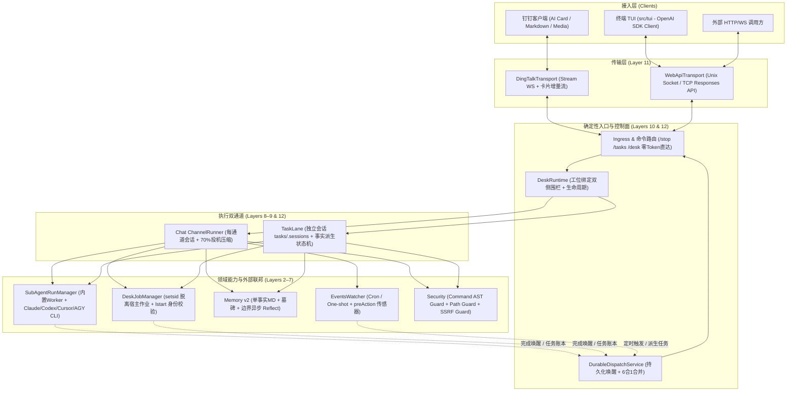

# Pipiclaw (v0.9.5+) 深度审查与演进路线图

> [!IMPORTANT]
> **总体审查结论**：在 `v0.9.5` 之后，Pipiclaw 已经越过了“能不能跑通闭环”的阶段，成长为一个在个人 Agent 领域**架构纯度极高、运行时不变量极其扎实**的“自托管异步研发控制面（Harness）”。全仓 `src/` 下 334 个 TypeScript 文件（60,835 行代码）在 AST 级架构门禁下保持 **0 分层逆向依赖、0 循环引用**，其事实派生任务状态机、脱离宿主进程的外部 CLI 联邦结算、双层透明文件记忆以及三层自证测试体系，在工程深度上已明显领先于市面上大多数以“Prompt 编排 + 插件堆砌”为主的开源个人助手。
>
> **下一阶段的核心矛盾**不再是“补齐基础能力”，而是解决三件事：
> 1. **堵住实现层跨模块接缝处的隐蔽缺陷与安全缺口**（例如 `bash`/`job`/`preAction` 漏传工位 `cwd`、`~/.pipiclaw` 自保护缺失、`EventsWatcher` 异步竞态泄漏 `Cron` 等）；
> 2. **消除单人日常高频工作流的“最后一公里摩擦”**（钉钉语音/文件/引用静默丢弃、单 DM 切换工位冻结后台任务、多仓 `cwd` 配置繁琐、历史归档任务与数天前会话检索失灵、并发写同一工作树的冲突）；
> 3. **在严控项目总复杂度的前提下，有选择地吸收 2026 业界最佳实践**（物理级 Worktree 隔离、已完成工作检索与技能反哺、基于确定性传感器的有界主动性），同时坚决拒绝多租户、向量数据库与角色流水线膨胀。

---

## 一、项目定位、核心使用场景与工程品味画像

### 1.1 本质定位：从“对话扳手”到“异步交付车床”

阅读 [design-philosophy.md](../../docs/design-philosophy.md) 与五篇杠杆手记（[001-from-wrench-to-lathe.md](../../docs/leverage/001-from-wrench-to-lathe.md) 至 [005-fewer-roles-better-handoffs.md](../../docs/leverage/005-fewer-roles-better-handoffs.md)），可以清晰看到 Pipiclaw 鲜明的个人工程底色：

- **定位不是“陪聊全能管家”，而是“单人开发者的全天候异步工程执行系统”**：钉钉（移动端随时发号施令、审批、收结果）与 TUI/WebAPI（桌面端深度沉浸研发）共享同一个守护进程与工位（Desk）真相源。
- **稀缺资源定义极其清醒**：稀缺的不是 Token，而是**开发者的注意力与上下文转述带宽**；错误成本由 `可发现 × 可回滚 × 爆炸半径` 决定，因此允许内部探索犯便宜的错，把硬闸门设在不可逆边界。
- **运行时与模型的职责切分克制而锋利**：“运行时守住不变量，模型负责判断”——状态持久化、唤醒投递、预算扣减、进程收养、命令拦截全部由确定性代码负责；何时拆任务、派哪个外部 CLI、验证是否通过交给模型判断。

### 1.2 五大核心使用场景与支撑链路

| 核心场景 | 典型交互入口 | 关键支撑模块 | 当前成熟度评估 |
|---|---|---|---|
| **① 移动端异步长任务委托与督办** | 钉钉单聊/群聊下达复杂目标，中途手机端审批/补充指令，异步收最终交付 | [ingress.ts](../../src/runtime/ingress.ts) → [task-lane.ts](../../src/runtime/task-lane.ts) → [state.ts](../../src/tasks/state.ts) → [delivery.ts](../../src/tasks/delivery.ts) | **核心机制极稳**；但移动端发语音/文件/引用回复、单 DM 切工位存在明显摩擦 |
| **② 桌面终端沉浸式编码与跨端接力** | 本地运行 `pipiclaw tui` 交互改码，出门后在钉钉查看同一工位进度 | [cli.ts](../../src/tui/cli.ts) → [server.ts](../../src/webapi/server.ts) → [desk-runtime.ts](../../src/runtime/desk-runtime.ts) | **协议解耦极佳**；但缺增量流式输出、多终端嵌入式锁冲突、`--cwd` 体验待打磨 |
| **③ 主会话领衔 + 外部顶级 CLI 联邦执行与独立验证** | 主模型理解意图后委派 `claude-main`/`codex-high`/`cursor-main`/`agy-main` 实施，再派 `codex-review` 独立核验 | [subagent.ts](../../src/tools/subagent.ts) → [runs.ts](../../src/subagents/runs.ts) → [run.ts](../../src/subagents/external/run.ts) | **进程生存与结算业界一流**；`cursor-cli` 核验存在一处 bug，并发写隔离仍靠手工命令 |
| **④ 跨会话长期记忆沉淀与冷历史回溯** | 自动提炼用户偏好与项目事实至 Markdown，写每日工作日记，必要时检索冷日志 | [boundary-work.ts](../../src/memory/boundary-work.ts) → [reflect.ts](../../src/memory/reflect.ts) → [session-search.ts](../../src/memory/session-search.ts) | **可审计性极强**；但 `session_search` 存在 500 块截断盲区，且已归档任务不可检索 |
| **⑤ 定时与传感器驱动的例行/守望工作** | 定时唤醒或通过 `preAction` 脚本检测外部变化后拉起独立任务实例 | [watcher.ts](../../src/events/watcher.ts) → [durable-dispatch.ts](../../src/runtime/durable-dispatch.ts) | **与一次性任务解耦清晰（Spec 052）**；存在并发重载竞态与 `timeoutMs` 往返丢失问题 |

### 1.3 运行时全栈拓扑与历史演进品味

特别值得肯定的是项目在近期迭代中展现出的**“敢于做减法的品味”**（我们在后续建议中将严格尊重这些既定裁决，绝不开倒车）：
- **单人可见性优先（[2026-10-30-design-focus-review.md](../../docs/reviews/2026-10-30-design-focus-review.md#L5)、[Spec 065](../../docs/specs/065-personal-delivery-focus/design.md)）**：因为只有一个真实人类用户，保留后台委派的实时通知可观测性比“为了安静而隐藏后台活动”更有价值；采用固定保留窗口（7 天作业、30 天委派记录）替代复杂的引用计数 GC。
- **按“能力/成本/权限边界”而非“虚拟角色岗位”配置子代理（[examples/sub-agents/README.md](../../examples/sub-agents/README.md)）**：果断删掉 `planner/builder/reviewer/scout` 角色流水线，收敛为 11 个按模型能力档位命名的配置项，彻底消除了多跳传话损耗。
- **严守上游 SDK 边界与零运行时迁移包袱（[Spec 067](../../docs/specs/067-execution-latency/design.md#L21)、[AGENTS.md](../../AGENTS.md#L114)）**：只消费官方 `@earendil-works/pi-*` 包，不维护私有补丁分支；数据格式演进只做一次性离线迁移，不在源码里堆积历史兼容分支。

---

## 二、设计层深度审查：沉淀的护城河 vs 结构性张力

### 2.1 六大标杆级架构优势（项目核心资产）

1. **物理上消灭“假等待”的事实派生任务状态机（Spec 064）**
   - 在 [state.ts](../../src/tasks/state.ts#L58-L126) 与 [frontmatter.ts](../../src/tasks/frontmatter.ts#L242-L254) 中，模型工具没有任何参数可以直接写 `state`、`waiting` 或 `paused`。`waiting` 严格由运行时观测到的三类事实派生：在途绑定工作（`work`）、未答复的用户提问（`user`）、或明确的时间点（`until`）。一旦在途工作归零，`evaluateWaiting` 自动返回 `"queue"`，从根源上杜绝了 Agent 框架最常见的“模型自称在等结果但没有任何唤醒源”的死锁。
   - 配合 [store.ts](../../src/tasks/store.ts#L81-L113) 的 **WAL 先行机制**（先追加带 `revision` 的 JSONL 检查点，再原子替换 `.md`）以及 [task-step.ts](../../src/runtime/task-step.ts#L154-L158) 基于 `contractSha` 的**无状态按需契约注入**（仅在首步、契约正文修改后或会话压缩冲掉旧消息后重发完整契约，其余步仅发增量 brief），既抗崩溃又极其省 Token。

2. **跨守护进程重启存活的外部 CLI 联邦与两阶段幂等结算**
   - [external/run.ts](../../src/subagents/external/run.ts#L171-L340) 将外部 CLI 的 stdout/stderr 直接重定向至磁盘文件描述符（父进程管道零缓冲），通过 `setsid` 独立进程组运行，并采集 `/proc/<pid>/stat` 的 `pidBirth`；守护进程重启后由 [reconciliation.ts](../../src/subagents/external/reconciliation.ts) 核验 PID 出生时间防止误杀复用 PID。
   - [runs.ts](../../src/subagents/runs.ts#L508-L948) 用三个独立幂等位（`settledAt`、`usageRecorded`、`wakeEnqueued`）串起“磁盘记账 → 费用归集 → 唤醒投递”，并在 `spawn` 前强制执行同步 `appendStrict` 审计日志（[logger.ts](../../src/security/logger.ts#L35-L40)）。这套设计在单机个人运行时中达到了准分布式系统的可靠性。

3. **零 Token 确定性控制面、唤醒合并与错误受众分流**
   - `/stop`、`/new`、`/tasks`、`/subagents`、`/desk` 全部在进入模型前由确定性路由拦截；`/new` 甚至能绕过卡死的通道队列先原子切换 `active-session.json`（[ingress-commands.ts](../../src/runtime/ingress-commands.ts#L76-L154)）。
   - [durable-dispatch.ts](../../src/runtime/durable-dispatch.ts#L434-L498) 的 `absorbPending` 将同一通道最多 6 个并发完成的子代理/作业唤醒折叠进**单次 LLM 回合**，并用 `stopEpoch` 防止 `/stop` 与合并竞态。
   - [recoverable-error.ts](../../src/shared/recoverable-error.ts) 将“模型能自己修的参数/状态错误”与“必须惊动人类的权限/故障错误”彻底分流，配合带下一步指引的报错文案，显著降低了无谓中断。

4. **全透明、防污染、不阻塞主回合的 Memory v2**
   - 会话切换/压缩时仅用几毫秒把原始切片落盘为 `.memory-work/<conv>/<id>.json`（[boundary-work.ts](../../src/memory/boundary-work.ts)），后台串行执行单次 LLM `reflect`。
   - 用确定性规则兜底模型幻觉：`source: user` 铁律禁止后台篡改用户显式记忆、[tombstones.ts](../../src/memory/tombstones.ts) 防止已删记忆死灰复燃、[transcript.ts](../../src/memory/transcript.ts#L24-L71) 剥离 `<memory_bootstrap>` 等注入标签防止回声自强化。

5. **极致的 Prompt Cache 保护与投机式后台压缩**
   - [turn-prompt.ts](../../src/agent/turn/turn-prompt.ts#L57-L62) 把所有易变上下文（时间戳、通道 ID、任务议程、记忆引导）全部移出 System Prompt 放入 User Turn XML 块且按稳定度排序；7 份内置 Playbook（共 9,589 units）通过渐进披露将日常常驻开销压到 ~250 units（[catalog.ts](../../src/playbooks/catalog.ts#L119-L146)）。
   - [compaction-snapshot.ts](../../src/agent/session/compaction-snapshot.ts#L64-L188) 在 70% 水位时于工具批次间隙做后台投机压缩，并在 `SessionManager.inMemory` 中精确验算净收益达标后才提交。

6. **AST 架构门禁与自证式三层评测基础设施**
   - [check-architecture.mjs](../../scripts/check-architecture.mjs) 用 TypeScript AST 同时卡住 26 模块分层表、Tarjan 文件环、800 行上限与文档死链；[oracle-checks.ts](../../evals/harness/oracle-checks.ts) 在花一分钱调真模型前先用正/负/等价控制样本校验评分器自身，工程纪律极强。

---

### 2.2 五大结构性设计张力（制约下一步体验跃升的核心瓶颈）

#### 张力一：`Desk`（工位）的生命周期与多仓开发模型存在“两头拧巴”
- **单人单钉钉 DM 切换工位会“冻结”原工位后台工作**：[desk-runtime.ts](../../src/runtime/desk-runtime.ts#L341-L355) 将工位是否激活严格绑定在 `boundCount(desk) > 0` 上。个人开发者在钉钉通常只有一个单聊入口（`dingtalk:dm:<staffId>`）。当 `repo-a` 工位正在跑长任务或定时巡检，用户在单聊发 `/desk bind repo-b` 去问另一个项目一句话时，`repo-a` 的绑定通道数瞬间归零，`deactivate("repo-a")` 会**立即停掉它的 `eventsWatcher`、冻结 `TaskLane` 推进，并丢弃在途子代理/作业的聊天唤醒**！
- **反过来，TUI 每次打开工位都会造成“永久激活泄漏”**：每次执行 `pipiclaw tui --desk repo-x` 都会在 `desk-bindings.json` 持久化一条 `webapi:conv_<id>` 绑定，关闭终端从不解绑，也没有 `/desk archive` 或 `/desk delete` 命令，导致历史工位永久处于活跃扫描态。
- **本地多 Git 仓库指向繁琐且记忆完全孤岛化**：在 `~/projects/foo` 下直接敲 `pipiclaw tui` 默认落进 `~/.pipiclaw/workspace/desk-default` 而非当前目录；想建一个指向现有仓库的工位必须手工改 `desk.json` 的 `"cwd"`（且热修改后 `DeskRuntime.records` 内存缓存还不刷新，见第三章）。同时，用户在 A 仓库沉淀的个人通用编码习惯（提交规范、SSH 环境、行文偏好）无法与 B 仓库共享。

#### 张力二：多执行体并发下的“共享工作树写所有权（Checkout Ownership）”真空
- 引入 `TaskLane`（单工位最多 3 个并发任务）和异步外部 CLI 后，同一个仓库目录可能同时面对：**聊天主会话改文件 + 任务会话改文件 + `mutates: "write"` 外部 CLI 改文件 + `codex-review` (`purpose: "verify"`) 读 diff 核验**。
- 目前 [workspace-lease.ts](../../src/subagents/workspace-lease.ts#L1-L95) **只互斥两个 `mutates: "write"` 的子代理**：主会话/任务领队的 `write`/`edit`/`bash` 完全无视写租约；`purpose: "verify"` 不持共享读锁（核验中途文件可被新写任务篡改）；省略 `workingDirectory` 时还会把整个 `desk-<name>/` 根目录锁死。同时，Git Worktree 的创建、交付合并与清理完全依赖模型阅读 [agent-delegation.md](../../src/playbooks/agent-delegation.md) 后手工拼 `bash` 命令，缺乏运行时级的轻量托管。

#### 张力三：任务成为生产中心后的“历史归档盲区（Archive Blind Spot）”
- 如今复杂工作都在 Task Lane 中完成并最终移入 `tasks/archive/`。但模型侧的 [factory.ts](../../src/tools/task-manage/factory.ts#L56)（`task_list`）只读活跃任务；[session-search.ts](../../src/memory/session-search.ts) 只扫 `conversations/` 下的聊天记录；`memory_search` 只搜提炼后的事实卡片。
- 结果是：**凡是在后台任务里做过的架构权衡、踩过的坑、跑过的验证结论，一旦任务关闭归档，对未来的会话和任务就彻底“失忆”了**（这也印证了 [2026-10-30-design-focus-review.md](../../docs/reviews/2026-10-30-design-focus-review.md) 中挂起的 `D3`）。

#### 张力四：外部 CLI 完全信任模型 vs 内置工具安全守卫的“内紧外松与错位摩擦”
- 一方面，内置 `bash` 的 [command-guard.ts](../../src/security/command-guard.ts#L494-L508) 极其严格：禁止除 `echo/printf` 外的一切 `$VAR` 变量展开、禁止 `git add *.ts` 等通配符、禁止 heredoc，且在 [bash.ts](../../src/tools/bash.ts#L255) 中将不支持的 shell 语法作为致命 `GuardBlockedError`（在聊天窗弹出刺眼的“高危操作”气泡）抛出，而非让模型静默改写命令的 `RecoverableToolError`。
- 另一方面，内置文件工具对 `~/.pipiclaw`（`APP_HOME_DIR`）却毫无防备（可直接读写密钥与安全开关，详见 §3.1），且模型一旦调用外部 CLI 子代理就天然绕过全部内置守卫。安全水位在“高频无害语法”上过紧，在“核心控制面自保”上却漏了底。

#### 张力五：粗粒度回合输出契约与嵌入式守护进程模型对 TUI / WebAPI 的限制
- [channel-context.ts](../../src/channel/channel-context.ts#L19-L45) 的 `TurnEvent` 只有完整块级事件（`thinking` 摘要、工具起止、最终完整 `answer`），没有 token 级增量 `delta`。钉钉靠卡片侧展示工具折叠进度尚可接受，但 TUI 与 WebAPI SSE/WS 客户端在模型生成长段代码/分析时会经历数十秒“完全静止 → 瞬间整屏刷出”的卡顿感。
- `pipiclaw tui` 在无后台守护进程时通过 `bootstrapEmbedded` 抢占全局 `daemon.lock` 启动仅含 Socket 的残血运行时（钉钉不在线，且多开第二个 TUI 终端会在第一个终端退出时被直接连根拔起）。

---

## 三、实现层深度审查：源码级缺陷、安全漏洞与复杂度审计

### 3.1 P0 级安全缺口与跨模块正确性缺陷（强烈建议优先修复）

> [!WARNING]
> 以下 5 项均已通过源码逐行核实，涉及**跨模块契约违背、控制面凭据自保缺失、SSRF 绕过以及必现崩溃/定时器泄漏**，修复成本均很低（每项约 15–60 行代码），但收益极大。

#### [P0-1] ✅ 已修复：`bash`、后台作业 `job` 与事件 `preAction` 全面漏传工位 `cwd`
- **定位**：[runner-factory.ts](../../src/agent/runner-factory.ts#L14-L19)、[bash.ts](../../src/tools/bash.ts#L402-L406)、[manager.ts](../../src/jobs/manager.ts#L290)、[watcher.ts](../../src/events/watcher.ts#L706)
- **根因与影响**：Spec 060、[runtime-orientation.md](../../src/playbooks/runtime-orientation.md#L46) 以及注入给模型的 `<runtime_turn_context>` 均明确承诺：相对路径与默认执行目录为当前工位 `cwd`（默认 `workspace/desk-<desk>/` 或 `desk.json` 自定义目录）。`read`/`write`/`edit`/`glob`/`grep` 与内外部子代理均正确绑定了该 `cwd`；唯独 `createRunner` 传入了裸 `createExecutor()`，`bash.ts` 调用 `executor.exec(...)` 未传 `cwd: securityContext.cwd`，`DeskJobManager.start`（含 [launch.ts](../../src/jobs/launch.ts#L49-L89)）和 `EventsWatcher.runPreAction` 也均未传 `cwd`。
- **后果**：所有同步 `bash`、`bash async:true` 后台作业（无论在聊天还是任务步中！）以及事件 `preAction` 传感器，实际全部运行在**启动守护进程时的宿主 `process.cwd()`** 下！模型先 `write("foo.txt")` 再 `bash("cat foo.txt")` 会直接找不到文件，多工位自定义仓库目录在 shell 层完全失效。
- **修复状态（已合入 `7e7519f`）**：已将工位 `cwd` 贯通至 `bash`（同步与 `async: true`）、`DeskJobManager.start` 及 `EventsWatcher.runPreAction`，与文件工具目录语义完全对齐。

#### [P0-2] ✅ 已修复：`pathGuard` 未保护 `~/.pipiclaw`（`APP_HOME_DIR`），允许模型读取全部密钥并热关闭安全守卫
- **定位**：[path-guard.ts](../../src/security/path-guard.ts#L16-L36)、[path-guard.ts](../../src/security/path-guard.ts#L280-L283)、[index.ts](../../src/tools/index.ts#L56-L58)、[session-host.ts](../../src/agent/session/session-host.ts#L104)
- **根因与影响**：`pathAllowedByDefaults` 默认放行整个 `$HOME`，而内置敏感路径黑名单 `HOME_SENSITIVE_*` 仅列了 `.ssh`/`.aws`/`.gnupg` 等，**漏掉了 `~/.pipiclaw` 自身**（以及外部 CLI 凭据如 `~/.claude/.credentials.json`、`~/.codex/auth.json`）。虽然 `withSubAgentsDirWriteDeny` 拦住了写 `workspace/sub-agents/`，但一旦遭遇网页/文档间接提示词注入：
  1. `read`/`grep` 可直接读取 `~/.pipiclaw/auth.json`（LLM API Keys / OAuth 令牌）、`channel.json`（钉钉 `clientSecret`）、`state/webapi/` 密钥哈希；
  2. `write`/`edit` 可直接把 `~/.pipiclaw/security.json` 覆写为 `{"enabled": false}`——而 `SessionHost` 在每轮重建工具时会热加载 `security.json`，下一轮所有守卫即刻全部失效！
- **修复状态（已合入 `7e7519f`）**：已在默认路径守卫中保护 `~/.pipiclaw` 及自定义 `appHomeDir` 下的控制面配置（`auth.json`、`channel.json`、`security.json`、`models.json`、`tools.json`、`settings.json`）与 `state/`（不影响 `workspace/`），并将 `~/.claude/.credentials.json` 与 `~/.codex/auth.json` 纳入敏感凭据黑名单。

#### [P0-3] ✅ 已修复：`web_fetch` 的 Jina 直通/回退绕过 `NetworkGuardError` SSRF 拦截（`home.ts` 初始化模板按设计保留 `networkGuard` 显式 opt-in）
- **定位**：[home.ts](../../src/app/home.ts#L140-L150)、[config.ts](../../src/security/config.ts#L29)、[client.ts](../../src/web/client.ts#L60-L81)、[fetch.ts](../../src/web/fetch.ts#L75-L120)、[fetch.ts](../../src/web/fetch.ts#L248-L264)
- **根因与影响**：
  1. `DEFAULT_SECURITY_CONFIG` 设计上默认 `networkGuard.enabled: true`，而 `home.ts` 的 `SECURITY_CONFIG_TEMPLATE` 在初始化 `~/.pipiclaw/security.json` 时写入 `"networkGuard": { "enabled": false }`（见 [docs/security.md](../security.md#L153-L154)，避免首次安装误伤本地代理与局域网 SearXNG）。
  2. 在 `web/fetch.ts` 中，当 `preferJina: true` 时直接跳过 `validateNetworkTarget`；当直连因 `NetworkGuardError`（如目标被判定为受限域名或私网地址）抛错时，`catch` 块在 `enableJinaFallback: true` 下把被拦截的原始 URL 拼接到 `https://r.jina.ai/<url>` 继续外发请求。
- **修复状态**：`home.ts` 按本地开发场景与文档契约保持 `networkGuard.enabled: false` 显式 opt-in；同时在 [client.ts](../../src/web/client.ts) 与 [fetch.ts](../../src/web/fetch.ts) 中修复了 Jina 绕过漏洞（`tryFetchViaJina` 前置校验原始目标 URL，`runWebFetch` 捕获 `NetworkGuardError` 时直接重抛不再回退 Jina）。

#### [P0-4] ✅ 已修复：`cursor-cli` 执行器在 `purpose: "verify"` 时必现参数崩溃
- **定位**：[discovery.ts](../../src/subagents/discovery.ts#L862-L863) 与 [cursor-cli.ts](../../src/subagents/external/cursor-cli.ts#L176-L180)
- **根因与影响**：Cursor CLI 不支持 `--model <name>[effort=...]` 后缀（因此 [examples/sub-agents/README.md](../../examples/sub-agents/README.md#L43) 中 `cursor-main` 刻意不配 `thinkingLevel`）。然而 `resolveConfiguredRole` 在 `purpose === "verify"` 且角色未配 `thinkingLevel` 时强行注入 `DEFAULT_THINKING_LEVEL`（`"medium"`），导致 `cursor-cli.ts` 拼出 `--model auto[effort=medium]` 直接启动失败。
- **修复状态（已合入 `7e7519f`）**：对 `cursor-cli` / `exec` 外部角色在未显式声明 `thinkingLevel` 时不再隐式注入 `"medium"`，且 `cursor-cli` 对 `model: auto` 保持裸传不加后缀。

#### [P0-5] ✅ 已修复：`EventsWatcher` 异步重载竞态泄漏永生 `Cron`，且 `event_manage` `show → update` 静默丢失 `preAction` 超时
- **定位**：[watcher.ts](../../src/events/watcher.ts#L105-L110)、[watcher.ts](../../src/events/watcher.ts#L241-L246)、[watcher.ts](../../src/events/watcher.ts#L458-L481) 与 [event-manage.ts](../../src/tools/event-manage.ts#L64)、[event-manage.ts](../../src/tools/event-manage.ts#L220)、[event-manage.ts](../../src/tools/event-manage.ts#L299)
- **根因与影响**：
  1. `start()` 中 `scanExisting()` 与 `fs.watch` 并发运行，`handleFileChange` 触发的异步 `handleFile(filename)` 未按文件名串行化；当两次 `handleFile` 重叠进入 `handlePeriodic` / `handleOneShot` 时，`this.crons.set(filename, cron)` 直接覆盖 Map 而不 `.stop()` 旧 `Cron` 实例，导致旧 `Cron` 变成内存孤儿，在守护进程存活期间无限重复触发且无法删除！
  2. `event_manage` 入参叫 `preAction.timeoutMs`，落盘字段叫 `preAction.timeout`；但 `action: "show"` 直接返回磁盘原始 JSON（含 `timeout`）。当模型遵循 [event-scheduling.md](../../src/playbooks/event-scheduling.md#L27) 先 `show` 再原样 `update` 时，`timeoutMs` 为 `undefined`，自定义超时被静默重置回 10 秒（且 Playbook 第 46 行示例写的也是磁盘不认的 `timeoutMs`）。
- **修复状态（已合入 `7e7519f`）**：已按文件名串行化 `EventsWatcher` 加载并在替换前 `.stop()` 旧 `Cron`/Timer；`event_manage` 的 `show` 投影 `timeoutMs` 并兼容 `timeout` / `timeoutMs`；`/events list` 补齐 `commandGuardConfig` 校验与 `.error.txt` 故障展示。

---

### 3.2 P1 级核心体验断点、长周期退化与并发隐患

#### 1. 钉钉移动端交互与投递链路断点（✅ 核心项已修复）
- **✅ 已修复 — 入站语音、文件与引用回复支持**：[inbound-media.ts](../../src/dingtalk/inbound-media.ts) 已原生支持 `audio`（优先提取 `content.recognition` 为 `[语音转写]`，无转写时回退下载语音原件）、`file`（20MB 上限落盘至 `inbox/` 并注入路径）与 `repliedMsg`（注入 `[引用消息：…]` 前缀）；对暂不支持的 `video`/`chatRecord`/`interactiveCard` 在 [inbound.ts](../../src/dingtalk/inbound.ts) 返回明确中文引导。
- **✅ 已修复 — 出站 `send_media` 限额对齐与可恢复报错**：[send-media.ts](../../src/tools/send-media.ts) 预读上限提升至 20MB，发送失败改为抛出带打包/转文本指引的 `RecoverableToolError`。
- **✅ 已修复 — 交付归档补齐与标题透传**：[delivery.ts](../../src/dingtalk/delivery.ts) 的 `replaceWithFinal` 已补调 `archiveBotResponse(text)`，`deliverAnswer` 已向 `sendFinal` 透传 `event.title`（`whenBusy: "steer"` 交互策略保持现状待后续评估）。

#### 2. 记忆与冷历史检索的长周期退化（✅ 检索与归档召回已修复；`reflect.ts` 锁优化留待后续）
- **✅ 已修复 — `session_search` 预截断修复与归档任务检索**：[session-search.ts](../../src/memory/session-search.ts) 已移除带查询词时的 `maxChunks` 前置截断并加入无损子串预筛；[session-corpus.ts](../../src/memory/session-corpus.ts) 已将 `tasks/archive/*.md` 及结项/汇报摘要纳入语料，`task_list`（[lifecycle.ts](../../src/tools/task-manage/lifecycle.ts)）已支持 `includeArchived` 与 `query` 过滤。
- **待后续迭代 — `reflect.ts` 规模化与事务性隐患**：
  1. [reflect.ts](../../src/memory/reflect.ts#L252) 在长达 45 秒的后台 LLM 请求期间全程持有 `.locks/memory.lock`，阻塞用户侧同步执行的 `memory_save` / `memory_forget`（超时仅 10 秒）；
  2. 第 415–428 行将“单条低价值 `add` 被跳过”算作 `skipped > 0`，进而阻断同批次所有合法的过时记忆 `delete`；
  3. 第 280–286 行 `touch` 操作无需任何跨日复现门槛即可直接将 `probationary` 记忆转正为永久记忆，而 `expires` 过期字段在所有读取与索引生成路径上从未被过滤；
  4. 当用户手工沉淀的 `source: "user"` 记忆超过 1,400 units（预算的 70%）时，`condense` 因无权修改用户记忆将陷入每次后台运行都白跑一轮 LLM 的死循环（[index-budget.ts](../../src/memory/index-budget.ts#L18)）；且 [sidecar-worker.ts](../../src/memory/sidecar-worker.ts#L222) 已支持的 JSON 格式 `repair` 回调在 `reflect.ts` 调用处未接线。

#### 3. Task Lane 长周期运行脆弱点与 I/O 放大（✅ 核心项已修复）
- **✅ 已修复 — `stopGraceMs` 放宽与隔离 Runner 自动解绑恢复**：[task-lane.ts](../../src/runtime/task-lane.ts) 默认 `stopGraceMs` 提升至 15 秒；[task-step.ts](../../src/runtime/task-step.ts) 在步骤被隔离时摘除旧 `runner` 并在其退出后安全 `dispose()`，后续执行 `/tasks resume` 即可重建干净会话恢复推进。
- **✅ 已修复 — 任务会话文件清理与压缩提示分流**：
  1. [archive.ts](../../src/tasks/archive.ts) 归档提交时已自动清理 `tasks/.sessions/<id>.jsonl` 并释放 [loop-log.ts](../../src/tasks/loop-log.ts) 的 `appenders` 句柄；
  2. [input-receipts.ts](../../src/tasks/input-receipts.ts#L23-L41) 的增量扫描留待后续按需优化；
  3. [compaction.ts](../../src/agent/session/compaction.ts) 与 [session-host.ts](../../src/agent/session/session-host.ts) 已区分任务会话与聊天会话，不再向任务步输出无效的 `/compact`、`/new` 提示。
- **按规格保留 — 匿名坏投递文件全局栅栏**：有明确归属 `taskId` 的损坏记录已按单任务隔离；完全匿名的损坏记录保留全局栅栏以严格守住 Spec 064 投递 FIFO 顺序不变量。
- **✅ 已修复 — 消除扫描回路子进程风暴**：[task-lane.ts](../../src/runtime/task-lane.ts) 在无对账变更时跳过二次全量扫描；[manager.ts](../../src/jobs/manager.ts) 的 `list()` 抽取 `refreshBatch` 改为单次批量调用 `probeAll`。

#### 4. WebAPI / TUI 运行时竞态与连接陷阱（✅ 核心项已修复）
- **按规格保留 — WebSocket `maxMs` 寿命上限**：[websocket.ts](../../src/webapi/routes/websocket.ts#L57-L108) 的连接时长上限属于 Spec 061 D19 契约，`response.cancel` 控制帧留待 H1.5 流式协议演进一并设计。
- **✅ 已修复 — `request-execution.ts` 双重 `dispose` 竞态与缓存驱逐**：[request-execution.ts](../../src/runtime/request-execution.ts) 在回合结束时先将一次性 runner 从 `running` 与 `runners` 池摘除再执行 `endTurn()` + `dispose()`，彻底消除 LRU 误驱逐与二次并发 `dispose()`。
- **✅ 已修复 — TUI 多仓 `--cwd`、补全根路径与 `/desk cwd`**：[cli.ts](../../src/tui/cli.ts) 与 [client.ts](../../src/tui/client.ts) 已支持 `--cwd <dir>` 并将 `@file` 补全 `basePath` 对齐到当前工位 `cwd`；新增 `/desk new <name> [cwd]`、`/desk cwd [path|--reset]` 与失联任务接管命令 `/tasks adopt <id>`（[commands.ts](../../src/desk/commands.ts)、[commands.ts](../../src/tasks/commands.ts)，同时删除 [catalog.ts](../../src/commands/catalog.ts) 中重复的 `archive` 条目）。

---

### 3.3 P2 级代码复杂度、架构基线治理与评测集（`evals/`）诊断（✅ 全部已完成）

1. **✅ 已完成 — 外部执行器（Harness）扩展摩擦过大**：已在叶子词汇表 [run-record.ts](../../src/subagents/run-record.ts) 收敛单一真相源 `EXTERNAL_HARNESS_IDS` / `RunHarness` 与 `ALLOWED_THINKING_LEVELS`，并在 [harness.ts](../../src/subagents/external/harness.ts) 的 `ExternalHarness` 契约上显式声明静态能力属性（`resumable`、`requiresProtocolTerminal`、`supportsImplicitVerifyThinking`、`acceptsSystemPromptFlag`、`verifiesResumeSession`、`roleWarnings`），由 [registry.ts](../../src/subagents/external/registry.ts) 的 `Record<RunHarness, ExternalHarness>` 穷尽校验驱动 [discovery.ts](../../src/subagents/discovery.ts)、[task-envelope.ts](../../src/subagents/task-envelope.ts)、[run.ts](../../src/subagents/external/run.ts)、[settlement.ts](../../src/subagents/external/settlement.ts) 与 [role-warnings.ts](../../src/subagents/external/role-warnings.ts)；同时修复了 `detectExistingFlags` 将 `-c` 误作非 Codex 适配器参数冲突的隐性缺陷，复用 `outputFormatConflicts` 与 `parseJsonObjectLines` 薄辅助函数，并将 [subagent-manage.ts](../../src/tools/subagent-manage.ts) 中的 `follow_up` 租约与派发编排下沉至 [dispatch.ts](../../src/subagents/external/dispatch.ts) 的 `dispatchExternalFollowUp`。
2. **✅ 已完成 — [architecture-baseline.json](../../scripts/architecture-baseline.json) 超长文件按职责内聚治理（拒绝机械凑 800 行）**：
   - ✅ **[subagents/discovery.ts](../../src/subagents/discovery.ts)（1031 行 → 631 行，已移出基线）**：将共享角色配置类型与默认常量下沉至叶子 [types.ts](../../src/subagents/types.ts)（解除了 `types.ts → discovery.ts` 的反向类型依赖），并将工具调用期参数解析独立为 [resolve.ts](../../src/subagents/resolve.ts)，使 `discovery.ts` 纯粹聚焦 `workspace/sub-agents/*.md` 发现与校验；
   - ✅ **[jobs/manager.ts](../../src/jobs/manager.ts)（975 行 → 893 行，收紧基线）**：将不依赖管理器私有状态的进程组身份核验与杀进程脚本对称抽离至 [kill.ts](../../src/jobs/kill.ts)（与 [launch.ts](../../src/jobs/launch.ts)、[probe.ts](../../src/jobs/probe.ts) 三套宿主 Shell 协议对齐），保留状态机与 GC 生命周期在单类内的高内聚封装；
   - ✅ **按高内聚原则保留 — [subagents/runs.ts](../../src/subagents/runs.ts)（基线由 1048 收紧至 1029 行）**：外围纯逻辑（`run-record.ts`、`run-archive.ts`、`completion-wake.ts`、`external/reconciliation.ts`）早已剥离完毕，剩余代码为维护 4 个幂等位点与锁序的单一恢复/结算状态机，不做破坏封装的碎片化硬拆。
3. **✅ 已完成 — 随手可修的细节瑕疵**：
   - ✅ [catalog.ts](../../src/commands/catalog.ts) 中重复的 `/tasks archive` 已合并去重；
   - ✅ [presentation.ts](../../src/tools/contract/presentation.ts#L78) 中 `memory_forget` 已改为读取真实 schema 字段 `args.name`；
   - ✅ [agent-delegation.md](../../src/playbooks/agent-delegation.md#L1-L6) 已补齐 `requires-tools: subagent`，禁用委派的 `request` 模式不再暴露该手册；
   - ✅ [durable-dispatch.ts](../../src/runtime/durable-dispatch.ts#L562-L615) 的 `drainOnce` 已改为按 `createdAt` 升序排空并支持 `exhausted` 死信记录到期自动清理；[history.ts](../../src/events/history.ts) 与 [commands.ts](../../src/events/commands.ts#L280-L290) 已为 `events-history.jsonl` 接入跨工位共享的容量轮转（2 MiB × 2 份归档）与跨分片历史读取。
4. **✅ 已完成 — `evals/` 行为评测集破旧立新与第二代升级**：
   - **大刀阔斧瘦身去噪（66 → 42 个高信噪比用例）**：物理删除 24 个已退役、带步骤执教（`coached`）、同构重复或测常量的低价值旧用例及孤立 fixture，保留的 42 个场景（12 个核心 + 29 个活跃扩展 + 1 个隔离探针）100% 为自然用户目标（`journey` + `natural`）；
   - **100% 可执行 Oracle Controls 覆盖（42/42 `qualified`）**：升级弱字符串评分器（新增真实 CLI 沙箱执行的 `cliScopeContract` 与严格类型/不变性校验的 `tsRefactorContract`），并在 [catalog.ts](../../evals/controls/catalog.ts) 为全部 42 个用例补齐正/负/等价三类离线自检控制，彻底清零 `uncovered`（`INCONCLUSIVE`）盲区；
   - **细粒度变更选择映射**：在 [catalog.ts](../../evals/cases/catalog.ts) 与 [selection.ts](../../evals/harness/selection.ts) 解除对 `src/agent/`、`src/tools/`、`src/runtime/` 的一刀切 `common = true`，改为按家族模块依赖精准选中受影响探针（仅底座公共链路变更回退 12 个核心代表集）；
   - **新增 3 个第二代高区分度真实协作探针**：在 [extended-families.ts](../../evals/cases/extended-families.ts) 与 [worker.ts](../../evals/harness/worker.ts)（薄扩展 `step.inbound` 走真实 `parseInboundMessage`）落地跨文件严格 TypeScript 账本重构 `C-refactor-ts-01`、多仓 `/desk cwd` 切换与归档任务回溯 `U-desk-cwd-01`（纳入日常 `dev` 集），以及钉钉日志文件 + 语音转写 + 引用回复精准唤醒目标等待任务的 `I-inbound-context-01`。

---

## 四、结合 2026 业界 Personal / Coding Agent 演进成果的对标思考

结合项目中已有的两篇高质量前沿调研（[personal-agent-proactivity-and-voice.md](../../docs/refer/personal-agent-proactivity-and-voice.md) 与 [personal-agent-proactivity-design-notes.md](../../docs/refer/personal-agent-proactivity-design-notes.md)）以及 2026 年 Coding Agent / Personal Harness 领域的最新实践，我们提炼出**最契合 Pipiclaw 基因的五条演进判断**：

| 业界演进方向（2026 代表实践） | 行业主流做法与痛点 | 对 Pipiclaw 的取舍建议（适配个人低复杂度偏好） |
|---|---|---|
| **1. 并行编码的物理隔离** *(Claude Code `--worktree`、Codex 沙盒工作树、Worktrunk、Cursor Parallel Agents)* | 多 Agent 共享同一 Git 工作树极易互相踩脏未提交变更；主流工具已从“Prompt 叮嘱建 worktree”升级为**Harness 原生自动分配隔离 Git Worktree + 完结返回分支/Diff**。 | **强烈建议吸收（极薄实现）**：无需引入容器/VM，只需在 `subagent` 派发 `mutates: "write"` 时提供可选运行时托管 Worktree（基于 `git worktree add --detach`），结算时自动记录分支/commit 并在任务归档时回收，同时补齐主会话/核验读锁感知。 |
| **2. 记忆与经验闭环** *(Letta/Mem0 图谱库 vs OpenClaw/Claude Auto-Dream 文件级技能蒸馏)* | 重型方案引入外部向量库 + 知识图谱，运维重、黑盒难调且极易召回噪声；轻量高杠杆方案坚持 **Markdown 真相源 + BM25/倒排全文检索 + 将反复成功的任务轨迹蒸馏为可复用 `SKILL.md`**。 | **坚持文件真相源，拒绝向量数据库**：① 修好 `session_search` 全量轻量词频评分（流式扫描无需建库）；② 将 `tasks/archive/*.md` 纳入统一历史工作检索；③ 增加“任务复盘 → 提议生成/更新 `workspace/skills/`”的半自动沉淀闭环。 |
| **3. 主动性（Proactivity）范式** *(Grok Bot / Muse 群聊陪伴抢话 vs OpenAI Dots / DeepSeek Super-agent 委托守望)* | 开放式“每条消息过分类器抢话”适合社交陪聊，但在研发个人助手里极易沦为打扰噪音，且难以验证收益。真正高价值的个人主动性是 **Scoped Watch（受托守望）**：用户明确声明关注条件（PR CI 变红、长跑实验收敛、依赖发布、日志异常），由零成本确定性传感器轮询，命中后才唤醒模型研判。 | **沿作者 11-06 设计笔记收敛落地**：不做群聊主动插话（Grok Bot 模式），而是把现有 `events` 的 `preAction` 升级为**带状态水位线（cursor/hash）的轻量 Watch 传感器 + Shadow Mode（静默记账期）**，把打扰门槛锁死在确定性退出码与冷却预算里。 |
| **4. 外部工具生态桥接** *(常驻多 MCP Server vs CLI-First + 按需单次桥接)* | 把十几个 MCP Server 挂进常驻会话会吞噬数千至上万 System Prompt Token，且长连接子进程脆弱。2026 高效 Coding Harness 普遍回归 **CLI-First**（模型天然擅长调 `gh`、`kubectl`、`sqlite3`、`mcporter` 单次命令 + Skill 说明文档）。 | **保持核心工具面极简（15 个以内）**：不在 Pipiclaw 内核维护复杂的常驻 MCP 进程池；通过一份薄 Skill 配合单次 CLI 调用接入外部 SaaS/数据源，把复杂度挡在守护进程之外。 |
| **5. 语音与移动伴行架构** *(GPT-Live 客户端工具委托、钉钉原生语音消息 vs 全双工 WebRTC)* | 全双工实时语音（Realtime Voice）延迟敏感、状态复杂，若塞进核心 Daemon 会严重污染确定性通道队列。而移动通勤场景 **80% 的真实需求是“松手发一条语音指令 + 异步收结构化文字/卡片结果”**。 | **两步走**：第一步用极小改动接通钉钉原生入站语音（直接消费 `content.recognition` ASR 文本 + 原音频落盘）；第二步若未来需要全双工实时语音，严格作为 **`WebApiTransport` 的独立进程外客户端**（类似 `src/tui` 的地位）构建。 |

---

## 五、Pipiclaw 下一阶段演进路线图（严控复杂度的四阶段计划）

> [!TIP]
> **复杂度预算守则**：本路线图遵循 **“先修内功与高频摩擦，再做高杠杆增量；不加新基础设施依赖，不破 13 层架构表”** 的原则。阶段 H0 与 H1 完成后，Pipiclaw 完全具备正式发布 **`v1.0.0`** 的工程成色。

### 阶段 H0：`v0.9.6` 安全与正确性封板（Pre-1.0 Hardening，高确定性低风险）— ✅ 已完成

1. **✅ 统一 Shell 执行目录语义（修 [P0-1]）**：已修复 `runner-factory.ts` / `bash.ts`、`DeskJobManager`、`EventsWatcher.preAction` 的 `cwd` 漏传，并在 [bootstrap.ts](../../src/runtime/bootstrap.ts) 与 [task-step.ts](../../src/runtime/task-step.ts) 补齐 `/desk cwd` 变更后的 Runner 缓存校验；在 [job-chain.test.ts](../../test/e2e/deterministic/job-chain.test.ts) 扩展了跨 `/desk cwd` + `write → bash → job` 的确定性 E2E 用例（已完成 mutation check）。
2. **✅ 补齐控制面自保护与 SSRF 闭环（修 [P0-2]、[P0-3]）**：已在 `path-guard.ts` 锁死 `appHomeDir` 下的配置/密钥/状态目录写权限与敏感凭据读权限；`home.ts` 模板按 [docs/security.md](../security.md#L153-L154) 保持 `networkGuard.enabled: false` 显式 opt-in，并在 [fetch.ts](../../src/web/fetch.ts) 堵住 `preferJina` 与 `enableJinaFallback` 对 `NetworkGuardError` 的绕过。
3. **✅ 修复外部执行器与事件调度必现缺陷（修 [P0-4]、[P0-5]）**：已修复 `cursor-cli` 在 `purpose: "verify"` 下的 `[effort=...]` 崩溃；串行化 `EventsWatcher.handleFile` 并停止被替换的旧 `Cron`/Timer；对齐 `event_manage` 的 `timeout` / `timeoutMs`。
4. **✅ 顺手消除低垂缺陷与清零架构基线**：
   - 已移除 `session_search` 打分前截断 500 块的 bug（先做轻量小写子串预筛再分词打分）；
   - 已修复钉钉 `replaceWithFinal` 漏归档、`deliverAnswer` 漏传 `title`、`send_media` 误抛普通 `Error`、`presentation.ts` 的 `memory_forget` 字段名、`catalog.ts` 重复 `archive`；
   - 已将 `TaskLane` 的 `stopGraceMs` 放宽至 15s、消除隔离态异步写 `pause` 与延迟结算 `endStep` 的竞态（[task-step.ts](../../src/runtime/task-step.ts)）、限定 `.delivery/` 坏文件故障仅影响对应任务、归档任务时一并归档/清理 `tasks/.sessions/<id>.jsonl` 与 `appenders` 缓存；
   - 已按 §3.3 按内聚度治理历史超长文件（拆分 `discovery.ts` 为 `types.ts` + `discovery.ts` + `resolve.ts` 并移出基线，抽离 `jobs/kill.ts` 并收紧 `jobs/manager.ts` 与 `subagents/runs.ts` 水位线）。

---

### 阶段 H1：`v1.0` 零摩擦单人高杠杆工作流（核心体验跃升）

#### 方向 1.1：钉钉移动生产力“全接住”闭环（✅ 已完成）
- **原生接入语音、文件与引用回复**：
  - `msgtype === "audio"`：优先提取 `content.recognition` 作为用户输入文本（标注 `[语音转写]`），同时可选保存原音频至 `inbox/`；
  - `msgtype === "file"`：复用已有的 `downloadMessageFile` + `persistInboundFile` 落盘至工位 `inbox/`，在消息中注入文件路径与大小供模型直接 `read` / `bash` 处理；
  - `repliedMsg`：当用户引用历史消息（尤其是引用某条任务报告或提问回执）时，将引用摘要拼入 `<replied_message>` 上下文；若引用的消息携带明确 `[task:<id>]` 标记，可直接确定性路由至 `task_message`！
  - 对暂不支持的富媒体类型返回一行清晰的中文引导，彻底消灭“发消息无回音”（已在 [inbound.ts](../../src/dingtalk/inbound.ts) 中覆盖所有无法提取正文或附件的非文本消息类型）。
- **后台任务委派通知精细化（尊重 Spec 065 可见性裁决）**：保留实时通知，但在任务触发的委派通知与进度回执上附带任务来源标签（已在 [receipts.ts](../../src/tasks/receipts.ts)、[runs.ts](../../src/subagents/runs.ts) 与 [commands.ts](../../src/subagents/commands.ts) 接入 `reportReceipt` 与 `taskId`）；当 `wake-coalescing` 合并 $K$ 个聊天子代理完成唤醒时，将 $K$ 条散碎完成提示合并为单条汇总提示。

#### 方向 1.2：`Desk` 多仓人体工学与双层记忆共享
- **极简仓库绑定体验**：支持 `pipiclaw tui --here`（或 `--cwd <path>`）与 `/desk new <name> [cwd]`、`/desk cwd <path>`，并在 `/desk list` 展示当前 `cwd`；修复 `DeskRuntime` 修改 `desk.json` 后的热刷新与 TUI `@file` 补全根目录。
- **解耦“活跃后台工作”与“当前聊天通道绑定”**：工位只要仍有 `running/waiting` 的 Task 或启用的定时 Event，即保持后台激活推进（结果投递至任务记录的归属通道）；用户在唯一钉钉 DM 中临时 `/desk bind repo-b` 聊天不再冻结 `repo-a` 的后台长任务！同时提供 `/desk archive <name>` 干净回收不再使用的临时项目工位。
- **“用户全局层 + 工位项目层”记忆清晰分工**：允许 `memory_save`（及 `reflect` 中高置信度的跨项目个人习惯）指定 `scope: "user" | "desk"`（底层对应已有的 `workspace/MEMORY.md` 或 `workspace/memory/` 与 `desk-<name>/memory/`），彻底打通多仓库间的个人工程偏好复用。

#### 方向 1.3：运行时辅助的轻量 Git Worktree 隔离与读写租约（✅ 已完成）
- **薄封装而非重沙盒**：
  - 在 [workspace-lease.ts](../../src/subagents/workspace-lease.ts)、[write-content.ts](../../src/tools/write-content.ts) 与 [edit.ts](../../src/tools/edit.ts) 中引入完整读写锁语义：`purpose: "verify"`（`mutates: "read"`）持共享读租约（允许并行核验、阻止并发写入污染），主会话/任务会话的 `write`/`edit` 检查目标路径是否存在活跃子代理写租约或核验读租约（冲突时抛 `RecoverableToolError` 引导模型等待或改用 `worktree: true`，内置子代理通过 `leaseOwnerRunId` 放行自身持锁目录且豁免工位控制面文件）；
  - 为 `subagent` / `subagent_inline` 落地运行时托管 `worktree: true`（[worktree.ts](../../src/subagents/worktree.ts)、[dispatch.ts](../../src/subagents/dispatch.ts)）：在 `<gitCommonDir>/pipiclaw-worktrees/<runId>`（`.git/pipiclaw-worktrees/<runId>`）自动创建 `pipiclaw/<runId>` 分支工作树，结算时在 `details.worktree`、`RunRecord`、唤醒通知与任务结算输入中结构化返回 `branch`、`headSha`、`changedFiles`；无改动工作树于结算时即刻回收，已合并的干净工作树在父任务关闭（[task-close.ts](../../src/runtime/task-close.ts)、[task-control.ts](../../src/runtime/task-control.ts)、[lifecycle.ts](../../src/tools/task-manage/lifecycle.ts)）或 24h 超时巡检（[runs.ts](../../src/subagents/runs.ts)）时自动 `git worktree remove` 回收，含未提交或未合并提交的工作树自动保留并在回执/日志中明确提示。

#### 方向 1.4：打通“已完成任务归档（Task Archive）”检索与 Shell 守卫降噪（✅ 已完成）
- **统一历史工作召回**：为 `task_list` 增加 `includeArchived` / 关键词过滤，或提供轻量 `work_search`（同时覆盖 `tasks/archive/*.md` 的目标/最终交付摘要与全量 `conversations/*/log.jsonl`），让模型在接新需求时能秒查“上次这个模块是怎么改的”（已在 [session-corpus.ts](../../src/memory/session-corpus.ts) 打通 `tasks/archive/<id>.md` 与 `<id>.jsonl` 的 `report`/`ask`/`message`/`close` 归档索引）。
- **Shell 守卫减摩**：在 [bash.ts](../../src/tools/bash.ts) 中将 `unsupported-shell`（语法受限但非恶意命令）改为抛 `RecoverableToolError`（不弹用户侧高危告警，直接指导模型改用简单命令或文件工具），并在 [command-guard.ts](../../src/security/command-guard.ts) 安全参数位置放开无副作用的只读检查命令 glob。
- **✅ 已完成 — 外部 Harness 注册表与 `follow_up` 编排收敛**：已在 [run-record.ts](../../src/subagents/run-record.ts) 与 [harness.ts](../../src/subagents/external/harness.ts) 收敛单一能力声明与 `Record<RunHarness, ExternalHarness>` 穷尽注册表，并将 `subagent-manage.ts` 中的 `follow_up` 执行逻辑下沉至 [dispatch.ts](../../src/subagents/external/dispatch.ts)。

#### 方向 1.5：WebAPI / TUI 增量流式与单机守护进程收敛（✅ 已完成）
- 在 `TurnOutputPort`（[channel-context.ts](../../src/channel/channel-context.ts)、[session-events.ts](../../src/agent/session/session-events.ts)、[response-state.ts](../../src/webapi/response-state.ts)、[pitui-frontend.ts](../../src/tui/pitui-frontend.ts)）增加增量事件 `text.delta` / `reasoning.delta`，让 TUI 与 WebAPI 客户端获得丝滑的实时逐字流式反馈（钉钉端继续按水位刷新）；
- 为 WebSocket（[websocket.ts](../../src/webapi/routes/websocket.ts)）补齐 `response.cancel` 控制帧，并在 [session.ts](../../src/tui/session.ts) 静默处理空闲态 60 分钟连接轮转；独立隔离 [request-execution.ts](../../src/runtime/request-execution.ts) 的无状态 Runner 字典；
- 优化 `pipiclaw tui` 启动策略：在 [client.ts](../../src/tui/client.ts) 检测到已有进程持有锁且无 WebAPI socket 时展示 `daemon.lock` 持有者 PID 与启动时间，并在 [cli.ts](../../src/tui/cli.ts) 为嵌入式模式补齐 `SIGHUP`/`SIGTERM` 优雅停机钩子。

---

### 阶段 H2：`v1.1` 有界主动性与自进化能力（放大长期复利）

1. **受托守望原语（Scoped Watch = 带水位线的 Event Sensor + Shadow Mode）**
   - 直接深化 [personal-agent-proactivity-design-notes.md](../../docs/refer/personal-agent-proactivity-design-notes.md) 的思路，不引入新顶层模块，而是在 `src/events/` 上做最小增强：
     - 为周期性事件的 `preAction` 提供一个专属状态目录/环境变量（如 `$PIPICLAW_EVENT_STATE_FILE`）与标准输出传递：传感器脚本（如 `gh pr checks`、`git fetch` 比对远端、监控日志新增错误行）仅在**状态发生有意义跃迁**时以 `exit 0` 输出变化摘要，将该摘要直接注入唤醒事件或派生任务契约；无变化时 `exit 1` 零 Token 静默跳过；
     - 支持 `mode: "shadow" | "notify"`：新建的守望规则可先在 `shadow` 模式下只写记录不推钉钉，由 `/events history` 审阅命中率后再转正，彻底杜绝垃圾推送。

2. **经验到技能的半自动蒸馏（Trajectory-to-Skill）**
   - 当一个多步复杂任务（例如耗费 >10 步、经历过排错重试最终成功关闭的任务）执行 `task_close` 时，或在 `reflect` 周期中发现同类技术排障重复出现时，支持生成一份候选 `SKILL.md` 草稿（或通过 `/tasks distill <id>` 显式触发），经用户确认后落入 `workspace/skills/`。相比自动往 `MEMORY.md` 塞零散事实，把“完整排障套路/项目构建诀窍”沉淀为按需加载的 Skill，既不占常驻上下文，复用精度又高出一个数量级。

3. **✅ 已完成 — `evals/` 第二代升级**
   - 已在 [catalog.ts](../../evals/cases/catalog.ts) 与 [selection.ts](../../evals/harness/selection.ts) 建立细粒度模块→用例映射（消除改一行代码跑全集的摩擦）；
   - 已物理清理 24 个退役/执教/同构旧用例，并为保留的全部 42 个用例（含媒体交互、记忆防投毒、外部委派、定时事件、崩溃恢复等）100% 补齐可执行正/负/等价 Oracle Controls（`selftest` 42/42 `qualified`）；
   - 已新增多文件严格 TypeScript 重构 `C-refactor-ts-01`、跨仓 `/desk cwd` 隔离与归档回溯 `U-desk-cwd-01`、钉钉文件+语音+引用消歧 `I-inbound-context-01` 三个第二代高区分度探针。

---

### 阶段 H3：`v1.2+` 进程外生态与多模态外设（按需选做）

- **语音实时伴行客户端（Out-of-Process Voice Frontend）**：若未来希望在通勤/散步时拥有双向语音交互，**绝不把音频编解码与 WebRTC 塞进 `src/runtime/`**，而是完全仿照 `src/tui/` 的架构，基于 `WebApiTransport` 编写独立的语音前端进程（连接 Qwen-Audio-Realtime / OpenAI Realtime 作为语音壳，复杂编码与仓库查询通过 Responses API 委托给本地 Pipiclaw 守护进程执行）。
- **轻量移动端/Web 看板客户端（可选）**：同样作为 `WebApiTransport` 的纯前端消费者展示跨工位任务时间线与 Diff 审阅，核心 Daemon 零膨胀。

---

## 六、明确建议“不做什么”（Anti-Roadmap / 复杂度防火墙）

为了守护 Pipiclaw 最宝贵的“单人可控、全栈透明、心智负担低”的特质，建议在未来迭代中**明确拒绝**以下诱惑：

1. **绝不引入外部向量数据库、图数据库或重型存储引擎（Postgres / Redis / Qdrant / Neo4j）**：个人规模（数千条对话分块、数百个归档任务、百余条精选记忆）在内存中做流式 BM25 / 词项匹配只需几毫秒，纯文本 Markdown + JSONL 的 `grep`/`git` 可审计性无可替代。
2. **绝不恢复“多角色拟人化流水线 / 辩论委员会（Planner → Coder → QA → PM Swarm）”**：保持“1 个拥有完整上下文的 Leader + 按能力/成本/隔离边界划分的执行器 + 1 次独立核验”的最短链路。
3. **绝不在核心 Daemon 内置浏览器自动化引擎（Playwright/Puppeteer）或常驻 MCP 进程管理器**：需要网页交互或外部系统集成时，一律通过外部 CLI / 单次脚本 + Skill 说明按需调用。
4. **绝不做开放式群聊“察言观色主动插话”分类器**：坚持“用户显式点名或确定性传感器触发才说话”，守住零打扰底线。
5. **绝不做多租户权限体系、RBAC 或云端同步账号系统**：保持单宿主、单信任域的纯粹假设。
6. **绝不为了兼容旧磁盘格式而在运行时保留双轨读取代码**：继续坚持 [AGENTS.md](../../AGENTS.md#L114) 的离线一次性迁移原则。

---

## 七、优先行动清单速查表（Actionable Checklist）

| 优先级 | 状态 | 事项 | 核心涉及文件 | 预估改动量 | 预期收益 |
|---|---|---|---|---|---|
| **P0** | ✅ 已修复 | 修复 `bash` / `job` / `preAction` 漏传工位 `cwd` | [bash.ts](../../src/tools/bash.ts), [manager.ts](../../src/jobs/manager.ts), [watcher.ts](../../src/events/watcher.ts) | ~40 行 | 彻底对齐文件工具与 Shell 工具的目录语义，激活多仓工位 |
| **P0** | ✅ 已修复 | 保护 `~/.pipiclaw` 控制面文件与外部 CLI 凭据 + 堵住 `web_fetch` Jina SSRF 绕过（`networkGuard` 模板保留 opt-in） | [path-guard.ts](../../src/security/path-guard.ts), [fetch.ts](../../src/web/fetch.ts), [client.ts](../../src/web/client.ts) | ~80 行 | 防止间接注入窃取密钥/热关闭守卫或通过 Jina 绕过受限域名拦截 |
| **P0** | ✅ 已修复 | 修复 `cursor-cli` 核验崩溃、`EventsWatcher` 竞态泄漏与 `timeoutMs` 丢失 | [cursor-cli.ts](../../src/subagents/external/cursor-cli.ts), [watcher.ts](../../src/events/watcher.ts), [event-manage.ts](../../src/tools/event-manage.ts) | ~70 行 | 消除必现参数报错与重复定时任务幽灵 |
| **P1** | ✅ 已修复 | 修复 `session_search` 500 块预截断 + 打通 `tasks/archive` 历史检索 | [session-search.ts](../../src/memory/session-search.ts), [session-corpus.ts](../../src/memory/session-corpus.ts), [lifecycle.ts](../../src/tools/task-manage/lifecycle.ts) | ~120 行 | 恢复数天前冷历史召回，消除已完成任务失忆 |
| **P1** | ✅ 已修复 | 钉钉入站接入 `audio`（ASR）、`file`、`repliedMsg` + 修复归档与 `send_media` | [inbound-media.ts](../../src/dingtalk/inbound-media.ts), [delivery.ts](../../src/dingtalk/delivery.ts), [send-media.ts](../../src/tools/send-media.ts) | ~180 行 | 手机端发语音、传日志、引用回复任务无缝闭环 |
| **P1** | ✅ 已修复 | `Desk` 多仓 `--cwd` / `/desk cwd` 人体工学 + `/tasks adopt` 接管失联任务 + 修复 `request-execution` 竞态 | [cli.ts](../../src/tui/cli.ts), [commands.ts](../../src/desk/commands.ts), [desk-runtime.ts](../../src/runtime/desk-runtime.ts), [task-control.ts](../../src/runtime/task-control.ts) | ~200 行 | 顺畅支撑一人同时推进多个本地代码仓库并保留 `DESK-3` 安全隔离 |
| **P1** | ✅ 已修复 | Task Lane 健壮性（`stopGraceMs`、隔离恢复、`.sessions` 清理、任务压缩分流、批量 `probeAll`） | [task-lane.ts](../../src/runtime/task-lane.ts), [task-step.ts](../../src/runtime/task-step.ts), [archive.ts](../../src/tasks/archive.ts), [manager.ts](../../src/jobs/manager.ts) | ~150 行 | 长周期无人值守任务抗抖动、零内存/文件泄漏 |
| **P1** | ✅ 已修复 | 轻量运行时托管 Git Worktree 隔离（`worktree: true`）+ `verify` 共享读租约 | [workspace-lease.ts](../../src/subagents/workspace-lease.ts), [worktree.ts](../../src/subagents/worktree.ts), [dispatch.ts](../../src/subagents/dispatch.ts) | ~250 行 | 多任务/并发校验与写委派不再互相踩脏工作树 |
| **P2** | ✅ 已完成 | 治理超长文件收紧 `architecture-baseline.json` + 收敛外部 Harness 注册表 + 细节瑕疵清零 | [manager.ts](../../src/jobs/manager.ts), [discovery.ts](../../src/subagents/discovery.ts), [registry.ts](../../src/subagents/external/registry.ts) | 纯结构重构 | 消除重复枚举/特判，降低后续新增执行器维护成本 |
| **P2** | ✅ 已完成 | `evals/` 第二代升级：物理瘦身（66→42）、42/42 `qualified` Oracle Controls、细粒度变更选择与 3 个高区分度探针 | [catalog.ts](../../evals/cases/catalog.ts), [selection.ts](../../evals/harness/selection.ts), [catalog.ts](../../evals/controls/catalog.ts), [coding.ts](../../evals/graders/coding.ts), [extended-families.ts](../../evals/cases/extended-families.ts) | 评测集升级 | 消除 `uncovered` 盲区与全集误触发，补齐多文件 TS / 多仓 `cwd` / 钉钉入站媒体引用评测 |
